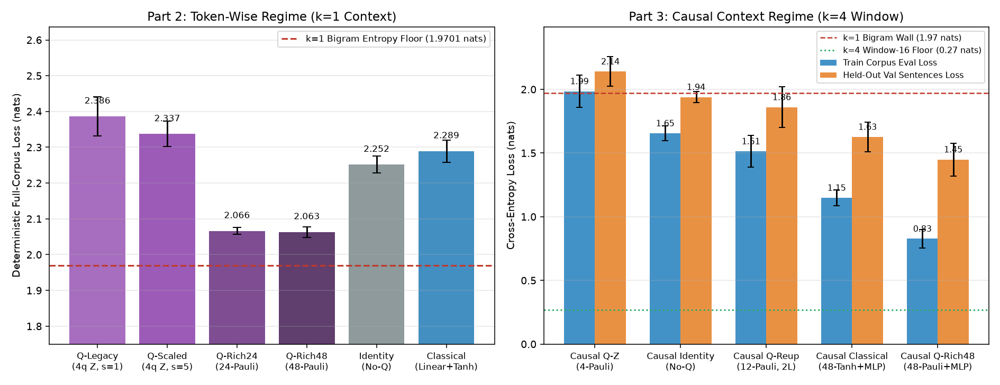
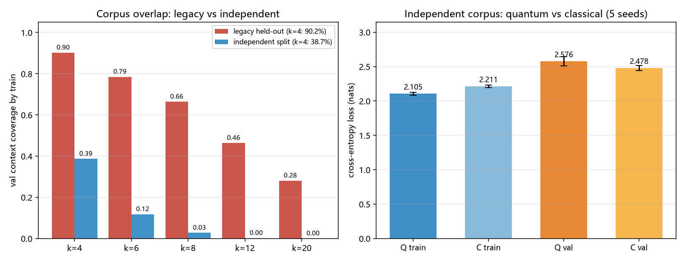
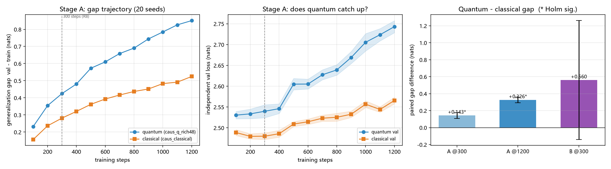
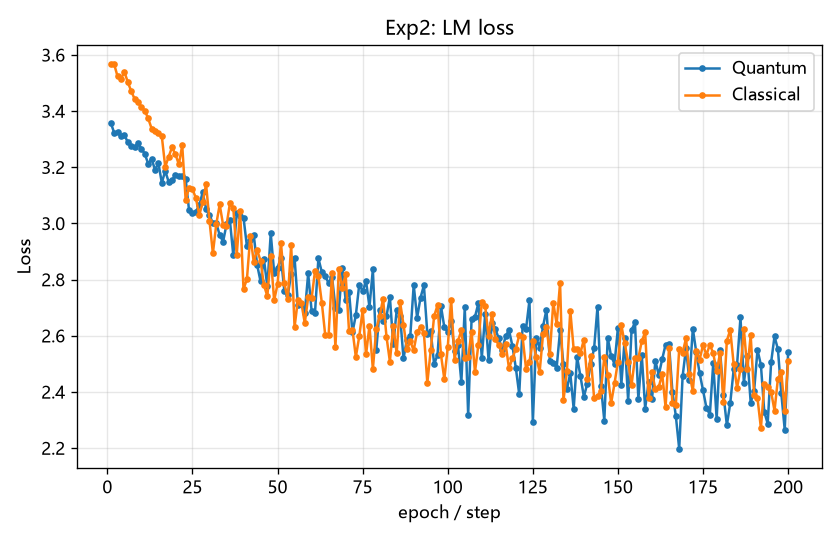

# 量子 LLM · 玩具级量子增强字符语言模型与方法学诊断


> **先把边界说清楚：这不是能对话的大语言模型。** 本仓库把参数化量子电路（VQC）当作**一个可微分变换层**嵌进字符级自回归语言模型，用严格受控的 5 随机种子实验剖析「信息进出量子层的秩瓶颈」与「因果上下文窗口对二元语法熵墙的破局」，并与同结构经典基线和无量子（`Identity`）消融组对比全语料交叉熵、留出验证集困惑度与训练耗时（该验证集与训练集高度重叠，见下方语料审查）。

当前硬件与状态向量模拟器条件下（态空间维数 $2^n$），不存在可行的十亿参数级量子 LLM。这里做的是**玩具级 QNLP 可行性验证与方法学审查**（词表 31 字符、训练集 1668 字符（同一段 417 字符重复 4 遍）+ 同词表留出验证集 382 字符（k=4 上下文 90.2% 训练时已见过）、序列长 16、4 qubits）。完整方法学审查报告见 [`docs/REVIEW.md`](docs/REVIEW.md)，姊妹仓库见 [quantum-mnist](https://github.com/quantum-machine-learning-code/quantum-mnist)。

---

## 快速结论（5-Seed 受控实验结果）

> **⚠ 2026-11-07 语料审查（[REVIEW.md 第 7 节](docs/REVIEW.md)，[`audit_corpus.py`](experiments/audit_corpus.py)）**：训练集 1668 字符是同一段 417 字符文本**重复 4 遍**（unique 4-gram 仅 22.4%）；所谓「独立未见句验证集」在模型实际使用的因果上下文长度 `k=4` 上，有 **90.2%** 的 token 上下文在训练集中出现过。因此 `val PPL 4.29` 只能读作**同分布重组句的迁移**，不是未见分布泛化，也不能作为量子层带来泛化能力的证据。原始统计见 [`docs/corpus_audit.json`](docs/corpus_audit.json)。
>
> **✅ 2026-11-13 已补独立语料重跑（[REVIEW.md 第 8 节](docs/REVIEW.md)，[归档](docs/independent_corpus_metrics.json)）**：句级 disjoint、主题分离的新语料把 `k=4` 上下文重叠率从 **90.2% 降到 38.7%**。5-seed 受控结果显示量子层在训练集上仍显著更好（Δ=`-0.1069` nats），但在独立验证句上优势消失且方向反转（Δ=`+0.0974`，CI 跨 0），泛化间隙显著更大（`+0.2044` nats）。**量子层的优势是拟合层面的，不是泛化层面的。**
>
> **✅ 2026-11-13 稳健性复核（[REVIEW.md 第 9 节](docs/REVIEW.md)，[归档](docs/robustness_metrics.json)）**：把独立语料扩到 **20 seed × 1200 步**，泛化间隙差值从 `+0.1433`（300 步）扩大到 `+0.3263`（1200 步），量子验证 loss 单调上升、训练 loss 单调下降 —— **不是 300 步欠拟合假象，而是持续加剧的过拟合**；5-seed 的 `+0.2044` 属小样本高估。20 seed 下独立语料的 val 差值也变为显著（`+0.0599`，Holm 后 `p=0.0022`）。
>
> **⚠ 但有语料边界**：换用 `k=4` 覆盖率仅 0.24%、字符分布 JS 散度 0.2538 的极端合成语料后，两臂验证 loss 都崩到 5+ nats，gap 差值 `+0.5602` 的 CI `[-0.1406, +1.2609]` 跨 0、Holm 后不显著。**结论只在这两份自写英文语料上成立，不推广为普遍的「量子泛化更差」。**

> **方法学审查要点（详见 [`docs/REVIEW.md`](docs/REVIEW.md)）**：
> 1. **为什么初版模型（`51e3ad4`）卡在 loss `~2.5` 且必然生成 `A qubit can hold the the the...`？**
>    初版 `TinyLM` 把 `(B, T, Q)` 直接展平为 `(B*T, Q)` 逐位置独立过变换层，位置 $t$ 之间**无任何跨时间步交互**，`--seq-len 16` 实际退化为 **$k=1$ 无记忆二元语法（Bigram）模型**。在该语料上，任意 $k=1$ 模型的信息论交叉熵下界为 **`1.9701` nats（PPL `7.17`）**，且精确 $k=1$ 查表 Oracle 的贪心解码必然陷入 `" the"` 的 4 字符死循环。
> 2. **为什么初版报告的 `0.032` nats 差异不可信？**
>    初版直接取末步单个随机 mini-batch（128 tokens）的瞬时 loss，步间标准差达 `0.11` nats（极差 `0.275` nats），噪声是被测差异的 8 倍；且两组使用了不同 batch 种子（`seed` vs `seed+1`）和未对齐的初始权重。
> 3. **如何破局？**
>    将 4-qubit 读出从 4 个 `PauliZ` 扩展至 **48 个正交单比特与两体 Pauli 观测量**（解除 `Linear(4, 31)` 的秩-4 瓶颈），并引入**严格因果上下文编码器（$k=4$ 窗口，`CausalContextEncoder`）**，5-seed 训练集全语料确定性 loss 从 **`2.3864 ± 0.0553`** 降至 **`0.8271 ± 0.0717` nats**（困惑度从 **`10.89`** 降至 **`2.29`**），留出验证集困惑度从 **`10.96`** 降至 **`4.29`**（同分布重组句迁移，非未见分布泛化），贪心生成成功走出 `" the"` 死循环。

### 1. 语料信息论条件熵下界 $H(C_{t+1} \mid C_{t-k+1..t})$

| 上下文阶数 $k$ | 对应模型能力 | 唯一上下文数 | 渐近条件熵 $H$ (nats) | 理论最低 PPL | 窗口 ($T=16$) 下界 | 窗口最低 PPL |
| --- | --- | --- | --- | --- | --- | --- |
| $k = -1$ | 均匀盲猜 $\ln V$ | 1 | `3.4340` | `31.00` | `3.4340` | `31.00` |
| $k = 0$ | 单字符频率（Unigram） | 1 | `2.8493` | `17.28` | `2.8493` | `17.28` |
| **$k = 1$** | **逐位置模型（`context_mode="token"`）** | **31** | **`1.9701`** | **`7.17`** | **`1.9701`** | **`7.17`** |
| $k = 2$ | 2 字符因果窗口 | 183 | `0.7938` | `2.21` | `0.8673` | `2.38` |
| **$k = 4$** | **4 字符因果窗口（`context_mode="causal"`）** | **373** | **`0.1000`** | **`1.11`** | **`0.2680`** | **`1.31`** |
| $k = 8$ | 8 字符因果窗口 | 416 | `0.0033` | `1.00` | `0.2005` | `1.22` |

### 2. 11 组 × 5 Seeds 受控实验汇总（300 steps, `seeds=[0,1,2,3,4]`）

复现脚本：`python experiments/diagnose_llm.py`，原始数据归档于 [`docs/llm_diagnosis_metrics.json`](docs/llm_diagnosis_metrics.json)。同模式各组共享逐位一致的初始前端与同维度分类头权重（SHA256 校验 5/5 seed 全部通过）及完全一致的 mini-batch 序列：

| 组 ID | 上下文模式 | 变换层与读出规格 | 参数量 | 读出维 | Train Eval Loss (nats) | Train PPL | Held-out Val Loss | Val PPL | 平均耗时 |
| --- | --- | --- | --- | --- | --- | --- | --- | --- | --- |
| `tok_q_legacy` | Token ($k=1$) | 4q `PauliZ`，`scale=1.0`（初版基线） | 291 | 4 | `2.3864 ± 0.0553` | `10.89 ± 0.61` | `2.3929 ± 0.0491` | `10.96` | `5.90 s` |
| `tok_q_scaled` | Token ($k=1$) | 4q `PauliZ` + `tanh*π/2` + `scale=5.0` | 291 | 4 | `2.3370 ± 0.0355` | `10.36 ± 0.36` | `2.3421 ± 0.0353` | `10.41` | `5.93 s` |
| `tok_identity` | Token ($k=1$) | **无量子恒等消融**（`Identity`） | 279 | 4 | `2.2515 ± 0.0235` | `9.50 ± 0.23` | `2.2629 ± 0.0281` | `9.61` | `0.37 s` |
| `tok_classical` | Token ($k=1$) | 经典 `Linear(4,4) + Tanh` | 299 | 4 | `2.2893 ± 0.0307` | `9.87 ± 0.30` | `2.2946 ± 0.0347` | `9.93` | `0.46 s` |
| `tok_q_rich24` | Token ($k=1$) | 4q **24 维读出**（`z+x+y+zzall`） | 911 | 24 | `2.0661 ± 0.0097` | `7.89 ± 0.08` | `2.0780 ± 0.0066` | `7.99` | `16.18 s` |
| **`tok_q_rich48`** | Token ($k=1$) | 4q **48 维两体读出**（逼近 $k=1$ 下界 `1.97`） | 1655 | 48 | **`2.0631 ± 0.0148`** | **`7.87 ± 0.12`** | **`2.0774 ± 0.0139`** | **`7.98`** | `37.41 s` |
| `caus_q_z` | Causal ($k=4$) | 4q `PauliZ`（4 维秩瓶颈） | 923 | 4 | `1.9850 ± 0.1262` | `7.33 ± 0.95` | `2.1403 ± 0.1155` | `8.55` | `6.36 s` |
| `caus_identity` | Causal ($k=4$) | **无量子恒等消融**（`Identity`） | 911 | 4 | `1.6549 ± 0.0573` | `5.24 ± 0.30` | `1.9394 ± 0.0448` | `6.96` | `0.66 s` |
| `caus_q_reup` | Causal ($k=4$) | **2 层可训练重上传** + 12 维 `z+x+y` | 1191 | 12 | `1.5135 ± 0.1253` | `4.57 ± 0.58` | `1.8598 ± 0.1606` | `6.49` | `14.33 s` |
| `caus_classical` | Causal ($k=4$) | 经典 `Linear(4,48)+Tanh` + `MLP` 头 | 4867 | 48 | `1.1483 ± 0.0617` | `3.16 ± 0.20` | `1.6266 ± 0.1166` | `5.11` | `0.90 s` |
| **`caus_q_rich48`** | **Causal ($k=4$)** | **4q 48 维两体读出 + `MLP` 头** | **4639** | **48** | **`0.8271 ± 0.0717`** | **`2.29 ± 0.16`** | **`1.4494 ± 0.1290`** | **`4.29`** | `37.76 s` |



**关键配对差值（双侧 95% Student-$t$ 置信区间，$n=5$，负值表示前者 Loss 更低）**：
> **口径**：以下均为未校正的单组配对 CI，未做多重比较校正；且留出验证集在 $k=4$ 上下文上与训练集重叠 90.2%，所有涉及 val 的差值只能读作同分布重组句的迁移，不是独立泛化证据（见上方语料审查）。
- **扩宽读出（Token 48 维 vs 4 维）**：`tok_q_rich48 - tok_q_scaled = -0.2738 ± 0.0384` nats，95% CI `[-0.3215, -0.2262]`（**显著**，5/5 seed 为负，逼近 $k=1$ 理论下界 `1.9701`）。
- **4 维量子读出的负贡献**：`tok_q_scaled - tok_identity = +0.0855 ± 0.0490` nats，95% CI `[+0.0246, +0.1464]`（**显著**，单比特 Z 读出比直接去掉量子层更差）。
- **因果窗口破壁（$k=4$ vs $k=1$）**：`caus_identity - tok_identity = -0.5966 ± 0.0655` nats，95% CI `[-0.6779, -0.5152]`（**显著**）。
- **可训练数据重上传（12 维 vs 4 维 Z）**：`caus_q_reup - caus_q_z = -0.4716 ± 0.1061` nats，95% CI `[-0.6033, -0.3398]`（**显著**）。
- **因果两体量子读出 vs 恒等消融**：`caus_q_rich48 - caus_identity = -0.8279 ± 0.0787` nats，95% CI `[-0.9256, -0.7301]`（未校正显著；验证集 `-0.4900 [-0.6986, -0.2814]` 同为负，但因语料重叠不能解读为泛化优势）。
- **因果两体量子读出 vs 同结构 4 维瓶颈经典基线**：`caus_q_rich48 - caus_classical` 在训练集上为 **`-0.3212 ± 0.1216`**（95% CI `[-0.4722, -0.1703]`，未校正显著），但在留出验证集上为 `-0.1772`（95% CI `[-0.4019, +0.0475]`，**跨 0 不显著**），且量子模拟耗时慢约 **42 倍**（`37.76s` vs `0.90s`）。

---

## 独立语料重跑（2026-11-13，5 seeds）

第 7 节指出旧留出集不足以支撑泛化结论；本节是补齐后的结果。复现：
`python experiments/independent_corpus.py`（约 2 分钟，`--quick` 为冒烟）。
语料见 [`qml_lab/corpus_independent.py`](qml_lab/corpus_independent.py)，
完整归档见 [`docs/independent_corpus_metrics.json`](docs/independent_corpus_metrics.json)，
对比图见 [`docs/figures/independent_corpus.png`](docs/figures/independent_corpus.png)。

新语料：训练集 3171 字符 / 44 句互不重复，验证集 947 字符 / 14 句主题完全不同（航海、烘焙、地质、天气、园艺），
**句级 disjoint**、验证集零 UNK、新 word-bigram 占 94.1%；训练集 k=4 条件熵下界从 `0.1000` 升到 `0.3309` nats，任务显著变难。



| 组 | train loss | 独立 val loss | val PPL | 泛化间隙 | 墙钟 / seed |
|---|---|---|---|---|---|
| `caus_q_rich48`（量子） | **`2.1045 ± 0.0200`** | `2.5756 ± 0.0692` | `13.164` | `0.4711` | `46.2 s` |
| `caus_classical`（经典替身） | `2.2115 ± 0.0169` | **`2.4782 ± 0.0385`** | **`11.926`** | **`0.2667`** | `1.3 s` |

配对差值（量子 − 经典，`n=5`，4 检验 Bonferroni）：train `−0.1069`（FWI CI `[-0.1568, -0.0570]`，**显著**）；
独立 val `+0.0974`（FWI CI `[-0.0656, +0.2604]`，不显著）；
**泛化间隙 `+0.2044`**（FWI CI `[+0.0436, +0.3651]`，**显著**）。

**结论**：旧语料上量子−经典的 val 差值为 `−0.1772`（不显著），独立语料上变成 `+0.0974`（仍不显著）——
90.2% 的上下文重叠确实把 val 伪装成了泛化能力。量子层的可复现优势只在训练集成立；
独立验证句上经典替身数值更好且泛化间隙显著更小。不宣称量子优势，也**不**宣称量子显著更差
（两个 val 主检验的 CI 都跨 0）。跨语料绝对 loss 不可逐位比较（词表 29 vs 31、任务难度不同）；
验证集仍共享 38.7% 的功能 4-gram，不是严格 OOD。

---

## 稳健性复核（2026-11-13，20 seeds × 1200 步 + 极端语料）

第 8 节的 `n=5 / 300 步` 结论可能只是欠拟合假象或单一语料偶然。复现：
`python experiments/robustness_check.py`（默认 8 workers；`--quick` 为冒烟）。
完整结果见 [REVIEW.md 第 9 节](docs/REVIEW.md)、[归档](docs/robustness_metrics.json)
与 [三面板图](docs/figures/robustness_check.png)。



| 检验 | 结果 | 判定 |
|---|---|---|
| 可复现性 | 1200 步训练的第 300 步检查点与第 8 节 seed 0–4 逐位一致（`max abs diff = 0`） | 两节数字可直接对照 |
| 效应量 | 5-seed gap `+0.2044` → 20-seed `+0.1433`（seed 0–4 子集仍为 `0.2044`） | 小样本高估约 43% |
| 收敛性 | gap 差值 `+0.0758`(100 步) → `+0.1433`(300 步) → `+0.3263`(1200 步)，Holm 后仍显著 | **不是欠拟合，是持续扩大的过拟合** |
| 验证 loss | 20-seed 下 val 差值 `+0.0599`(300 步, `p=0.0022`) / `+0.1774`(1200 步)，Holm 后显著 | 第 8 节「不宣称显著更差」收紧为「该语料上显著更差」 |
| 极端语料 | 新 `synthetic` 语料 `k=4` 覆盖率 0.24%、JS 0.2538；两臂 val loss 均 5+ nats，gap `+0.5602` CI 跨 0 | 压力测试超出有效范围，**结论有语料边界** |

量子 val loss 从 step 100 起单调上升 `2.5305 → 2.7431`，train loss 持续下降
`2.2982 → 1.8922`，说明训练充分；经典 val 仅 `2.4887 → 2.5657`。
51 个检验 Bonferroni 后 35 个显著，6 个主检验 Holm 后 4 个显著（全在独立语料）。
量子 `256 s/seed` vs 经典 `7.7 s/seed`。

**两臂始终同配置、都没有各自调参**；补调参对照是下一步最该做的实验。
不宣称量子优势，也不把「该语料上显著更差」推广为普遍结论。

---

## 能做什么，不能做什么

- **不是 LLM**：字符级词表 31、序列长 16、内置语料 1668 字符，没有自注意力或大规模预训练，不能对话。
- **不宣称通用量子优势**：`caus_q_rich48` 在训练集上优于 `caus_classical` 的前提是两者都被迫通过人为设定的 **4 维瓶颈（`n_qubits=4`）**，此时 48 个两体 Pauli 观测量提供了显式的二次三角单项式展开；但在留出验证集上两者差异统计不显著，且该验证集 90.2% 的 k=4 上下文在训练时已见过，不能作为泛化证据；若解除 4 维瓶颈，纯经典网络快 40 倍以上、loss 更低。**换用 k=4 重叠率仅 38.7% 的独立语料后（见独立语料重跑一节）**，量子层在训练集上的优势仍显著，但独立验证集上经典替身反而数值更好、泛化间隙显著更小。**扩到 20 seed 并训练 1200 步后（见上一节）**，该泛化间隙差值扩大到 `+0.3263` 且 Holm 后仍显著，独立验证 loss 差值也变为显著；但在 `k=4` 覆盖率 0.24% 的极端合成语料上未复现，因此不推广为普遍结论。
- **模拟器的内存与测量墙**：`default.qubit` 状态向量维度为 $2^n$；解析模式下同时读出 48 个 Pauli 期望无需采样，但真机硬件需按对易组（QWC）拆分并增加 shots 以控制采样方差。
- **完全离线可复现**：语料与留出验证集均内置，无需真机凭证或联网下载。

---

## 目录结构

```
quantum-llm/
├── README.md
├── LICENSE                         # MIT
├── requirements.txt
├── qml_lab/
│   ├── utils.py                    # 随机种子、路径、JSON、参数量、终端表格
│   ├── data.py                     # 内置训练/留出验证语料、经验条件熵下界、可复现 batch 生成器
│   ├── corpus_independent.py       # 两份语料 (independent / synthetic) + 重叠率与分布散度工具
│   ├── quantum.py                  # PennyLane VQC、多观测量 (make_rich_layer) 与可训练重上传
│   ├── models.py                   # CausalContextEncoder、TinyLM 与受控对照模型 RichQuantumLM
│   ├── train.py                    # 自回归训练循环、全语料确定性评估 (evaluate_lm) 与贪心解码
│   └── viz.py                      # 训练曲线与诊断图绘制
├── experiments/
│   ├── train_llm.py                # 单组/多 seed 受控量子 vs 经典对照脚本
│   ├── diagnose_llm.py             # 11 组 × 5 seeds 系统方法学诊断与消融实验
│   ├── audit_corpus.py             # 语料审查：训练/验证集 n-gram 上下文重叠率
│   ├── independent_corpus.py       # 独立语料 5-seed 受控重跑（量子 vs 经典 + 配对检验）
│   └── robustness_check.py         # 20-seed 收敛扫描 + 极端语料稳健性复核（Holm/Bonferroni）
├── tests/smoke_test.py             # 离线契约与因果性测试（含末字符覆盖、零未来泄漏、权重对齐断言）
├── docs/
│   ├── REVIEW.md                   # 完整方法学审查（第 7–9 节：语料审查 / 独立重跑 / 稳健性复核）
│   ├── DEV_NOTES.md                # 本机环境与复现备注
│   ├── llm_diagnosis_metrics.json  # 5-seed 诊断实验完整归档数据
│   ├── corpus_audit.json           # 旧语料重叠统计归档
│   ├── independent_corpus_metrics.json # 独立语料 5-seed 重跑归档
│   ├── robustness_metrics.json     # 20-seed 收敛轨迹与跨语料稳健性归档
│   └── figures/                    # 实测对比图 (lm_diagnosis.png, independent_corpus.png, robustness_check.png)
└── results/                        # 运行产物（gitignore）
```

---

## 安装与快速开始

要求 Python 3.11+，纯 CPU 即可运行全部实验：

```bash
python3 -m venv .venv
.venv/bin/python -m pip install -r requirements.txt
```

### 1. 运行离线契约测试与快速冒烟验证

```bash
.venv/bin/python tests/smoke_test.py
.venv/bin/python experiments/train_llm.py --quick
.venv/bin/python experiments/diagnose_llm.py --quick
```

`--quick` 仅跑极小规模并将产物写入 `results/`，不会覆盖 `docs/` 下的正式归档。

### 2. 复现受控基线（`train_llm.py`）与完整 5-Seed 诊断（`diagnose_llm.py`）

```bash
# 单组受控对照（支持 --context-mode token|causal 与 --observables）
.venv/bin/python experiments/train_llm.py \
    --qubits 4 --layers 1 --seq-len 16 --batch-size 8 --steps 200 --seed 0

# 因果窗口 + 48维两体 Pauli 读出受控运行
.venv/bin/python experiments/train_llm.py \
    --context-mode causal --observables "z+x+y+zzall+xxall+yyall" \
    --pre-scale --near-identity-init --scale 5.0 --head mlp --steps 300 --seed 0

# 复现 README 与 docs/REVIEW.md 的全部 11 组 × 5 seeds 诊断实验
.venv/bin/python experiments/diagnose_llm.py --steps 300 --seeds 0 1 2 3 4 --workers 12
```

---

## 参数速查（`experiments/train_llm.py`）

| 参数 | 默认值 | 含义 |
| --- | --- | --- |
| `--qubits` | `4` | 量子比特数（瓶颈维度） |
| `--layers` | `1` | `StronglyEntanglingLayers` 层数 |
| `--context-mode` | `token` | `token`（逐字符 $k=1$）或 `causal`（因果卷积窗口） |
| `--context-window` | `4` | `causal` 模式下的历史窗口长度 $k$ |
| `--observables` | `z` | 可观测量规格（如 `z`, `z+x+y`, `z+x+y+zzall`, `z+x+y+zzall+xxall+yyall`） |
| `--reupload` | `none` | 数据重上传模式：`none` / `fixed` / `trainable` |
| `--pre-scale` | 关闭 | 是否启用 `tanh(h)*π/2` 入线角度防饱和缩放 |
| `--scale` | `1.0` | 读出放大倍数（如 `5.0` 或 `learnable`） |
| `--head` | `linear` | 分类头类型：`linear` 或 `mlp` |
| `--seq-len` | `16` | 自回归序列窗口长度 |
| `--batch-size` | `8` | 批大小 |
| `--steps` | `200` | 训练步数 |
| `--lr` | `0.01` | 学习率 |
| `--seed` / `--seeds` | `0` | 单个或多个随机种子 |
| `--quick` | 关闭 | 极小规模冒烟验证 |

---

## 训练曲线与耗时对比



困惑度收敛曲线与 5-seed 平均训练墙钟耗时见 [`docs/figures/lm_perplexity.png`](docs/figures/lm_perplexity.png) 与 [`docs/figures/lm_time.png`](docs/figures/lm_time.png)。

---

## 相关仓库与许可

- 方法学审查报告：[`docs/REVIEW.md`](docs/REVIEW.md)
- 姊妹仓库：[quantum-mnist](https://github.com/quantum-machine-learning-code/quantum-mnist) · 量子手写数字识别与读出瓶颈分析
- 组织主页：[quantum-machine-learning-code](https://github.com/quantum-machine-learning-code)

本项目采用 [MIT License](LICENSE)。
