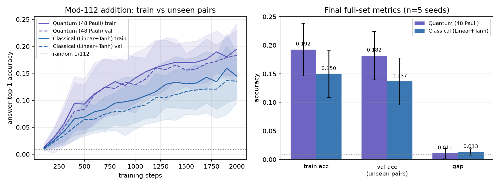
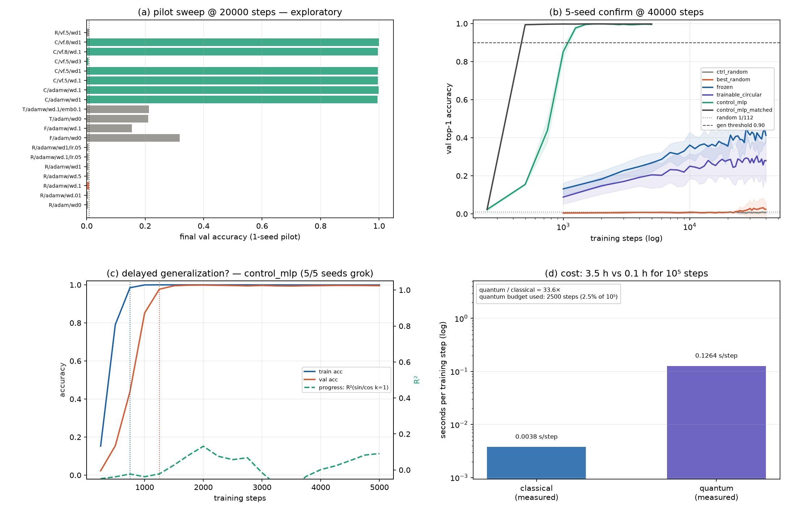
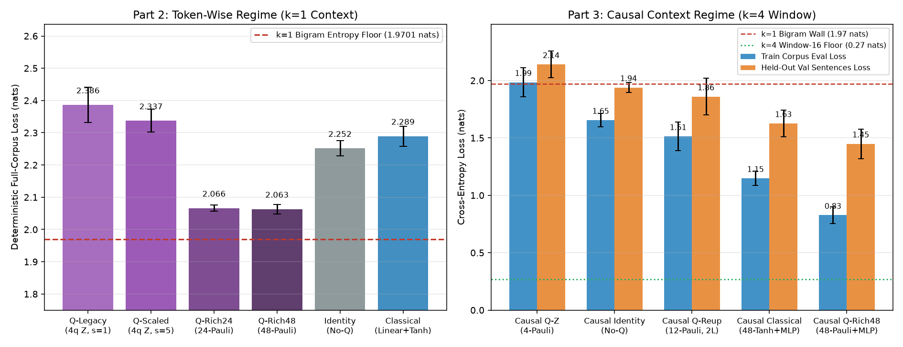

# Quantum LLM · Task 1: Modulo-112 Addition; Task 2: Toy Character Language Model & Methodological Audit

English | [简体中文](README.md)


> **Scope upfront: this is NOT a conversational Large Language Model.** This repository embeds a parameterized quantum circuit (VQC) as **one differentiable transformation layer** inside toy sequence models and runs strictly controlled multi-seed experiments to diagnose the "rank bottleneck into and out of the quantum layer" and how a causal context window breaks the bigram entropy wall. All runs compare against parameter-matched / architecture-matched classical baselines and no-quantum (`Identity`) ablations on deterministic full-corpus cross-entropy, held-out perplexity, and wall-clock runtime.

At current hardware and state-vector simulator limits ($2^n$ state dimension), billion-parameter quantum LLMs do not exist. Instead, this codebase conducts **toy-scale QNLP feasibility studies and methodological audits** (e.g., 31-character vocabulary, 1,668-char built-in training corpus formed by repeating a 417-char block 4 times plus a 382-char held-out split with 90.2% $k=4$ context overlap, sequence length 16, 4 qubits, as well as zero-overlap modular arithmetic and a disjoint-sentence corpus). For the full methodological review (in Chinese), see [`docs/REVIEW.md`](docs/REVIEW.md); for the sister image-classification benchmark, see [quantum-mnist](https://github.com/quantum-machine-learning-code/quantum-mnist).

> **Task split (2026-11-13)**: Task 1 replaces the overlapped text task with **exhaustive, zero-overlap modulo-112 addition**, while the character-level language model becomes Task 2. Both share the same controlled quantum-vs-classical comparison harness.

---

## Task 1: Modulo-112 Addition ($\mathbb{Z}_{112}$, 2026-11-13)

> **Task definition**: Compute $(a + b) \bmod 112$ over $\{0, \dots, 111\}$ (`111+1=0` wrap-around, `0+0=0` identity). The vocabulary has **117 tokens: 112 integer tokens + four operators (`+ - * /`) + `=`**. Only addition equations are generated in this round; the remaining operators reserve vocabulary slots for follow-up arithmetic tasks (`/` does not always have a unique inverse on the non-field $\mathbb{Z}_{112}$).

| Equation | Token sequence |
| --- | --- |
| `111+1=0` | `[111, 112, 1, 116, 0]` |
| `0+0=0` | `[0, 112, 0, 116, 0]` |

The model reads `[a][+][b][=]` (exactly `context_window=4`) and predicts the answer token `c` — **112-way single-token classification** with random baseline $1/112 = 0.0089$. All $112 \times 112 = 12{,}544$ ordered pairs `(a, b)` are strictly disjoint-split into 10,035 train / 2,509 validation pairs so **validation $k=4$ context coverage in training is 0.0%** (versus 90.2% in the legacy corpus and 38.7% in the independent corpus), testing genuine unseen compositional generalization.



| Group | Train Acc | Unseen Val Acc | Val Loss | Wall-clock / seed |
| --- | --- | --- | --- | --- |
| `add_q_rich48` (Quantum) | `0.1924` | **`0.1817 ± 0.0423`** | `2.2880` | `440.6 s` |
| `add_classical` (Matched classical ablation) | `0.1496` | `0.1365 ± 0.0410` | `2.6587` | `17.5 s` |

Across 5 seeds × 2,000 steps, both arms beat random guessing overwhelmingly (binomial $p \approx 0$), confirming compositional generalization rather than memorization, yet accuracies stay low (18% / 14%) and curves are still rising. **0 of 3 pre-specified primary tests survive Holm correction**: the paired validation accuracy difference is `+0.0451` with 95% CI `[-0.0003, +0.0905]` crossing zero — higher mean for the quantum arm, but **no statistically verifiable positive quantum contribution**. Although `val_loss` differs by `-0.3707` (significant after Bonferroni), loss is not the primary accuracy endpoint.

**Three essential caveats**:
1. **Shared circular prior**: Under random embeddings across 3 learning rates up to 25.5 epochs, both arms remained stuck at chance. We therefore initialized the integer token embeddings with a **shared circular angle encoding** $[\sin(2\pi n/112), \cos(2\pi n/112), \sin(4\pi n/112), \cos(4\pi n/112)]$ as a classical inductive bias — a prerequisite for this architecture to learn the task, **not a quantum advantage**. Section 12 below shows that a grokking quadratic MLP learns the exact same zero-overlap split from random embeddings to >99%, proving the bottleneck lies in the architecture, not task learnability.
2. **Initialization, not freezing**: `nn.Embedding` defaults to `requires_grad=True`, so Adam updates it on every step (measured RMS drift `0.2816` / `0.3674` after training).
3. **Matched untuned hyperparameters**: Both arms use identical settings (`lr=0.015`) with no per-arm hyperparameter tuning.

### Three-Way Embedding Ablation (frozen vs. trainable vs. random)

Archived in [`docs/embedding_ablation_metrics.json`](docs/embedding_ablation_metrics.json) and plotted in [`docs/figures/embedding_ablation.png`](docs/figures/embedding_ablation.png): `frozen_circular` (circular init, frozen), `trainable_circular` (circular init, trainable — Task 1 default), and `trainable_random` (random init, trainable). Over 5 seeds × 2,000 steps evaluated on all 2,509 unseen pairs:

| Embedding Mode | Quantum Val Acc | Classical Val Acc |
| --- | --- | --- |
| `frozen_circular` | **`0.2418 ± 0.0488`** | `0.1839 ± 0.0427` |
| `trainable_circular` (Task 1 default) | `0.1835 ± 0.0463` | `0.1462 ± 0.0447` |
| `trainable_random` | `0.0062 ± 0.0012` | `0.0062 ± 0.0012` |

- Unfreezing the circular prior lowers validation accuracy numerically in both arms (`-0.0583` `[-0.1318, +0.0153]` quantum / `-0.0377` `[-0.1187, +0.0433]` classical), though **CIs cross zero**. What is strongly significant is the circular prior itself (`+0.1773` `[+0.1200, +0.2346]` / `+0.1400` `[+0.0849, +0.1950]`); `trainable_random` stays at loss `4.735 ≈ ln(112)` after 2,000 steps.
- Across all three modes, quantum − classical accuracy differences are `+0.0579 / +0.0373 / +0.0000`, with **0 of 9 primary tests significant after Holm correction**. Note also that 2,000 steps correspond to only ~6.4 epochs while curves are still rising.

### Negative Grokking Result & Positive Control

Archived in [`docs/grokking_metrics.json`](docs/grokking_metrics.json), [`docs/grokking_pilot.json`](docs/grokking_pilot.json), and [`docs/figures/grokking_scan.png`](docs/figures/grokking_scan.png). Holds-out over `(a, b)` with trainable random embeddings mirror Power et al. (2022), while our circular encoding resembles the Fourier representations Nanda et al. (2023) showed grokking networks converge to. We ran a 3-stage scan (1-seed 19-condition pilot up to 20,000 steps → 5-seed 40,000-step confirmation → short quantum timing run) alongside a grokking quadratic MLP positive control:



| 5-Seed Confirmation | Steps | Val Acc | Grokking Seeds |
| --- | --- | --- | --- |
| `RichQuantumLM` random embedding + AdamW `wd=0.1` | 40,000 | `0.0255 ± 0.0411` | **0/5** |
| `frozen` (frozen circular encoding) | 40,000 | `0.4207 ± 0.0292` | 0/5 |
| `trainable_circular` (default) | 40,000 | `0.2736 ± 0.1129` | 0/5 |
| Quadratic MLP positive control (20% train split + `wd=1.0`) | 5,000 | **`0.9944 ± 0.0006`** | **5/5** |
| Quadratic MLP positive control (same 80/20 split) | 5,000 | `0.9983 ± 0.0002` | 0/5 |

- **Negative finding for this repo's architecture**: Grokking reproduces cleanly in the positive control (memorization by step 1,000 with train acc `1.00`, sudden generalization jump `+0.667` to val acc `0.99` by step 1,500), whereas extending `RichQuantumLM` to 20× budget (40,000 steps) with weight decay produces **0/5 grokking seeds**. Under the exact same 80/20 split, the architectural gap is `+0.9910` (CI `[+0.9877, +0.9943]`, the sole significant primary comparison after Holm correction). Thus, the bottleneck is architectural lack of multiplicative / bilinear interaction terms rather than training length.
- **Cost asymmetry**: Measured simulation speed is `0.1264 s/step` (quantum) vs. `0.0038 s/step` (classical) — a **33.6×** gap (`~3.5 h` vs. `~0.1 h` at $10^5$ steps).

---

## Task 2: Character-Level Language Model · Summary & Methodological Findings

> **Corpus Audit (2026-11-07, [`audit_corpus.py`](experiments/audit_corpus.py), [`docs/corpus_audit.json`](docs/corpus_audit.json))**: The legacy 1,668-character training text repeats a single 417-character paragraph 4 times (only 22.4% unique 4-grams), and **90.2%** of token positions in the legacy 382-character validation split share $k=4$ contexts already seen in training. Hence `val PPL 4.29` on the legacy split measures **in-distribution sentence recombination**, not unseen generalization.
>
> **Independent Disjoint Corpus (2026-11-13, [`docs/independent_corpus_metrics.json`](docs/independent_corpus_metrics.json))**: A topic-separated, sentence-disjoint English corpus (3,171 train chars / 44 sentences vs. 947 val chars / 14 sentences covering sailing, baking, geology, weather, and gardening; 94.1% novel word bigrams) lowers $k=4$ context overlap from **90.2% to 38.7%**. Over 5 seeds, the quantum arm still fits training data better ($\Delta = -0.1069$ nats), but reverses on validation ($\Delta = +0.0974$ nats, CI crosses 0) with a significantly larger generalization gap (`+0.2044` nats). **The quantum layer's benefit here is training fit, not generalization.**
>
> **Robustness Check (2026-11-13, 20 seeds × 1,200 steps, [`docs/robustness_metrics.json`](docs/robustness_metrics.json))**: Scaling the independent corpus benchmark to **20 seeds × 1,200 steps** grows the generalization gap difference from `+0.0758` (100 steps) → `+0.1433` (300 steps) → `+0.3263` (1,200 steps, Holm-significant). Quantum validation loss climbs monotonically (`2.5305 → 2.7431`) while training loss drops (`2.2982 → 1.8922`), confirming **progressive overfitting rather than 300-step underfitting**; validation loss difference becomes significant (`+0.0599` at 300 steps, Holm $p = 0.0022$; `+0.1774` at 1,200 steps). However, on a harsher `synthetic` stress corpus (`k=4` coverage `0.24%`, JS divergence `0.2538`), both arms collapse above `5` nats and the gap difference (`+0.5602`, CI `[-0.1406, +1.2609]`) is not significant — establishing a clear corpus validity boundary.

### Why the Initial Baseline (`TinyLM`) Stalled & How Diagnostics Fixed It

1. **Unigram/Bigram trap ($k=1$):** Flattening `(B, T, Q)` to `(B*T, Q)` leaves no cross-timestep interaction, collapsing a `seq_len=16` model into a **$k=1$ bigram model** whose theoretical entropy floor on the legacy corpus is **`1.9701` nats (PPL `7.17`)** and whose greedy decoding loops on `" the"`.
2. **Batch-noise illusion:** Reporting single final mini-batch loss (128 tokens) introduced step-to-step std `0.11` nats — 8× larger than the claimed `0.032`-nat difference — compounded by unaligned batch seeds and weights.
3. **Controlled resolution:** Expanding 4-qubit readouts from 4 `PauliZ` channels to **48 orthogonal single- and two-qubit Pauli observables** (`z+x+y+zzall+xxall+yyall`, relieving the rank-4 `Linear(4, 31)` bottleneck) plus a strictly causal $k=4$ convolution (`CausalContextEncoder`) lowers 5-seed full-corpus deterministic train loss from **`2.3864 ± 0.0553`** (PPL `10.89`) to **`0.8271 ± 0.0717` nats** (PPL `2.29`), while remaining slower by **~42×** (`37.76 s` vs. `0.90 s` per seed) than `caus_classical` (`Linear(4, 48) + Tanh` + `MLP`).

### Information-Theoretic Conditional Entropy Floors $H(C_{t+1} \mid C_{t-k+1..t})$ (Legacy Corpus)

| Context order $k$ | Model class | Unique contexts | Asymptotic $H$ (nats) | Min asymptotic PPL | Window ($T=16$) floor | Min window PPL |
| --- | --- | --- | --- | --- | --- | --- |
| $k = -1$ | Uniform $\ln V$ | 1 | `3.4340` | `31.00` | `3.4340` | `31.00` |
| $k = 0$ | Unigram frequency | 1 | `2.8493` | `17.28` | `2.8493` | `17.28` |
| **$k = 1$** | **Per-token (`context_mode="token"`)** | **31** | **`1.9701`** | **`7.17`** | **`1.9701`** | **`7.17`** |
| $k = 2$ | 2-char causal window | 183 | `0.7938` | `2.21` | `0.8673` | `2.38` |
| **$k = 4$** | **4-char causal window (`context_mode="causal"`)** | **373** | **`0.1000`** | **`1.11`** | **`0.2680`** | **`1.31`** |
| $k = 8$ | 8-char causal window | 416 | `0.0033` | `1.00` | `0.2005` | `1.22` |

### 11-Group × 5-Seed Controlled Benchmark (300 steps, `seeds=[0,1,2,3,4]`)

Reproduce via `python experiments/diagnose_llm.py` ([`docs/llm_diagnosis_metrics.json`](docs/llm_diagnosis_metrics.json)):

| Group ID | Context | Layer & Readout Spec | Params | Readout Dim | Train Eval Loss (nats) | Train PPL | Held-out Val Loss | Val PPL | Mean Time |
| --- | --- | --- | --- | --- | --- | --- | --- | --- | --- |
| `tok_q_legacy` | Token ($k=1$) | 4q `PauliZ`, `scale=1.0` | 291 | 4 | `2.3864 ± 0.0553` | `10.89 ± 0.61` | `2.3929 ± 0.0491` | `10.96` | `5.90 s` |
| `tok_q_scaled` | Token ($k=1$) | 4q `PauliZ` + `tanh*π/2` + `scale=5.0` | 291 | 4 | `2.3370 ± 0.0355` | `10.36 ± 0.36` | `2.3421 ± 0.0353` | `10.41` | `5.93 s` |
| `tok_identity` | Token ($k=1$) | No-quantum `Identity` ablation | 279 | 4 | `2.2515 ± 0.0235` | `9.50 ± 0.23` | `2.2629 ± 0.0281` | `9.61` | `0.37 s` |
| `tok_classical` | Token ($k=1$) | Classical `Linear(4,4) + Tanh` | 299 | 4 | `2.2893 ± 0.0307` | `9.87 ± 0.30` | `2.2946 ± 0.0347` | `9.93` | `0.46 s` |
| `tok_q_rich24` | Token ($k=1$) | 4q 24-dim (`z+x+y+zzall`) | 911 | 24 | `2.0661 ± 0.0097` | `7.89 ± 0.08` | `2.0780 ± 0.0066` | `7.99` | `16.18 s` |
| **`tok_q_rich48`** | Token ($k=1$) | 4q 48-dim two-body readout | 1,655 | 48 | **`2.0631 ± 0.0148`** | **`7.87 ± 0.12`** | **`2.0774 ± 0.0139`** | **`7.98`** | `37.41 s` |
| `caus_q_z` | Causal ($k=4$) | 4q `PauliZ` (rank-4 bottleneck) | 923 | 4 | `1.9850 ± 0.1262` | `7.33 ± 0.95` | `2.1403 ± 0.1155` | `8.55` | `6.36 s` |
| `caus_identity` | Causal ($k=4$) | No-quantum `Identity` ablation | 911 | 4 | `1.6549 ± 0.0573` | `5.24 ± 0.30` | `1.9394 ± 0.0448` | `6.96` | `0.66 s` |
| `caus_q_reup` | Causal ($k=4$) | 2-layer trainable re-upload + `z+x+y` | 1,191 | 12 | `1.5135 ± 0.1253` | `4.57 ± 0.58` | `1.8598 ± 0.1606` | `6.49` | `14.33 s` |
| `caus_classical` | Causal ($k=4$) | Classical `Linear(4,48)+Tanh` + `MLP` | 4,867 | 48 | `1.1483 ± 0.0617` | `3.16 ± 0.20` | `1.6266 ± 0.1166` | `5.11` | `0.90 s` |
| **`caus_q_rich48`** | **Causal ($k=4$)** | **4q 48-dim two-body + `MLP`** | **4,639** | **48** | **`0.8271 ± 0.0717`** | **`2.29 ± 0.16`** | **`1.4494 ± 0.1290`** | **`4.29`** | `37.76 s` |



**Independent corpus (38.7% $k=4$ overlap, 5 seeds × 300 steps):**

| Group | Train Loss | Independent Val Loss | Val PPL | Gen Gap | Time / seed |
| --- | --- | --- | --- | --- | --- |
| `caus_q_rich48` (Quantum) | **`2.1045 ± 0.0200`** | `2.5756 ± 0.0692` | `13.164` | `0.4711` | `46.2 s` |
| `caus_classical` (Classical surrogate) | `2.2115 ± 0.0169` | **`2.4782 ± 0.0385`** | **`11.926`** | **`0.2667`** | `1.3 s` |

Paired quantum − classical differences (4-test Bonferroni): train `-0.1069` (FWI CI `[-0.1568, -0.0570]`, significant); val `+0.0974` (FWI CI `[-0.0656, +0.2604]`, not significant); **generalization gap `+0.2044`** (FWI CI `[+0.0436, +0.3651]`, significant).

---

## Installation & Quickstart

Requires **Python 3.11+**. All experiments run offline on CPU (no hardware credentials or downloads needed).

```bash
python3 -m venv .venv
# Install CPU-only PyTorch first to avoid large CUDA wheels on Linux/CI:
.venv/bin/python -m pip install torch --index-url https://download.pytorch.org/whl/cpu
.venv/bin/python -m pip install -e ".[dev]"
```

Or with `requirements.txt`:

```bash
.venv/bin/python -m pip install -r requirements.txt
```

### 1. Offline Tests & Smoke Checks

```bash
.venv/bin/python -m pytest -v tests/smoke_test.py
.venv/bin/python tests/smoke_test.py
.venv/bin/python experiments/train_llm.py --quick
.venv/bin/python experiments/diagnose_llm.py --quick
.venv/bin/python experiments/train_addition.py --quick
```

### 2. Reproducing Task 1 (Modulo-112 Addition, Embeddings, & Grokking)

```bash
.venv/bin/python experiments/train_addition.py                             # 5 seeds x 2000 steps (~13 min)
.venv/bin/python experiments/train_addition.py --probe                     # 1 seed x 1000 steps probe
.venv/bin/python experiments/train_addition.py --probe --no-circular-embedding
.venv/bin/python experiments/embedding_ablation.py --quick                 # 3-mode smoke check
.venv/bin/python experiments/embedding_ablation.py                         # 3 modes x 5 seeds full ablation
.venv/bin/python experiments/grokking_scan.py --quick                      # End-to-end grokking smoke
.venv/bin/python experiments/grokking_scan.py --pilot-only                 # 1-seed exploratory pilot
.venv/bin/python experiments/grokking_scan.py --pilot-from docs/grokking_pilot.json
.venv/bin/python experiments/grokking_scan.py --redraw-from docs/grokking_metrics.json
```

When running long scans (`grokking_scan.py`, default `workers=6`), lower `--workers` and set `OMP_NUM_THREADS=1 MKL_NUM_THREADS=1` if host RAM is tight.

### 3. Reproducing Task 2 (Char-LM Baselines, Independent Corpus, & 20-Seed Robustness)

```bash
# Single controlled run (--context-mode token|causal)
.venv/bin/python experiments/train_llm.py \
    --qubits 4 --layers 1 --seq-len 16 --batch-size 8 --steps 200 --seed 0

# Causal window + 48-dim two-body Pauli readout
.venv/bin/python experiments/train_llm.py \
    --context-mode causal --observables "z+x+y+zzall+xxall+yyall" \
    --pre-scale --near-identity-init --scale 5.0 --head mlp --steps 300 --seed 0

# Full 11-group x 5-seed diagnosis
.venv/bin/python experiments/diagnose_llm.py --steps 300 --seeds 0 1 2 3 4 --workers 12

# Disjoint-corpus 5-seed check & 20-seed robustness check
.venv/bin/python experiments/independent_corpus.py
.venv/bin/python experiments/robustness_check.py
```

`--quick` modes write small test outputs under `results/` (or a custom `--out` directory) and never overwrite committed archives in `docs/`.

---

## Related Repositories & License

- Full methodological review (Chinese): [`docs/REVIEW.md`](docs/REVIEW.md)
- Sister benchmark: [quantum-mnist](https://github.com/quantum-machine-learning-code/quantum-mnist)
- Organization: [quantum-machine-learning-code](https://github.com/quantum-machine-learning-code)

Licensed under the [MIT License](LICENSE).
