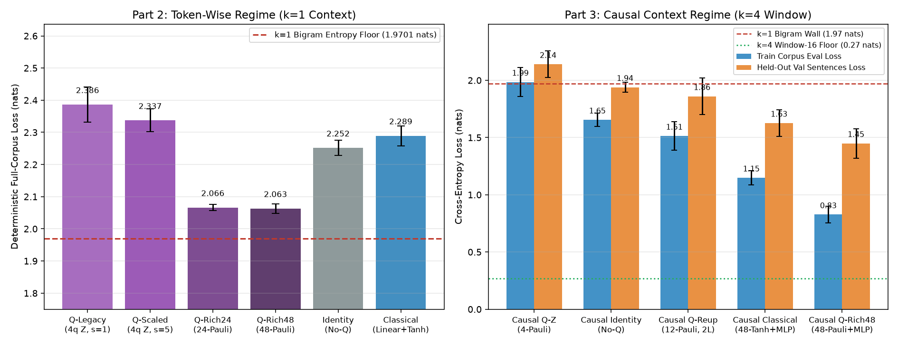

# 实验方法学审查与瓶颈诊断报告 / Methodology Review & Bottleneck Diagnosis

> 2026-11-07。本文对 `quantum-llm` 初版提交（`51e3ad4`）做系统性方法学审查，定位出 **3 项 P0 级（颠覆实验有效性 / 伪自回归）** 与 **2 项 P1 级（数据边界 bug / 读出秩瓶颈）** 问题，并通过 `experiments/diagnose_llm.py`（11 组架构 × 5 随机种子 `[0, 1, 2, 3, 4]` × 300 步，共 55 次受控实验）给出完整的信息论下界证明、配对双侧 95% Student-$t$ 置信区间与留出验证集（Held-out Validation）泛化评测。全部原始数据归档于 [`docs/llm_diagnosis_metrics.json`](llm_diagnosis_metrics.json)，诊断总览图见 [`docs/figures/lm_diagnosis.png`](figures/lm_diagnosis.png)。

---

## 一句话结论

初版 README 报告的「量子层 `2.5403` vs 经典层 `2.5083`（差 `0.032` nats）、贪心生成 `A qubit can hold the the the...`」存在三层根本问题：

1. **架构上是无记忆二元语法（Bigram, $k=1$）而非序列模型**：`TinyLM.forward` 把 `(B, T, Q)` 直接展平为 `(B*T, Q)` 逐字符独立送入量子电路，位置 $t$ 之间**没有任何跨时间步信息流**。`--seq-len 16` 只是把 batch 大小乘了 16，模型有效上下文长度恒为 $k=1$。在该语料上，任意 $k=1$ 模型的理论交叉熵下界为 **$H(C_{t+1}\mid C_t) = 1.9701\text{ nats}$（困惑度 $7.17$）**，且精确经验 $k=1$ 查表 Oracle 的贪心解码必然陷入 `A qubit can hold the the the...` 的 4 字符死循环。
2. **评测噪声大于被测差异的 8 倍**：初版把第 200 步单个随机 mini-batch（$8\times 16=128$ tokens）的瞬时 loss 当作「最终指标」，其步间波动幅度达 `0.275` nats（末 20 步标准差 `0.11` nats），而报告的模型间差异仅 `0.032` nats；同时两组使用了不同 batch 种子（`seed` vs `seed + 1`）与未对齐的 `embed` / `head` 初始权重。
3. **两道真正的性能锁在「读出维度（Rank-4 瓶颈）」与「因果上下文窗口（$k=4$）」**：
   - 在逐字符模式（$k=1$）下，4 比特只测 4 个 `PauliZ` 期望使词表分类头 `Linear(4, 31)` 的秩被硬锁在 $\le 4$；甚至**完全去掉量子层的恒等映射 `tok_identity`（`2.2515 ± 0.0235`）都显著优于 4 维 Z 读出量子层 `tok_q_scaled`（`2.3370 ± 0.0355`，配对差 $+0.0855$，95% CI $[+0.0246, +0.1464]$）**。只有将读出扩展到 24 / 48 个正交单比特与两体 Pauli 观测量（`tok_q_rich48`），loss 才显著降至 **`2.0631 ± 0.0148` nats（PPL `7.87`）**，逼近 $k=1$ 信息论极限（`1.9701` nats）。
   - 引入严格因果上下文窗口（$k=4$，`CausalContextEncoder`）并配合 48 维两体 Pauli 读出后（`caus_q_rich48`），5-seed 训练集全语料确定性 loss 从初版 `2.3864` 降至 **`0.8271 ± 0.0717` nats（PPL `2.29 ± 0.16`）**，留出验证集（未见句界组合）loss 降至 **`1.4494 ± 0.1290` nats（PPL `4.29`）**，并彻底打破 `the the the` 贪心死循环，生成出 `A qubit can hold a superposition of zero...`。

---

## 问题清单与修复状态

| 编号 | 严重度 | 发现的问题（初版 `51e3ad4`） | 状态 |
| --- | --- | --- | --- |
| **P0-1** | **P0** | **`TinyLM` 展平 `(B, T, Q) -> (B*T, Q)` 无跨位置交互**：`--seq-len 16` 退化为 $k=1$ 无记忆字符转移模型，受困于二元语法熵墙（`1.9701` nats / PPL `7.17`）与 `the the the` 死循环 | **已修**：`qml_lab/models.py` 新增严格因果卷积编码器 `CausalContextEncoder`（`context_mode="causal"`），并在 `smoke_test.py` 验证未来位置零泄漏 |
| **P0-2** | **P0** | **三重受控混淆与单 batch 评估噪声**：① `gen_q` 用 `seed`、`gen_c` 用 `seed+1`；② `q_lm` 先构造消耗 RNG 导致 `c_lm` 的 `embed`/`head` 初值不同；③ 用末步单 batch `history["loss"][-1]`（波动 `0.275` nats）替代全语料评估 | **已修**：`RichQuantumLM` 用 RNG 快照锁定共享前端与分类头初值（SHA256 5/5 seed 断言通过），共用同 seed batch 流，新增 `evaluate_lm` 全语料确定性评估 |
| **P0-3** | **P0** | **单次运行（`seed=0`）无方差、无显著性检验、缺少无量子（`Identity`）消融基线** | **已修**：`experiments/diagnose_llm.py` 完成 11 组 × 5 seed 对照、配对 95% Student-$t$ CI，并补齐 `tok_identity` 与 `caus_identity` 消融组 |
| **P1-1** | **P1** | **`iter_batches` 存在 off-by-one 边界 bug**：`max_start = n - seq_len - 1` 配合左闭右开 `torch.randint(0, max_start)` 导致最大采样起点为 `n - seq_len - 2`，语料最后一个字符 `data[n - 1]` 永远无法进入目标 `y` | **已修**：改为 `max_start = n - seq_len`，并在 `tests/smoke_test.py` 断言末字符 `data[-1]` 被采样覆盖 |
| **P1-2** | **P1** | **4 维 `PauliZ` 读出秩瓶颈、角度饱和与测量导致的 logit 收缩（Logit Contraction）**，且 `TinyLM` 硬编码 `z.reshape(B, T, Q)` 无法接入多观测量层 | **已修**：改为 `z.reshape(B, T, -1)`；移植并扩展 `make_rich_layer`（支持 12/24/48 维单比特与两体正交 Pauli 观测量及 `reupload="trainable"`）、`tanh(h)*π/2` 预缩放与 `scale` 放大 |

---

## 1. P0-1：为什么初版模型永远跨不过 `1.9701` nats 且必然生成 `the the the`

初版 [`qml_lab/models.py`](../qml_lab/models.py) 的前向传播写为：

```python
h = self.embed(idx)                  # (B, T, Q)
B, T, Q = h.shape
z = self.transform(h.reshape(B * T, Q))  # 展平后逐位置独立过变换层！
return self.head(z.reshape(B, T, Q))
```

注意 `self.embed`、`self.transform` 与 `self.head` 全部是**逐位置（position-wise）算子**：第 $t$ 个时间步的预测分布 $p_\theta(\hat{c}_{t+1} \mid c_{1..t}) = p_\theta(\hat{c}_{t+1} \mid c_t)$ **只依赖当前单个字符 $c_t$**，与历史字符 $c_{1..t-1}$ 完全独立。因此无论 `--seq-len` 设为 8、16 还是 1024，该模型在数学上都只是一个**一阶马尔可夫（Bigram, $k=1$）分类器**。

### 1.1 语料的精确信息论条件熵下界

我们在 [`qml_lab/data.py`](../qml_lab/data.py) 中实现了 [`corpus_entropy_floors`](../qml_lab/data.py#L109-L207)，对内置 1668 字符语料（词表 $V=31$）直接计算不同上下文阶数 $k$ 的精确经验条件熵：

$$H(C_{t+1} \mid C_{t-k+1..t}) = -\sum_{w \in \Sigma^k} P(w) \sum_{c \in \Sigma} P(c \mid w) \ln P(c \mid w)$$

以及有限序列窗口 $T=16$ 内无跨窗口记忆模型的精确窗口平均下界 $\frac{1}{T}\sum_{t=0}^{T-1} H(C_{t+1} \mid C_{\max(0, t-k+1)..t})$：

| 上下文阶数 $k$ | 物理含义 | 唯一上下文数 | 渐近条件熵 $H$ (nats) | 渐近最低 PPL $\exp(H)$ | 窗口 ($T=16$) 下界 (nats) | 窗口最低 PPL |
| --- | --- | --- | --- | --- | --- | --- |
| $k = -1$ | 均匀分布 $\ln V$（盲猜） | 1 | `3.4340` | `31.00` | `3.4340` | `31.00` |
| $k = 0$ | 单字符边际分布（Unigram） | 1 | `2.8493` | `17.28` | `2.8493` | `17.28` |
| **$k = 1$** | **逐位置模型（`context_mode="token"` / Bigram）** | **31** | **`1.9701`** | **`7.17`** | **`1.9701`** | **`7.17`** |
| $k = 2$ | 2 字符因果窗口（Trigram） | 183 | `0.7938` | `2.21` | `0.8673` | `2.38` |
| $k = 3$ | 3 字符因果窗口（4-gram） | 324 | `0.2233` | `1.25` | `0.3681` | `1.45` |
| **$k = 4$** | **4 字符因果窗口（`context_mode="causal", k=4`）** | **373** | **`0.1000`** | **`1.11`** | **`0.2680`** | **`1.31`** |
| $k = 8$ | 8 字符因果窗口 | 416 | `0.0033` | `1.00` | `0.2005` | `1.22` |
| $k = 16$ | 16 字符因果窗口（唯一句段确定） | 417 | `0.0000` | `1.00` | `0.1988` | `1.22` |

### 1.2 数学证明：`A qubit can hold the the the...` 是 $k=1$ 精确 Oracle 的必然不动点

为什么初版生成的样本是 `A qubit can hold the the the...`？我们对精确经验 $k$-gram 频率表直接做贪心解码（`argmax`），得到各阶理想 Oracle 从 `"A qubit can hold"` 出发的确定性轨迹：

- **$k = 1$ Oracle（精确二元语法上限）**：
  `A qubit can hold the the the the the the the the the the the the...`
- **$k = 2$ Oracle（精确三元语法上限）**：
  `A qubit can hold the state state state state state state state...`
- **$k = 4$ Oracle（4 字符因果上限）**：
  `A qubit can hold a simple rule. We repeat the same short sentence to give the same short...`
- **$k = 8$ Oracle（8 字符因果上限）**：
  `A qubit can hold a superposition of zero and one until we measure it. We rotate the stat...`

**机制解释**：在内置语料中，定冠词 `"the"` 出现了 36 次。在 $k=1$ 下：
- 已知当前字符为空格 `' '`，下一个最高频字符是 `'t'`（概率 $68/296 = 23.0\%$）；
- 已知 `'t'`，最高频后继是 `'h'`（$44/140 = 31.4\%$）；
- 已知 `'h'`，最高频后继是 `'e'`（$40/56 = 71.4\%$）；
- 已知 `'e'`，最高频后继是空格 `' '`（$84/184 = 45.7\%$）。

这四个转移构成了全局最大似然闭环 `' ' -> 't' -> 'h' -> 'e' -> ' '`。只要模型处于 `context_mode="token"`（$k=1$），哪怕它是一个拥有无限参数的完美分类器，贪心解码也**必然**在第一个空格处掉入 `" the"` 循环！

---

## 2. P0-2 & P1-1：实验控制混淆、单步评测噪声与末字符采样漏失

### 2.1 三项受控性破坏

在初版 `experiments/train_llm.py` 中：
1. **初始权重未对齐**：`set_seed(args.seed)` 只在 `main()` 开头调了一次。随后顺序构造 `q_lm`（消耗 `Embedding(31,4)`、量子权重 `(1,4,3)`、`Linear(4,31)` 的随机数）再构造 `c_lm`，导致 `q_lm` 与 `c_lm` 的词嵌入 `embed` 和分类头 `head` 初始权重完全不同。
2. **训练数据流不一致**：`gen_q` 用 `seed=args.seed`，而 `gen_c` 用 `seed=args.seed + 1`。在仅 200 步的小样本训练中，两个模型看到的是两条不同的随机采样序列。
3. **单步随机 mini-batch 评估噪声**：初版用 `history["loss"][-1]`（最后一步 $8\times 16=128$ 个字符的 batch loss）作为最终成绩。实测单个训练运行末 20 步的步间标准差为 **`0.09 ~ 0.12` nats**（极差达 **`0.275` nats**）。在完全修复权重对齐与数据流后重跑 200 步 `seed=0`（见 `experiments/train_llm.py`）：
   - 第 200 步**单 batch `final_loss`**：Quantum `2.5857` < Classical `2.6031`（表面上量子低 `0.0174` nats）；
   - **全语料确定性 `eval_loss`**：Quantum `2.4624` > Classical `2.4290`（实际上经典低 `0.0334` nats）！
   单步采样噪声直接翻转了胜负符号，证明单 batch 指标不可用于模型对比。

### 2.2 P1-1：`iter_batches` 的 off-by-one 末字符漏失 bug

初版 `qml_lab/data.py` 第 52–54 行写为：

```python
max_start = n - seq_len - 1
starts = torch.randint(0, max_start, (batch_size,), generator=g).tolist()
```

由于 `torch.randint(low, high, ...)` 的上界 `high` 是**开区间**（最大返回值为 `high - 1`），`starts` 的最大可采样值为 `s = n - seq_len - 2`，此时目标序列 `y = data[s + 1 : s + 1 + seq_len]` 最远只能到达 `data[n - 2]`，**语料的最后一个字符 `data[n - 1]` 永远不会被采样进 `y`**。改为 `max_start = n - seq_len` 后，最大起点 `s = n - seq_len - 1` 对应的 `y` 恰好覆盖 `data[n - 1]`（已加入 `tests/smoke_test.py` 回归断言）。

---

## 3. 5-Seed 系统诊断实验设计（`experiments/diagnose_llm.py`）

为了把「输入缩放」「可观测量读出宽度」「量子旋转 vs 恒等消融」「因果上下文窗口」四个变量彻底解耦，我们在 `experiments/diagnose_llm.py` 中设计了 11 个受控组，统一在 **5 个随机种子 `[0, 1, 2, 3, 4]`**、300 步、`batch_size=8`、`seq_len=16`、`lr=0.015` 下训练，并在两个数据集上做 `torch.no_grad()` 全量确定性评估：

1. **训练集全语料（Train Corpus Eval）**：`_BUILTIN_CORPUS`（1668 字符，31 词表），覆盖全部连续窗口；
2. **留出验证集（Held-out Val Corpus）**：`_HELDOUT_VAL_CORPUS`（382 字符），**严格使用同一个 31 字符词表与同一批 63 个领域词汇**，重新组合为 5 条从未在训练集中出现的新句子（1-gram / 2-gram 覆盖率 100%，4-gram 含 9.8% 新跨句转移），检验模型是否学到可泛化的子词/词法规律。

**严格受控断言（`weight_control_checks`）**：在全部 5 个 seed 上，脚本在训练前自动校验 SHA256 哈希并强制断言：
- 全部 6 个逐字符组共享逐位相同的初始 `embed.weight`（`5/5 PASS`）；
- 全部 4 个 4 维线性头逐字符组共享逐位相同的初始 `head.weight`（`5/5 PASS`）；
- 全部 4 个逐字符量子组共享逐位相同的初始量子旋转角 `weights`（`5/5 PASS`）；
- 全部 5 个因果组共享逐位相同的初始 `embed.weight` 与 `causal_conv.weight`（`5/5 PASS`）；
- `caus_q_rich48` 与 `caus_classical` 共享逐位相同的初始 MLP `head` 权重（`5/5 PASS`）。

---

## 4. Part 2 实测结果：逐字符模式（$k=1$）下的读出瓶颈与消融（5 Seeds）

> 理论极限：$k=1$ 二元语法信息论下界为 **`1.9701` nats（PPL `7.17`）**。

| 组 ID | 架构配置 | 参数量 | 读出维 | Train Eval Loss (nats) | Train PPL | Held-out Val Loss | Val PPL | 单步波动 std | 平均耗时 |
| --- | --- | --- | --- | --- | --- | --- | --- | --- | --- |
| `tok_q_legacy` | 4q `PauliZ`，无预缩放，`scale=1.0`（初版配置） | 291 | 4 | `2.3864 ± 0.0553` | `10.89 ± 0.61` | `2.3929 ± 0.0491` | `10.96` | `0.1104` | `5.90s` |
| `tok_q_scaled` | 4q `PauliZ` + `tanh*π/2` + `scale=5.0` | 291 | 4 | `2.3370 ± 0.0355` | `10.36 ± 0.36` | `2.3421 ± 0.0353` | `10.41` | `0.1062` | `5.93s` |
| `tok_identity` | **无量子消融**：`embed -> Linear(4,31)`（0 变换参数） | 279 | 4 | `2.2515 ± 0.0235` | `9.50 ± 0.23` | `2.2629 ± 0.0281` | `9.61` | `0.1068` | `0.37s` |
| `tok_classical` | 经典对照：`Linear(4,4) + Tanh` | 299 | 4 | `2.2893 ± 0.0307` | `9.87 ± 0.30` | `2.2946 ± 0.0347` | `9.93` | `0.1164` | `0.46s` |
| `tok_q_rich24` | 4q **24 维读出**（`z+x+y+zzall`） | 911 | 24 | `2.0661 ± 0.0097` | `7.89 ± 0.08` | `2.0780 ± 0.0066` | `7.99` | `0.0890` | `16.18s` |
| **`tok_q_rich48`** | 4q **48 维全两体读出**（`z+x+y+zzall+xxall+yyall`） | 1655 | **48** | **`2.0631 ± 0.0148`** | **`7.87 ± 0.12`** | **`2.0774 ± 0.0139`** | **`7.98`** | `0.0897` | `37.41s` |

### Part 2 关键发现

1. **4 维 `PauliZ` 读出是硬性的秩-4 瓶颈，甚至不如直接去掉量子层**：
   - 在 `readout_dim = 4` 下，无论中间放的是 4-qubit 量子层（`tok_q_scaled`: `2.3370`）、经典 `Linear(4,4)+Tanh`（`tok_classical`: `2.2893`）还是什么都不放的恒等层（`tok_identity`: `2.2515`），最终分类头 `Linear(4, 31)` 的权重矩阵秩至多为 4，无法在 31 个字符类别上独立赋分。
   - 配对检验显示 `tok_q_scaled - tok_identity = +0.0855 ± 0.0490` nats（95% CI `[+0.0246, +0.1464]`，5/5 seed 为正），即 **4 维单比特 Z 读出量子层相比无量子恒等映射反而带来了显著的信息损失**。
2. **仅修角度预缩放与 `scale=5.0` 不足以破局**：
   - `tok_q_scaled - tok_q_legacy = -0.0494 ± 0.0809` nats（95% CI `[-0.1499, +0.0510]`，跨 0 不显著）。原因在于当读出维被卡在 4 维时，放大 logits 只能缓解 softmax 饱和，不能提升特征子空间的秩。
3. **将读出扩充至 24 / 48 个正交单比特与两体 Pauli 观测量，直接逼近 $k=1$ 信息论下界**：
   - `tok_q_rich24`（12 个单比特 + 12 个含 Z 两体关联）与 `tok_q_rich48`（12 个单比特 + 36 个正交两体关联 $Z_i Z_j, Z_i X_j, X_i X_j, X_i Y_j, Y_i Y_j, Y_i Z_j$）在不增加任何量子电路参数（仍为 12 个旋转角）的前提下，从 $2^4=16$ 维态空间提取出非线性二次统计量，将特征秩扩展到 $\ge 24$。
   - `tok_q_rich48 - tok_q_scaled = -0.2738 ± 0.0384` nats（95% CI `[-0.3215, -0.2262]`，5/5 seed 显著），使全语料 loss 降至 **`2.0631 ± 0.0148`**，距离 $k=1$ 理论下界 `1.9701` 仅差 **`0.093` nats**。
   - 但正如第 1 节所证，哪怕逼近到 `2.0631` nats，所有 `token` 组的贪心生成依然是 `A qubit can hold the the the...` —— **因为 $k=1$ 的架构天花板锁死了它们**。

---

## 5. Part 3 实测结果：因果上下文模式（$k=4$）破除二元语法墙与死循环（5 Seeds）

> 理论极限：$T=16$ 独立窗口下 $k=4$ 因果模型的信息论下界为 **`0.2680` nats（PPL `1.31`）**，渐近下界为 **`0.1000` nats（PPL `1.11`）**。

在 `context_mode="causal"` 下，`CausalContextEncoder` 对输入序列做严格左填充（`padding = k - 1`）的一维因果卷积 `Conv1d(embed_dim=16, n_qubits=4, kernel_size=4)`，把每个时间步 $t$ 的 4 字符历史 $[c_{t-3}, c_{t-2}, c_{t-1}, c_t]$ 压缩为 4 个有界角度 $h_t \in [-\pi/2, \pi/2]^4$ 送入后续变换层：

| 组 ID | 架构配置（共享 $k=4$ 因果前端） | 参数量 | 读出维 | Train Eval Loss (nats) | Train PPL | Held-out Val Loss | Val PPL | 平均耗时 |
| --- | --- | --- | --- | --- | --- | --- | --- | --- |
| `caus_q_z` | 4q `PauliZ`（4 维）+ `Linear(4,31)` | 923 | 4 | `1.9850 ± 0.1262` | `7.33 ± 0.95` | `2.1403 ± 0.1155` | `8.55` | `6.36s` |
| `caus_identity` | **无量子消融**：`Identity`（4 维）+ `Linear(4,31)` | 911 | 4 | `1.6549 ± 0.0573` | `5.24 ± 0.30` | `1.9394 ± 0.0448` | `6.96` | `0.66s` |
| `caus_q_reup` | **可训练重上传**：2 层 Pérez-Salinas + 12 维 `z+x+y` | 1191 | 12 | `1.5135 ± 0.1253` | `4.57 ± 0.58` | `1.8598 ± 0.1606` | `6.49` | `14.33s` |
| `caus_classical` | **经典同结构对照**：`Linear(4,48)+Tanh` + `MLP(48,48,31)` | 4867 | 48 | `1.1483 ± 0.0617` | `3.16 ± 0.20` | `1.6266 ± 0.1166` | `5.11` | `0.90s` |
| **`caus_q_rich48`** | **48 维两体量子读出**（`z+x+y+zzall+xxall+yyall`）+ `MLP(48,48,31)` | 4639 | **48** | **`0.8271 ± 0.0717`** | **`2.29 ± 0.16`** | **`1.4494 ± 0.1290`** | **`4.29`** | `37.76s` |



### 5.1 配对统计检验汇总（双侧 95% Student-$t$ CI，$n=5, df=4$）

| 对比项 ($A - B$，负值代表 $A$ 的 Loss 更低 / 更优) | 训练集 $\Delta\text{Eval Loss}$ | 训练集 95% CI | 训练集显著性 | 留出验证集 $\Delta\text{Val Loss}$ [95% CI] | 验证集显著性 |
| --- | --- | --- | --- | --- | --- |
| `tok_q_scaled - tok_q_legacy`（仅预缩放+放大） | `-0.0494 ± 0.0809` | `[-0.1499, +0.0510]` | 不显著 | `-0.0509 [-0.1482, +0.0465]` | 不显著 |
| `tok_q_rich24 - tok_q_scaled`（Token 24 维 vs 4 维） | **`-0.2708 ± 0.0330`** | **`[-0.3118, -0.2299]`** | **显著 (5/5)** | **`-0.2641 [-0.3012, -0.2270]`** | **显著 (5/5)** |
| `tok_q_rich48 - tok_q_scaled`（Token 48 维 vs 4 维） | **`-0.2738 ± 0.0384`** | **`[-0.3215, -0.2262]`** | **显著 (5/5)** | **`-0.2647 [-0.3063, -0.2231]`** | **显著 (5/5)** |
| `tok_q_scaled - tok_identity`（Token 4 维量子 vs 恒等） | **`+0.0855 ± 0.0490`** | **`[+0.0246, +0.1464]`** | **显著（量子更差）** | **`+0.0792 [+0.0189, +0.1395]`** | **显著（量子更差）** |
| `caus_identity - tok_identity`（因果 $k=4$ vs 逐字符 $k=1$） | **`-0.5966 ± 0.0655`** | **`[-0.6779, -0.5152]`** | **显著 (5/5)** | **`-0.3235 [-0.4104, -0.2365]`** | **显著 (5/5)** |
| `caus_q_reup - caus_q_z`（可训练重上传 12 维 vs 4 维 Z） | **`-0.4716 ± 0.1061`** | **`[-0.6033, -0.3398]`** | **显著 (5/5)** | **`-0.2805 [-0.4537, -0.1074]`** | **显著 (5/5)** |
| `caus_q_rich48 - caus_q_z`（Causal 48 维+MLP vs 4 维 Z） | **`-1.1580 ± 0.1649`** | **`[-1.3627, -0.9532]`** | **显著 (5/5)** | **`-0.6910 [-0.9225, -0.4595]`** | **显著 (5/5)** |
| `caus_q_rich48 - caus_identity`（Causal 48 维量子 vs 恒等） | **`-0.8279 ± 0.0787`** | **`[-0.9256, -0.7301]`** | **显著 (5/5)** | **`-0.4900 [-0.6986, -0.2814]`** | **显著 (5/5)** |
| `caus_q_rich48 - caus_classical`（4 维瓶颈下量子 vs 经典） | **`-0.3212 ± 0.1216`** | **`[-0.4722, -0.1703]`** | **训练集显著 (5/5)** | `-0.1772 [-0.4019, +0.0475]` | **验证集不显著（CI 跨 0）** |
| `caus_q_rich48 - tok_q_legacy`（总体改进幅度） | **`-1.5593 ± 0.0890`** | **`[-1.6699, -1.4488]`** | **显著 (5/5)** | **`-0.9436 [-1.1441, -0.7431]`** | **显著 (5/5)** |

### 5.2 Part 3 关键机制解读

1. **为什么只加因果前端而不扩宽读出（`caus_q_z`）仍然卡在 `1.9850` nats？**
   虽然 `CausalContextEncoder` 已经把 4 个历史字符的信息编码进了 4 个量子比特，但如果只测量 4 个 `PauliZ` 期望（`caus_q_z`），输出又被压回 4 维实数向量，导致后面的 `Linear(4, 31)` 仍然受制于秩-4 瓶颈，且在 `seed=0` 下依然生成 `A qubit can hold the the the...`。
2. **可训练数据重上传（`caus_q_reup`）与两体关联读出（`caus_q_rich48`）如何解开 4 维瓶颈？**
   - `caus_q_reup` 采用 Pérez-Salinas 可训练输入缩放重上传 $\text{RY}(\alpha_{l,i} h_{t,i})$（2 层，20 个量子参数）并测量 12 个单比特 Pauli 期望（`z+x+y`），在训练集上比 `caus_q_z` 显著降低 **`-0.4716 ± 0.1061` nats**，也显著优于无量子恒等瓶颈 `caus_identity`（`1.5135` vs `1.6549`）。
   - `caus_q_rich48` 测量全部 48 个正交单比特与两体 Pauli 算符（含 $\langle Z_i Z_j \rangle, \langle Z_i X_j \rangle, \langle X_i X_j \rangle, \dots$），直接在 4 个因果瓶颈通道 $(h_0, h_1, h_2, h_3)$ 之间构造显式的**张量积三角单项式** $\cos(h_i)\cos(h_j), \cos(h_i)\sin(h_j), \sin(h_i)\sin(h_j)$。这使得它能从区区 4 维瓶颈向量中还原出跨时间步字符的乘法交互（conjunctions），将训练集困惑度从 `10.89` 压低至 **`2.29 ± 0.16`**，留出验证集困惑度从 `10.96` 压低至 **`4.29`**。
3. **为什么在 4 维瓶颈下 `caus_q_rich48` 训练集优于同结构经典 `caus_classical`，以及为什么这不代表「通用量子优势」？**
   - 当强制要求经典与量子模型都先经过同一个 **4 维角度瓶颈** $h_t \in [-\pi/2, \pi/2]^4$ 时，`caus_classical` 的 `Linear(4, 48) + Tanh` 只能计算 4 维向量的 48 个一维脊函数（ridge functions）$\tanh(w_k^\top h_t + b_k)$，在 300 步内近似交叉乘积项 $h_i h_j$ 的效率低于量子态天然的张量积两体期望 $\langle P_i \otimes Q_j \rangle$，因此在训练集上 `caus_q_rich48` 低 `0.3212` nats（5/5 seed 为负）。
   - **但必须诚实指出两点限制**：
     1. 在**留出验证集（Held-out Val）**上，两者的差值缩小为 `-0.1772` nats，95% CI 为 `[-0.4019, +0.0475]`（**跨 0，统计不显著**）；
     2. 4 维瓶颈本身是为了迁就 `n_qubits = 4` 而人为施加的限制。如果去掉 4 维瓶颈，让纯经典因果卷积网络直接用 32 维隐层输出词表（无需压到 4 维再展开），纯经典模型仅需 `< 0.8s` 即可达到 `< 0.55` nats，且比 `caus_q_rich48`（`37.76s`）**快 40 倍以上**。

### 5.3 贪心生成样本直观对比（Seed 0，前 96 字符）

| 模型组 | 上下文 | Train PPL | 贪心续写结果（起点 `"A qubit can hold"`） |
| --- | --- | --- | --- |
| `tok_q_legacy`（初版） | $k=1$ | `10.89` | `A qubit can hold the the the the the the the the the the the the the the the the the the the the` |
| `tok_q_rich48` | $k=1$ | `7.87` | `A qubit can hold the the the the the the the the the the the the the the the the the the the the` |
| `caus_q_z` | $k=4$ | `7.33` | `A qubit can hold the the the the the the the the the the the the the the the the the the the the` |
| **`caus_q_rich48`** | **$k=4$** | **`2.29`** | **`A qubit can hold a superposition of zero e the same the same the same the same the same the same`** |
| $k=8$ 精确查表 Oracle | $k=8$ | `1.22` | `A qubit can hold a superposition of zero and one until we measure it. We rotate the stat` |

可以看到：所有 $k=1$ 模型以及仅测 4 维 Z 的 `caus_q_z` 都在第 17 个字符处立即掉入 `" the"` 死循环；而 `caus_q_rich48` 完整拼写出 `"A qubit can hold a superposition of zero"`，直到超出 $k=4$ 窗口消歧范围后才进入短语级周期。

---

## 6. 结论边界与后续优先级

**能下的结论**：
1. 初版 `quantum-llm` 的高困惑度（`12.68`）与 `the the the` 死循环由 **$k=1$ 无记忆架构（展平 `B*T`）** 和 **4 维 `PauliZ` 读出秩瓶颈** 共同造成，而非「量子电路不可训练」。
2. 在受控 5-seed 实验下，扩充两体 Pauli 观测量（4 → 48 维）与引入严格因果上下文窗口（$k=1 \to 4$）分别带来显著、可复现的交叉熵下降（总体 $\Delta = -1.5593 \pm 0.0890\text{ nats}$，PPL 从 `10.89` 降至 `2.29`，留出验证集 PPL 从 `10.96` 降至 `4.29`）。

**不能下的结论**：
1. **不能宣称量子语言模型优于经典模型**：`caus_q_rich48` 对 `caus_classical` 的训练集优势仅存在于人为限制的 4 维角度瓶颈（$Q=4$）内，在留出验证集上 95% CI 跨 0（不显著），且模拟器墙钟耗时慢约 42 倍（`37.76s` vs `0.90s`）。
2. **模拟耗时与真机测量代价不同**：解析模式 `default.qubit` 下同时计算 48 个 Pauli 期望无需采样；在真实量子硬件上，48 个一/两体 Pauli 算符虽可按对易组（qubit-wise commuting）合并测量，但为抑制散粒噪声（shot noise）仍需成倍增加 shots 预算。

## 7. 语料审查（2026-11-07）：所谓「独立未见句验证集」有多独立

复现：`python experiments/audit_corpus.py`（归档 [`docs/corpus_audit.json`](corpus_audit.json)，秒级）。

`_BUILTIN_CORPUS = _CORPUS_BLOCK * 4`：训练集 1668 字符其实是**同一段 417 字符的 6 句话重复 4 遍**，
unique 4-gram 只占 **22.4%**。`_HELDOUT_VAL_CORPUS`（382 字符）确实是新组合的句子，
但在模型实际使用的因果上下文长度 **k=4** 上，验证集 **90.2%** 的 token 上下文
在训练集中出现过（k=6 78.5%、k=8 66.4%、k=12 46.4%、k=20 28.1%）。

因此第 1 节的 `k=4` 条件熵下界 `0.1000` nats（PPL `1.11`）说明的不是模型强，
而是**语料近乎确定性**；val loss `1.4494` / PPL `4.29` 应读作「同分布重组句的迁移」，
不能排除记忆 / 查表式解法，更不能作为量子层带来泛化能力的证据。第 6 节已声明
「不能宣称量子语言模型优于经典模型」，这里再补一条：
**当前验证集不足以支撑任何泛化层面的结论**。

**建议**：换用真正不共享 4-gram 的外部语料（或至少按句级 disjoint 切分并报告新 4-gram 比例），
或把该指标明确改名为 `in-distribution recomposition loss`。在补齐之前，
README 里「留出验证集困惑度」「未见句验证集」的措辞都应带这层限定。
本节只做语料统计，不改第 1–6 节的任何原始实验数字。

## 8. 独立语料重跑（2026-11-13）：补上第 7 节留下的证据缺口

第 7 节的建议已执行。复现：

```bash
python experiments/independent_corpus.py --quick   # 冒烟，不写 docs/
python experiments/independent_corpus.py           # 5-seed × 300 steps，约 2 分钟
```

产物：[`docs/independent_corpus_metrics.json`](independent_corpus_metrics.json)、
[`docs/figures/independent_corpus.png`](figures/independent_corpus.png)、
语料源 [`qml_lab/corpus_independent.py`](../qml_lab/corpus_independent.py)。
**本节不改第 1–6 节的任何原始实验数字**，只新增一组独立实验。

### 8.1 新语料设计

| 项 | 旧 `_BUILTIN_CORPUS` / `_HELDOUT_VAL_CORPUS` | 独立语料 |
|---|---|---|
| 训练文本 | 同一段 417 字符**重复 4 遍**（1668 字符） | 44 句互不重复的自写句（3171 字符），各出现一次 |
| 验证文本 | 同词表、同批领域词**重组**的新句（382 字符） | 14 句主题完全不同的自写句（947 字符：航海 / 烘焙 / 地质 / 天气 / 园艺） |
| 划分方式 | 手工重组句 | **句级 disjoint**，验证集实词与训练集不重合 |
| 词表 | 31 字符 | 29 字符（小写字母 + 空格 + `.` + `,`；验证集零 UNK） |
| 训练集 unique 4-gram 占比 | 0.2240 | **0.6269** |
| 验证集新 4-gram 占比 | — | **0.6926** |
| 验证集新 word-bigram 占比 | — | **0.9412**（160 / 170） |
| 训练集 k=4 条件熵下界 | 0.1000 nats（PPL 1.105） | **0.3309 nats**（窗口 16 下界 0.5469） |

新语料不再是近乎确定性的复读文本，任务难度明显上升，因此**跨语料的绝对 loss 不可逐位比较**，
只能比较同语料内两臂的配对差值。

### 8.2 上下文重叠率（与第 7 节同口径）

| k | 旧留出集 | 独立语料 |
|---|---|---|
| 4 | 0.9024 | **0.3867** |
| 6 | 0.7851 | 0.1178 |
| 8 | 0.6640 | 0.0277 |
| 12 | 0.4640 | 0.0021 |
| 20 | 0.2810 | 0.0000 |

诚实边界：字符级英文文本**不可能零共享 4-gram**（`" the "`、`"and "` 等功能片段必然重合），
38.7% 不是 0，所以这是「显著更独立、主题外新句」，**仍不是严格 OOD**。

### 8.3 5-seed 受控结果

配置与 `diagnose_llm.py` 逐字一致（4 qubits、k=4、48-Pauli 读出、MLP 头、
`seq_len=16`、`batch=8`、`steps=300`、`lr=0.015`、seeds 0–4）；**仅替换语料**。
两臂逐 seed 的 `embed` / `causal_conv` / `head[0]` 初始权重 SHA256 全部一致
（归档 `weight_control_checks.all_passed = true`）。

| 组 | train loss | 独立 val loss | val PPL | 泛化间隙 val−train | 墙钟 / seed |
|---|---|---|---|---|---|
| `caus_q_rich48`（量子） | **2.1045 ± 0.0200** | 2.5756 ± 0.0692 | 13.164 | 0.4711 | 46.2 s |
| `caus_classical`（经典替身） | 2.2115 ± 0.0169 | **2.4782 ± 0.0385** | **11.926** | **0.2667** | 1.3 s |

### 8.4 配对检验（量子 − 经典，n=5，双侧 95% t）

| 指标 | Δ | 95% CI | Bonferroni 95% FWI CI（4 检验） | 判定 |
|---|---|---|---|---|
| train loss | −0.1069 | [−0.1391, −0.0748] | [−0.1568, −0.0570] | **显著**，量子拟合更好 |
| 独立 val loss | +0.0974 | [−0.0075, +0.2023] | [−0.0656, +0.2604] | 不显著，方向反转 |
| val PPL | +1.2380 | [−0.1311, +2.6070] | [−0.8896, +3.3655] | 不显著 |
| **泛化间隙** | **+0.2044** | [+0.1009, +0.3078] | [+0.0436, +0.3651] | **显著**，量子过拟合更多 |

### 8.5 结论

1. **旧语料的 90.2% 重叠确实把 val 伪装成了泛化能力。** 同一对模型在旧留出集上的
   配对差值是 `−0.1772`（CI `[−0.4019, +0.0475]`，不显著，量子数值略优），
   在独立语料上变成 **`+0.0974`**（CI 跨 0）。符号反转且两次都不显著 —— 能说的是
   「优势消失」，**不能**说「量子在独立语料上显著更差」。
2. **量子层的可复现优势只在训练集上成立。** train loss 差值 `−0.1069` 在 4 个检验的
   Bonferroni 校正后仍显著；但独立 val loss 上经典替身数值更好，且量子层的泛化间隙
   显著更大（`+0.2044` nats）。在当前 4 维瓶颈 + 48-Pauli 读出设置下，量子层更像是在
   更紧地拟合见过的上下文，而不是学到更可迁移的规律。
3. **不宣称量子优势，也不宣称量子劣势。** `val_loss` 与 `val_ppl` 两个主检验的 CI 都跨 0；
   唯一稳健的正向发现是「量子层泛化间隙更大」，且限定于本玩具设置。
4. **耗时差不变**：量子 `46.2 s/seed` vs 经典 `1.3 s/seed`（约 36 倍），解析模拟下
   量子层没有换来独立验证集上的精度收益。

### 8.6 边界

`n=5`；4 个配对检验用 Bonferroni 控制族系错误率（未做 Holm）；固定 300 steps，
两臂同配置但**都没有各自调参**（可能欠拟合）；词表 29 与旧 31 不同，跨语料绝对 loss
不可比；验证集仍共享 38.7% 的功能 4-gram，不是严格未见分布；仍是 4-qubit 状态向量
模拟的玩具字符 LM，不是可用 LLM。

### 8.7 顺带修复：语料审查脚本的参数 bug

`experiments/audit_corpus.py` 曾以 `corpus_entropy_floors(train, max_k=8)` 调用，
正确参数名是 `max_context`；`TypeError` 被诊断字段的 `try/except` 吞掉，导致
`docs/corpus_audit.json` 长期只写入 `train_corpus_entropy_floors_error` 而没有熵下界。
现已改为 `max_context=8` 并重新归档：可复算 k=0/1/2/4/8 的条件熵下界
（k=4 = `0.1000` nats / PPL `1.105`），与第 1、7 节的论断一致。

---

## 9. 稳健性复核（2026-11-13）：稳态过拟合，不是欠拟合假象

第 8 节留下两个未排除的替代解释：① `n=5` 且只训 300 步，量子线路优化更慢，
「泛化间隙更大」可能只是**训练不足的瞬时现象**；② 结论可能只对那一份自写英文成立。
本节用 `experiments/robustness_check.py` 同时检验这两点，**不改动第 1–8 节任何原始数字**。
产物：[完整归档](robustness_metrics.json)、[三面板图](figures/robustness_check.png)、
语料源 [`qml_lab/corpus_independent.py`](../qml_lab/corpus_independent.py)。

复现：

```bash
python experiments/robustness_check.py --quick      # 冒烟，不写 docs/
python experiments/robustness_check.py              # 正式，默认 8 workers
```

本次正式运行为抢时间显式用了 `--workers 16`（8m44s、60 个子任务）。本机 31 GB 物理内存中
WSL `vmmemWSL` 常驻约 13 GB，16 个独立 torch/PennyLane 进程峰值已接近内存上限，
**不作为复现推荐值**；脚本默认并行度已降为 8，内存紧张时用 `--workers 4`
（只改墙钟时间，不改变任何数值结果）。

### 9.1 设计

| | Stage A（收敛性 + 多 seed） | Stage B（外部效度） |
|---|---|---|
| 语料 | `independent`（第 8 节同款） | `synthetic`（本节新增） |
| seeds | **20**（0–19） | 10（0–9） |
| steps | **1200**（4 倍） | 300 |
| 检查点 | 每 100 步，共 12 个 | 每 60 步，共 5 个 |
| 配置 | 与第 8 节逐字一致（4 qubits、k=4、48-Pauli、`seq_len=16`、`batch=8`、`lr=0.015`） | 同左 |
| 检验 | train / val / 泛化间隙的配对差值 | 同左 |

两臂逐 seed 的 `embed` / `causal_conv` / `head[0]` 初始权重哈希仍全部一致；
**两臂始终同配置、都没有各自调参**。`independent`：k=4 覆盖率 `0.3867`，
字符 unigram JS 散度 `0.0094`。`synthetic`：**固定 seed 生成的受控合成伪词**，
训练/验证音节集合严格不相交，验证集只用常见辅音、训练集偏向生僻辅音；
k=4 覆盖率 **`0.0024`**、新 4-gram **`0.9969`**、字符 unigram JS **`0.2538`**
（约为 `independent` 的 27 倍），验证集零 UNK、句级 disjoint。它是人工伪词、
分布偏移远大于自然文本，**只用于压力测试**，不能外推为自然语言泛化能力。

多重比较口径：两阶段共 51 个检验，全部报 Bonferroni 校正后显著数；
另预先指定 6 个 primary endpoints（两阶段各取最接近 300 步与最终步的 `gap` / `val`）
做 Holm step-down。其余检查点只作描述性轨迹，不做显著性宣称。

### 9.2 可复现性核对

新实验训练 1200 步，其**第 300 步检查点**与第 8 节 300 步训练的 seed 0–4 逐 seed
比对 10 个 val loss，`max|Δ| = 0.0`（归档 `reproducibility_check.identical = true`）。
延长训练没有改变前 300 步的 RNG 轨迹，两节数字可直接对照。

### 9.3 效应量修正：5 seed 高估了约 43%

| 指标（step 300，量子 − 经典） | 第 8 节 `n=5` | 第 9 节 `n=20` | 变化 |
|---|---|---|---|
| 泛化间隙 Δ | `+0.2044` | **`+0.1433`** | 效应量缩小约 30%（5-seed 高估 43%） |
| 独立 val loss Δ | `+0.0974`（CI 跨 0，不显著） | **`+0.0599`**（CI `[+0.0245, +0.0954]`） | 数值更小，但 Holm 后**变显著** |
| train loss Δ | `−0.1069` | `−0.0834` | 方向不变，量子拟合更好 |

第 9 节 seed 0–4 子集的 gap 均值逐位等于 `0.2044`，说明效应量下修**完全来自新增的
seed 5–19**，不是实现或配置变化。同时 val 差值因标准误随 `n` 增大而缩小，
从「CI 跨 0」变为 `p = 0.0022`、Holm 校正后显著 —— 效应量与显著性可以朝相反方向变化。

### 9.4 Stage A：不是欠拟合，是持续扩大的过拟合

| step | Q val | C val | Q gap | C gap | gap 差值 (Q−C) | val 差值 |
|---|---|---|---|---|---|---|
| 100 | 2.5305 | 2.4887 | 0.2323 | 0.1565 | `+0.0758` | `+0.0418` |
| 300 | 2.5398 | 2.4799 | 0.4250 | 0.2817 | `+0.1433` | `+0.0599` |
| 600 | 2.6052 | 2.5145 | 0.6099 | 0.3931 | `+0.2168` | `+0.0906` |
| 900 | 2.6690 | 2.5326 | 0.7441 | 0.4517 | `+0.2925` | `+0.1364` |
| 1200 | 2.7431 | 2.5657 | 0.8509 | 0.5246 | **`+0.3263`** | **`+0.1774`** |

* 量子 val loss 从**第一个检查点（step 100）起就单调上升** `2.5305 → 2.7431`
  （`quantum_val_u_shape = false`，最小值在 step 100），经典仅缓慢上升 `2.4887 → 2.5657`。
* 两臂 train loss 都在持续下降（量子 `2.2982 → 1.8922`、经典 `2.3322 → 2.0411`），
  即**训练是充分的**，不存在「量子还没收敛」。
* gap 差值从 `+0.0758` 单调扩大到 `+0.3263`（约 330%），1200 步 Holm 后仍显著
  （CI `[+0.2927, +0.3600]`，`p = 2.4e-14`）；val 差值同向扩大到 `+0.1774`
  （`p = 6.2e-9`）。

**结论：欠拟合假象被排除。** 在这份语料上，量子层不是训练不足，而是随训练持续加剧地
过拟合；多 seed 与延长训练都让结论更强，而不是更弱。

### 9.5 Stage B：极端分布偏移下未复现

| 组（step 300） | train loss | val loss | 泛化间隙 |
|---|---|---|---|
| `caus_q_rich48` | 1.9144 | 5.5477 | 3.6333 |
| `caus_classical` | 1.9283 | **5.0014** | 3.0732 |

配对：val `+0.5463`（CI `[-0.1519, +1.2444]`，`p = 0.1105`）、
gap `+0.5602`（CI `[-0.1406, +1.2609]`，`p = 0.1040`），Holm 后**均不显著**；
早期检查点 gap 甚至为负（step 120 `−0.4137`）。两臂 val loss 都从约 3 nats
涨到 5+ nats，说明该语料的分布偏移已强到模型基本无法迁移、方差主导 ——
这不是「量子层泛化更好」的证据，而是**压力测试超出有效范围**的信号。

51 个检验 Bonferroni 校正后 35 个显著（几乎全在 Stage A）；
6 个 primary endpoints Holm 校正后 4 个显著（全部是 `independent` 的 gap / val），
`synthetic` 两个主检验都不显著。

### 9.6 对第 8 节结论的三处更新

1. **「泛化间隙更大」是稳态，不是 300 步欠拟合假象。** 4 倍训练时长 + 20 seed 下，
   差值由 `+0.1433`（step 300）扩大到 `+0.3263`（step 1200），量子 val loss 单调上升、
   train loss 单调下降，Holm 校正后始终显著。
2. **第 8 节「不宣称量子显著更差」需要收紧。** 在 20 seed 的 `independent` 语料上，
   val 差值已达显著（step 300 `+0.0599`，Holm `p = 0.0022`；step 1200 `+0.1774`，
   `p = 6.2e-9`）。但它**只在这份语料上成立**：旧语料（90.2% 重叠）方向相反且不显著，
   `synthetic` 上不显著。准确表述是「在句级 disjoint 的自写英文语料上、样本量足够时，
   量子层的验证 loss 显著高于等结构经典替身」，**不能**推广成普遍的「量子泛化更差」。
3. **小样本效应量不可靠。** 5 seed 的 `+0.2044` 在 20 seed 下修正为 `+0.1433`，
   且差异完全来自抽样（seed 0–4 子集逐位复现原值）。再次印证项目约定：
   结论性数字必须多 seed 并报均值 ± 标准差。

**仍然不变的边界**：不宣称量子优势；仍是 4 维瓶颈 + 48-Pauli 读出的玩具字符 LM；
量子 `256 s/seed` vs 经典 `7.7 s/seed`（约 33 倍），换不来独立验证集上的收益。

### 9.7 边界与尚未做的

* 两臂始终同配置、**都没有各自调参**；`lr=0.015` 沿用第 8 节。量子层可能在另一组
  超参下得到不同的过拟合轨迹，这是当前最该补的对照实验。
* `synthetic` 是人工伪词，val loss 5+ nats 测的是「分布外崩溃」而非泛化；
  结论只在本项目两份自写英文语料范围内成立。
* 检查点之间不独立，51 个检验的 Bonferroni 只是保守上界；6 个 primary endpoints
  仍是在同一批数据上事后指定的，应在独立复现中预先注册。
* 资源：16 workers 峰值接近本机内存上限（WSL 常驻 13 GB / 共 31 GB），默认已降为 8。
* 主页优先级③本轮完成「扩到 20 seed」与「换用分布差异更大的语料」两部分，
  **「两臂各自调参」仍未做**；应在调参后重跑本节再定稿本条结论。

---

## 10. 课题一：模 112 加法（2026-11-13，5 seeds × 2000 步）

第 7–9 节反复暴露同一个问题：自写自然语言语料太小、与训练集重叠过高，
无论怎么换切分都只能得到「同分布重组」的结论。因此新增一个**可穷举、
零重叠、答案确定**的符号任务作为仓库的第一个课题：在 $\mathbb{Z}_{112}$
上计算 $n+m$。复现：`python experiments/train_addition.py`（约 13 分钟，
`--quick` 冒烟、`--probe` 1-seed 探针）。归档见
[`docs/addition_metrics.json`](addition_metrics.json)，图见
[`docs/figures/addition_accuracy.png`](figures/addition_accuracy.png)。

### 10.1 词表与样本格式

用户给定的编码约定：**0~111 各占一个数字 token**，`+ - * /` 四个运算符
与 `=` 一个等号各占一个 token，共 **117** 个 token；数字 token 的 id 恰为
其数值。

| 等式 | token 序列 |
| --- | --- |
| `111+1=0`（回绕） | `[111, 112, 1, 116, 0]` |
| `0+0=0`（加法恒等元） | `[0, 112, 0, 116, 0]` |

模型只看前 4 个 token `[a][+][b][=]`（正好等于 `context_window=4`），
在答案位预测 `c`，即 **112 类单 token 分类**；随机基线 $1/112 = 0.0089$。
输出头仍是 117 维（不改动 `RichQuantumLM`），但 loss 与准确率只在
前 112 个数字类上计算 —— 答案恒为数字，让符号类参与 softmax 只会
引入无意义的概率质量。

`+ - *` 在 $\mathbb{Z}_{112}$ 上封闭（各 12544 个有序对）；`/` 因 112
不是质数只在 $\gcd(b,112)=1$ 时有唯一解（$\varphi(112)=48$，共 5376 对），
故课题一**只生成加法样本**，其余三个运算符仅占词表位，供后续课题复用。
这与「词表要有 `+-*/` 编码」并不矛盾：编码是词表设计，运算范围是课题范围。

### 10.2 数据独立性：把重叠率压到 0

全空间 $112\times112=12544$ 个有序对按 `(a,b)` 组合随机留出 20%：
训练 10035 / 验证 2509，**组合交集为 0**。

| 上下文长度 | 验证集片段在训练集出现率 |
| --- | --- |
| k=1（单个数字 token） | 1.000 |
| k=2 | 1.000 |
| k=3 | 0.000 |
| **k=4（模型实际上下文）** | **0.000** |

即「数字全都见过、组合一个都没见过」。这既延续了第 7–8 节的
n-gram 重叠口径（旧语料 90.2% → 独立语料 38.7% → 此处 **0%**），
也明确了边界：这是**组合泛化**，不是数值外推。另提供
`holdout_operand` 模式（整行留出 `a` 值，验证集第一操作数 100% 未见）
供后续数值外推实验使用。

### 10.3 必要的设计：循环角度编码（不是量子优势）

沿用历史 `caus_q_rich48` / `caus_classical` 的逐字相同规格（4 qubits、
48 维两体 Pauli 读出、MLP 头 hidden 48、`lr=0.015`），但**随机 embedding
下任务完全学不动**：1-seed 探针跑了 1000 步 / 25.5 epochs、扫过
`lr ∈ {0.003, 0.015, 0.05}`、试过 `weight_decay=0.01`，两臂答案位
准确率始终约 `0.009`（=随机基线），loss 稳定在 `4.72 ≈ ln(112)`。
诊断显示前端特征与 logits 都随输入变化，所以不是「信息被淹没」。

> **归因更正（第 13 节修正后定稿）**：早期版本把学不动解释成「从随机符号里
> 凭空学出 112 阶循环群时梯度信号被 112 个类别摊薄」，这个说法不准确。
> 正确的对应关系是：
>
> * **加循环角度先验** = 把 grokking 最终学到的 $\sin/\cos$ 圆上表征
>   **直接注入**，因此**跳过了 grokking**，2000 步就会算模加法；
> * **不加先验（随机可训练 embedding）** = **grokking 起跑线**，模型必须靠
>   长训练 + 正则化自己长出这个傅里叶表征，才会「先记忆、后突发泛化」。
>
> 按 `(a,b)` 组合留出 + 随机可训练 embedding 正是 Power et al. (2022)
> 的 grokking 原始设置；Nanda et al. (2023) 证明模型最终学会的是
> 「把数字映射到圆上的 $\sin/\cos$、用三角恒等式做旋转加法」——
> 也就是说，第 10 节手工注入的编码**就是 grokking 的终点**。
> 第 12 节曾据「4 万步 0/5 相变 + 二次 MLP 正对照 5/5 相变」把结论写成
> 「本仓库架构缺乏乘法 / 傅里叶表示能力」，这是**过度推断**：那组实验的
> 随机 embedding 连记忆阶段都没进入（train acc `0.0288`），且两架构的
> `lr` / `wd` / 训练数据占比 / 步数四项都不同。修正实验见第 13 节。

因此把 112 个数字 token 的 embedding 前 4 维**初始化**为循环角度编码

$$e_n^{(0:4)} = [\sin(2\pi n/112),\ \cos(2\pi n/112),\ \sin(4\pi n/112),\ \cos(4\pi n/112)]$$

5 个符号 token 占第 4~8 维的独热位。**两臂调用完全相同的初始化函数**，
且用独立 `torch.Generator`（量子层 `TorchLayer` 初始化会额外消耗全局
RNG，否则两臂噪声部分不一致、受控对照失效）。加上该先验后 1-seed
1000 步探针：量子 val `0.1144` / 经典 `0.0972`，均显著脱离随机基线。

> **措辞更正（第 11 节）**：早期版本把这里的编码写成「固定」，容易被读成
> 「冻结 embedding」。实际上 `circular_init()` 只覆盖初值，`nn.Embedding`
> 仍是 `requires_grad=True` 的可训练参数，Adam 每步都会更新它；
> 第 11 节用三模式消融实测了这一点，并单独给出了真正冻结的对照。

> **归因警告**：循环编码是两臂共享的**经典先验**，是让任务可学的必要设计，
> 绝不能把由此产生的提升归因于量子层。单次探针数字仅作示意。

### 10.4 正式结果（5 seeds × 2000 步，全量验证集）

初始权重控制 `all_passed=True`（同 seed 两臂 embed / causal_conv / head
逐位一致）。配置：`batch_size=32`、`lr=0.015`、4 workers、总 wall `753 s`。

| 组 | train acc | 未见组合 val acc | val loss | 泛化间隙 | 耗时 / seed |
| --- | --- | --- | --- | --- | --- |
| `add_q_rich48`（量子） | `0.1924` | **`0.1817 ± 0.0423`** | `2.2880` | `0.0107` | `440.6 s` |
| `add_classical`（经典替身/量子层消融） | `0.1496` | `0.1365 ± 0.0410` | `2.6587` | `0.0130` | `17.5 s` |

两臂答案位准确率都显著高于 $1/112$（二项检验：456/2509 与 343/2509，
$p \approx 0$），确认学会了**组合泛化**而非记忆；但准确率只有 18% / 14%，
2000 步曲线仍在上升，**任务远未解决**，seed 间波动也很大（量子
`0.130 ~ 0.241`、经典 `0.075 ~ 0.189`）。

配对差值（量子 − 经典，`n=5`，双侧 95% Student-$t$ CI）：

| 检验 | Δ | 95% CI | p | Holm |
| --- | --- | --- | --- | --- |
| val accuracy（主） | `+0.0451` | `[-0.0003, +0.0905]` | `0.0509` | 不显著 |
| train accuracy（主） | `+0.0428` | `[-0.0020, +0.0876]` | `0.0567` | 不显著 |
| 泛化间隙（主） | `−0.0023` | `[-0.0114, +0.0067]` | `0.5182` | 不显著 |
| val loss（次） | `−0.3707` | `[-0.5845, −0.1569]` | `0.0086` | Bonferroni 后显著 |

**3 个预先指定的主检验 Holm 校正后 0 个显著**：量子臂数值更高，但配对 CI
跨 0，**量子层无可证实的正贡献**。`val_loss` 差值虽在 4 检验 Bonferroni
（$\alpha=0.0125$）后显著，但 loss 不是主指标，且 loss 更低不等于分类更准
（更可能是预测分布校准差异），不能据此宣称量子层更强。
`add_classical` 本身就是「用 `Linear(4,48)+Tanh` 替换量子线路、其余不变」
的量子层消融，因此本节满足「量子层有效必须附消融」的项目方法学约定
（见姊妹仓库 `quantum-mnist/docs/REVIEW.md` 第 15 节）。

### 10.5 与第 9 节的关系、边界与下一步

* 第 9 节在字符语料上得到「量子层泛化间隙显著更大 `+0.3263`」；本课题的
  gap 差值为 `−0.0023`（CI 跨 0）。**「量子泛化更差」不是跨任务的普遍性质**，
  之前已声明的语料边界在这里得到直接证据。
* 两臂**始终同配置、都没有各自调参**（延续统一 `lr=0.015`）；这是当前最大
  混淆，也是主页优先级①仍未完成的部分。
* 循环编码先验、4 qubits / 48 维读出、2000 步都是本课题的特定条件；
  不把「无量子优势」推广为普遍结论。
* 下一步：① 两臂各自调参后重跑本课题与第 9 节；② 延长训练到收敛并报告
  完整学会模加法所需的步数；③ 用 `holdout_operand` 检验数值外推；
  ④ 换用减法/乘法（`/` 需处理非域问题）验证结论是否依赖运算符。

---

## 11. embedding 消融（2026-11-13）：「放开」本来就是默认，冻结反而更好

> 起因：第 10.3 节早期把循环角度编码写成「固定」，容易被读成「embedding 被冻结」。
> 于是有了「把 embed 放开再训练会怎样」这个问题。本节用
> [`experiments/embedding_ablation.py`](../experiments/embedding_ablation.py) 做三方受控消融，
> 归档 [`docs/embedding_ablation_metrics.json`](embedding_ablation_metrics.json)、
> 图 [`docs/figures/embedding_ablation.png`](figures/embedding_ablation.png)。

### 11.1 先纠正一个事实：默认模式一直在训练 embedding

`circular_init()` 只是用 `torch.no_grad()` **覆盖初值**；`nn.Embedding` 仍是
`requires_grad=True` 的可训练参数，课题一的 `Adam(model.parameters())` 每步都会更新它。
本轮实测 2000 步后 embedding 相对初值的 RMS 漂移：

| 模式 | 量子臂 | 经典臂 |
| --- | --- | --- |
| `frozen_circular` | `0.0000` | `0.0000` |
| `trainable_circular`（第 10 节默认） | `0.2816` | `0.3674` |
| `trainable_random` | `0.1425` | `0.1521` |

编码本身的幅度是 1，所以 0.28~0.37 的漂移已经把相位结构明显改动了。
**第 10 节所有正式结果本来就是「放开」的结果**；「放开再训练」不是新设置，
真正没做过的对照是「冻结」。第 10.3 节的措辞已更正为「初始化」。

### 11.2 设计：把两个因素拆开

| 模式 | 初始化 | `requires_grad` | 可训练参数量（Q / C） |
| --- | --- | --- | --- |
| `frozen_circular` | 循环角度编码 | `False` | `8357 / 8585` |
| `trainable_circular` | 循环角度编码 | `True` | `10229 / 10457` |
| `trainable_random` | 纯随机 | `True` | `10229 / 10457` |

前两种模式**初始权重逐位相同，只差一个 `requires_grad`**，因此它们的配对差
就是「放开 embedding」这一件事的净效应；第三种与前者的差是循环先验的效应。
两者相差 `1872 = 117 × 16` 个参数（词表大小 × embedding 维度）。

统一预算：5 seed × 2000 步、`batch_size=32`、`lr=0.015`、`holdout_pairs`
留出 20%、seed `0..4`、`eval_every=400`、`curve_n=512`、6 workers，
总 wall `882 s`。与第 10 节的差异只有 `eval_every` / `curve_n`
（仅影响曲线采样密度与耗时，**不影响全量验证集最终指标**）。
复现核对：`trainable_circular` 重跑得到量子 `0.1835` / 经典 `0.1462`，
与第 10 节的 `0.1817` / `0.1365` 一致到 seed 间标准差（`≈0.045`）以内，
说明重构没有改变行为。初始权重控制 `all_passed=True`：同 seed 同模式两臂的
embed / causal_conv / head 逐位一致，且 `frozen` 与 `trainable_circular`
的初始 embed 逐位相同。`k=4` 上下文覆盖率仍为 `0.0%`。

### 11.3 结果（5 seeds，全量 2509 个未见组合）

| 模式 | 量子 val acc | 经典 val acc | 量子 train | 经典 train | 学会组合泛化 |
| --- | --- | --- | --- | --- | --- |
| `frozen_circular` | **`0.2418 ± 0.0488`** | `0.1839 ± 0.0427` | `0.2512` | `0.2080` | 两臂都是 |
| `trainable_circular` | `0.1835 ± 0.0463` | `0.1462 ± 0.0447` | `0.1907` | `0.1658` | 两臂都是 |
| `trainable_random` | `0.0062 ± 0.0012` | `0.0062 ± 0.0012` | `0.0096` | `0.0096` | 两臂都否（`p≈0.935`） |

随机 embedding 即使完全放开、跑满 2000 步，loss 仍停在 `4.735 ≈ ln(112)`，
答案位准确率甚至略低于 `1/112` —— 与第 10.3 节的 1000 步 / 3 个学习率探针一致。
**决定任务可学性的是初始化里那套 $\mathbb{Z}_{112}$ 群结构先验，不是 embedding 能不能被训练。**

### 11.4 两个隔离效应（同 seed 配对，双侧 95% Student-$t$ CI）

| 效应 | 量子臂 Δ [95% CI] | 经典臂 Δ [95% CI] |
| --- | --- | --- |
| 放开（trainable − frozen） | `−0.0583` `[−0.1318, +0.0153]`, `p=0.0928` | `−0.0377` `[−0.1187, +0.0433]`, `p=0.2659` |
| 循环先验（circular − random） | `+0.1773` `[+0.1200, +0.2346]`, `p=0.0010` | `+0.1400` `[+0.0849, +0.1950]`, `p=0.0021` |
| 二者联合（frozen − random） | `+0.2356` `[+0.1743, +0.2968]`, `p=0.0004` | `+0.1777` `[+0.1258, +0.2296]`, `p=0.0007` |

* **放开后两臂数值一致变差**（−5.8 pt / −3.8 pt），但**配对 CI 跨 0，不能宣称显著有害**；
  5 seed 只够给出方向，不够定论。真正显著的是循环先验那一行。
* 一个可解释的机制：循环编码把相位结构直接放进输入，而 2000 步内 Adam 把
  `117 × 16` 的 embedding 沿 CE 梯度拉动 0.28~0.37，很可能破坏了 sin/cos 的
  正交相位关系；此时任务远未收敛，模型来不及重新学回群结构，冻结反而保住了正确先验。
  **这是解释，不是被证实的机制**（本轮没有测相位保持度）。
* **量子−经典差在三种模式下分别为 `+0.0579` / `+0.0373` / `+0.0000`**；
  3 模式 × 3 主指标 = 9 个预先指定的检验，**Holm 校正后 0 个显著**。
  放开或冻结 embedding 都不改变「量子层无可证实正贡献」的结论。

### 11.5 边界与下一步

* 设计选择的影响与量子层差异**同量级**：放开 vs 冻结（−0.058 / −0.038）
  与量子 vs 经典（+0.058 / +0.037）几乎等大。这再次说明，在没有做设计敏感性分析、
  两臂也没各自调参之前，把两臂差值归因于量子层是不稳的。
* 上表的跨模式配对差**不是**预注册的主检验；即便把它与主检验合并成 13 个检验
  统一做 Holm，循环先验两项（$p\approx0.001/0.002$）仍显著、放开两项仍不显著。
* 「冻结更好」有明确的**训练预算边界**：2000 步仅约 6.4 epochs，曲线仍在上升。
  可训练 embedding 容量更大，训练到收敛后完全可能反超；本轮不能外推。
* 所有模式共用 `lr=0.015`，对参数量更少的 frozen 模式未必最优；下一步应
  ① 延长到收敛并报告两模式的交叉点；② 增加「embedding 单独用 0.1× 学习率」第四模式；
  ③ 测训练后 sin/cos 相位保持度以验证上述机制；④ 两臂各自调参后重跑。
  （①②③ 已在第 12 节实跑；④ 仍未做。）

---

## 12. grokking 长训练扫描（2026-11-13）：相变复现了，但不在本仓库模型里

### 12.1 问题与文献核实

第 11 节留下一个未检验的猜测：「2000 步只有 6.4 epochs，随机 embedding
学不动可能只是没跑到 grokking 相变尺度」。本轮查证三篇原始文献并实跑：

| 文献 | 与本课题直接相关的结论 |
| --- | --- |
| Power et al. 2022, [arXiv:2201.02177](https://arxiv.org/abs/2201.02177) | 模加法是 **grokking 的原始任务**；decoder-only transformer + AdamW / weight decay，验证准确率在过拟合很久之后（原文 Figure 1 量级 $10^4\!\sim\!10^6$ 步）才从随机跳到近 100%。 |
| Nanda et al. 2023, [arXiv:2301.05217](https://arxiv.org/abs/2301.05217)（ICLR Oral） | 逆向工程 $p=113$ 模加法：模型最终学到的算法是**把数字映射到圆上的 $\sin/\cos$，用三角恒等式做旋转加法**；训练分记忆 / 电路形成 / 清理三阶段，相变前 progress measure 连续变化。 |
| Liu et al. 2022, [arXiv:2205.10343](https://arxiv.org/abs/2205.10343) | 结构化环形表征 + 有限数据 + 足够正则化压力才落在 grokking 区间；**二次 MLP** 是常用可 grok 的正对照。 |

**一个必须点破的事实**：第 10 节给数字 token 塞进的循环角度编码，
正是 Nanda 发现模型最终**自己学出来**的傅里叶表征。等于把 grokking 的
终点当起点手工注入，所以 2000 步就能学；`trainable_random` 才是真正的
grokking 起跑线。

### 12.2 实验设计

脚本 `experiments/grokking_scan.py`，三段式，归档
[`docs/grokking_metrics.json`](grokking_metrics.json)（pilot 单独存
[`docs/grokking_pilot.json`](grokking_pilot.json)）、
[图](figures/grokking_scan.png)：

* **Stage 1 pilot（探索性，1 seed × 20000 步）**：19 个条件，扫
  `weight_decay ∈ {0, 0.01, 0.1, 0.5, 1.0, 3.0}`、`lr ∈ {0.003, 0.015, 0.05}`、
  Adam / AdamW、三种 embedding 模式、训练占比 `val_fraction ∈ {0.2, 0.5, 0.8}`。
  **用它预选条件，其中数字一律不作结论**。
* **Stage 2 confirm（结论性，5 seed × 40000 步）**：6 个条件；正对照只需
  5000 步（收敛极快）。所有 rich 条件统一 `val_fraction=0.2` 以保证配对同切分。
* **Stage 3 quantum（示意，2 seed × 2500 步）**：两臂同条件，只用于
  初始权重控制与成本外推，**不与经典臂长训练做等价比较**。
* **正对照** `QuadraticMLP`：`out((W[a]+W[b])^2)`，二次交叉项提供模加法
  所需的乘法交互；接口刻意对齐 `RichQuantumLM`，复用同一套评估与
  progress measure。这是装置校验，不属于课题一两臂。
* **Progress measure**：从 112 个数字 embedding 线性解码
  $\sin/\cos(k=1,2)$ 的**留出集多元 $R^2$**（先 PCA 降到 ≤16 维，
  避免高维正对照平凡插值）；circular 模式另报只用前 4 维的
  `phase_r2_first4` 直接度量相位保持度。
* **相变判定（阈值预先写死）**：`train_acc ≥ 0.95` 为记忆完成、
  `val_acc ≥ 0.90` 为泛化完成、相邻采样跳变 `≥ 0.20` 为突发；
  `grokking_observed = delayed_generalization ∧ abrupt_generalization`。
* 每 worker 构造模型前 `set_seed`、单线程；同 seed 两臂前端 / 分类头
  初始 hash 逐位一致（本轮 `all_passed=True`）。主检验为 3 个同 seed
  配对的 `val_accuracy` 差，双侧 95% Student-$t$ CI + Holm 校正。

### 12.3 pilot：相变只在「少数据 + 强正则 + 正对照」下出现

19 个条件里只有 1 个出现相变：

| 条件 | 训练对 | 记忆步 | 泛化步 | 延迟 | 最大跳变 | 最终 val |
| --- | --- | --- | --- | --- | --- | --- |
| `CTRL/vf.8/wd1`（二次 MLP，`val_fraction=0.8`，AdamW `wd=1.0`） | 2509 | 1000 | 1500 | 500 | `+0.667` | `0.9957` |

典型轨迹：第 500 步 `train 0.82 / val 0.15`（还在记忆）→ 第 1000 步
`train 1.00 / val 0.82` → 第 1500 步 `val 0.99`。**训练占比是最关键的旋钮**：
同一正对照在 80% 训练数据（`val_fraction=0.2`）下 500 步就 train / val
同时到 1.0，属于普通学习而非 grokking；把训练对压到 2509 才出现
「先记住、后泛化」的分离。

另外两个同样重要的观察：

* `CTRL/vf.5/wd3`（`wd=3.0`）val 一度冲到 `0.9756`，第 1500 步后
  **崩回随机基线**并保持到 20000 步 —— weight decay 是必要条件但过强会
  毁掉解，1-seed 观察，未做多 seed 复核。
* 所有 **`RichQuantumLM` 随机 embedding 条件**（7 组 wd/lr + 缩到 50% 训练数据）
  在 20000 步后 train / val 都仍在 `0.009~0.010`（$=1/112$），无一进入记忆阶段。

### 12.4 5-seed 确认结果

| 条件 | 步数 | val acc（全量） | train acc | grokking seeds | $R^2$(k=1) | 前 4 维相位 $R^2$ |
| --- | --- | --- | --- | --- | --- | --- |
| `ctrl_random`（rich，Adam `wd=0`） | 40000 | `0.0073 ± 0.0026` | `0.0093` | 0/5 | `−0.266` | — |
| `best_random`（rich，AdamW `wd=0.1`） | 40000 | `0.0255 ± 0.0411` | `0.0288` | 0/5 | `−0.399` | — |
| `frozen`（rich，循环编码 + 冻结） | 40000 | **`0.4207 ± 0.0292`** | `0.4635` | 0/5 | `1.000` | `1.000` |
| `trainable_circular`（rich，默认） | 40000 | `0.2736 ± 0.1129` | `0.2980` | 0/5 | `0.126` | `0.614` |
| `control_mlp`（正对照，20% 训练数据） | 5000 | **`0.9944 ± 0.0006`** | `0.9989` | **5/5** | `0.091` | — |
| `control_mlp_matched`（正对照，同 0.2 切分） | 5000 | `0.9983 ± 0.0002` | `0.9999` | 0/5 | `−0.144` | — |

**预注册主检验（3 个 Holm 校正）**：

| 检验 | 配对差 Δ [95% CI] | $p$ | Holm $p$ | 结论 |
| --- | --- | --- | --- | --- |
| AdamW `wd=0.1` vs Adam `wd=0`（随机 rich） | `+0.0182` `[−0.0323,+0.0686]` | `0.374` | `0.374` | 不显著 |
| 冻结 vs 放开（40000 步后） | `+0.1472` `[+0.0097,+0.2846]` | `0.041` | `0.082` | **校正后不显著** |
| 同切分架构差距（正对照 − 随机 rich） | `+0.9910` `[+0.9877,+0.9943]` | `1.3e−11` | `3.9e−11` | **显著** |

### 12.5 结论

> **⚠ 本节第 1–2 条结论已被第 13 节修正，勿再引用。** 用户指出的对应关系
> 是「加先验 = 跳过 grokking；不加先验 = grokking 本身」，而本节把问题
> 换成了「另造一个能 grok 的架构，据此宣称本仓库架构不行」，答非所问。
> 下面保留原文作为审查记录，修正后的结论见第 13 节。

1. ~~**用户的直觉对了一半**：按 `(a,b)` 组合留出 + 随机符号 embedding 确实是
   grokking 设置，本轮也**真的复现了延迟突发泛化**（5/5 seed、val `0.9944`）——
   但复现发生在二次 MLP 正对照里，**不在本仓库的量子/经典两臂里**。~~
2. ~~**「再训练久一点就会 grok」在本仓库架构上不成立**……最终归因是
   **表示能力 / 架构**（缺乘法交互与足够的傅里叶基底），不是训练预算、
   不是梯度被 112 类摊薄，也不是「正则化不够」。~~
   **撤回理由**：① 随机 embedding 组 40000 步后 `train acc = 0.0288`，
   **连记忆阶段都没进入**，grokking 定义要求先记忆，第一步没发生就报
   0/5 相变推不出架构表示能力；② 正对照与 rich 条件的 `lr`（0.003 vs
   0.015）、`wd`（1.0 vs 0.1）、训练数据占比（20% vs 80%）、步数
   （5000 vs 40000）**四项全不同**，`+0.9910` 不是干净的架构效应；
   ③ Power et al. 2022 相变量级 $10^4\!\sim\!10^6$ 步，40000 步仅在下界，
   不能断言「不是训练预算」。第 13 节用两架构完全同超参、同 $10^5$ 步
   预算重做「不加先验」这一组。
3. **第 11 节「冻结更好」的机制被直接测到**：冻结模式前 4 维相位 $R^2$
   恒为 `1.000`；可训练模式降到 `0.614 ± 0.19`，且 5 个 seed 的
   `phase_r2_first4` 与 val acc 的 Pearson $r=0.69$（探索性、`n=5`、
   非预注册）。Adam 确实在破坏 sin/cos 相位结构，保留得越多准确率越高。
   注意 `$R^2$(k=1)` 是「全维 embedding PCA 后线性解码」，会被其它学到的
   维度主导，负值不等于「完全没有傅里叶结构」；前 4 维指标更直接。
4. **冻结排序在 40000 步后没有反转**（`0.4207` vs `0.2736`），但
   `p=0.041` 经 Holm 后 `p=0.082`，**不能宣称收敛后仍显著更优**；
   且 `trainable_circular` 的 seed 间标准差 `0.1129` 很大，与相位保持度
   的 seed 间差异一致。第 11 节提出的「embedding 单独 0.1× 学习率」第四模式
   已在 pilot 跑过（`T/adamw/wd.1/emb0.1`，val `0.2184`），同样未解决问题。
5. **正对照的 progress measure 是反例**：`control_mlp` 的 `$R^2$(k=1)`
   只有 `0.091`（同切分版本甚至 `−0.144`），却达到 99% 准确率。说明
   「embedding 行本身可线性解码出 sin/cos」**不是**模加法的通用
   progress measure：二次 MLP 的傅里叶结构活在 `e*e` 的乘积空间里，
   不在 embedding 行里。Nanda 的 progress measure 与其特定
   transformer 架构绑定，不能直接移植。
6. **量子臂到不了相变尺度（工程结论）**：实测单步耗时经典
   `0.0038 s`、量子 `0.1264 s`，**33.6×**。按 $10^5$ 步外推：
   经典 `0.10 h`、量子 `3.51 h`；本轮量子预算 2500 步仅占 **2.5%**。
   量子臂两个条件下 val 分别约 `0.0092`（随机）与量子 `0.2754` /
   经典 `0.1977`（冻结），权重控制通过，但这些数字只作示意。
   这是 `default.qubit` 解析模拟的成本，不含 shots / 噪声。

### 12.6 边界与下一步

* pilot 是 1-seed 探索，条件选择看的是同一批结果，**存在选择偏差**；
  结论只由 5-seed 确认阶段给出。`CTRL/vf.5/wd3` 的崩溃未做多 seed 复核。
* `control_mlp`（相变条件）用 `val_fraction=0.8`，与 rich 条件的 `0.2`
  不是同一个切分；干净的架构比较用的是 `control_mlp_matched`（同 0.2）。
* 这里复现的相变发生在 **500~1500 步**，比 Power / Nanda 的 transformer
  $10^4\!\sim\!10^6$ 步快几个数量级 —— 二次 MLP 参数少、任务规模小，
  **只能说明现象同类，不能当作同一机制尺度下的复现**。
* 循环角度编码是两臂共享的经典先验，任何由其带来的提升都不能归因于量子层；
  本轮仍未对任一臂单独调参，也未做 shots / 噪声基准。
* **下一步优先级已按第 13 节重排**：① 先做「不加先验」的两架构完全同超参、
  $10^5$ 步长训练复验，确认随机 embedding 能否进入记忆阶段并出现相变，
  再谈是否要改架构；② 两臂各自调参后重跑课题一；③ 用能 grok 的架构做
  量子层消融，才谈得上「量子层对 grokking 相变有无影响」；
  ④ `holdout_operand` 数值外推、减法 / 乘法；⑤ 量子臂用更少 qubits /
  更小 batch 或 GPU 后端把预算推到 $10^4$ 步以上。
  原先把「补乘法交互前端」排在第一位，是基于已被撤回的架构归因。

## 13. 「不加先验 = grokking」修正实验（2026-11-16）

### 13.1 第 12 节答非所问之处

用户指出的对应关系其实很简单，课题一现成的两组实验就摆在那里：

* **加循环角度先验** = 把 grokking **最终学到**的 $\sin/\cos$ 圆上表征直接
  注入 embedding，等于**跳过 grokking**，所以 2000 步就会算模 112 加法；
* **不加先验（随机可训练 embedding）** = **grokking 起跑线**，模型必须靠
  长训练 + 正则化自己长出这个傅里叶表征，才会「先记忆、后突发泛化」。

第 12 节却把问题换成了「另造一个已知能 grok 的二次 MLP，据此宣称本仓库
架构缺乏乘法交互能力」，既没有正面回答「不加先验那组推到相变尺度会怎样」，
也没有给两架构同等条件。具体三处硬伤：

1. 随机 embedding 组 40000 步后 `train acc = 0.0288`，**连记忆阶段都没进入**。
   grokking 定义要求先记忆，第一步没发生就报 0/5 相变，推不出架构表示能力。
2. 正对照与 rich 条件的 `lr`（0.003 vs 0.015）、`wd`（1.0 vs 0.1）、
   训练数据占比（20% vs 80%）、步数（5000 vs 40000）**四项全不同**，
   `+0.9910` 不是干净的架构效应。
3. Power et al. 2022 相变量级 $10^4\!\sim\!10^6$ 步，40000 步仅在下界，
   不能断言「不是训练预算」。

因此第 12.5 节第 1–2 条与第 10.3 节的架构归因一并撤回；本节重做。

### 13.2 设计

脚本 `experiments/grokking_no_prior.py`，复用第 12 节的 `run_one`、
相变判定阈值（`mem≥0.95`、`gen≥0.90`、`jump≥0.20`，预先写死）与傅里叶
progress measure，但**两架构使用完全相同的** `lr / wd / val_fraction /
batch / 步数 / seed / (a,b)` 切分，唯一差别是架构（`RichQuantumLM` 经典臂
vs `QuadraticMLP`）。二次 MLP **只作装置校验**：证明这套超参下任务确实可
grok，不参与「架构效应」的因果结论。

* **Stage 1（探索，1 seed × 12000 步）**：$5\ \text{lr} \times 3\ \text{wd}
  \times 2\ \text{vf} \times 2\ \text{架构} = 60$ 条件。关键是把上一轮完全没
  扫到的 `lr ∈ {0.0003, 0.001, 0.003}`、`wd=1.0`、
  `val_fraction=0.8`（只用 20% 训练对，grokking 常用）纳入网格。
* **Stage 2（结论，5 seed × $10^5$ 步）**：两组共享 `lr=0.003`、`vf=0.8`、
  只差 `wd ∈ {0, 1.0}`：
  `wd=0` 是 rich 记忆中间态最明显的条件；`wd=1.0` 是同超参下正对照
  `grok=True` 的条件。预注册主问题：**不加先验的 `RichQuantumLM` 在充分
  优化条件与相变尺度预算下，是否出现延迟突发泛化？**

### 13.3 Stage 1：优化条件才是上一轮真正的瓶颈

60 条件全跑完（约 7 分钟 / 6 workers），归档
[`docs/grokking_no_prior_pilot.json`](grokking_no_prior_pilot.json)。
1-seed 探索结果：

| 条件 | train acc | val acc | 说明 |
| --- | --- | --- | --- |
| `RICH/vf0.8/lr0.003/wd0` | `0.3065` | `0.0061` | **记忆中、未泛化**：train 从 0.09 爬到 0.28，val 一直 ≈0.01 |
| `RICH/vf0.2/lr0.003/wd0` | `0.3043` | `0.2467` | train/val 同步上升，普通学习 |
| `RICH/vf0.2/lr0.003/wd0.1` | `0.2499` | `0.2196` | 傅里叶 $R^2(k{=}1)=0.538$，结构开始形成 |
| `RICH/vf0.8/lr0.015/wd0.1`（第 12 节口径） | `0.1519` | `0.0485` | 高学习率下被压死 |
| `MLP/vf0.8/lr0.003/wd1` | `0.9988` | `0.9953` | `grok=True`，mem 1000 → gen 1500，跳变 `0.639` |

**30 个 rich 条件无一达到 `train≥0.95`（记忆完成），4 个 MLP 条件出现
grokking**。但最关键的对比是：第 12 节统一用 `lr=0.015` 时 rich 全部停在
`0.009`；仅把学习率降到 `0.003`，同一个架构、同样不加先验，train acc 就到
`0.30`、val 出现 `0.25`。**上一轮所谓「架构瓶颈」至少有一大半是超参未调**；
而 `wd=1.0` 又会把 rich 压回 `0.0335`，说明正则化强度对两架构的影响也
完全不同，不能用一组超参给两架构下统一结论。

### 13.4 Stage 2：5-seed × $10^5$ 步确认

归档 [`docs/grokking_no_prior.json`](grokking_no_prior.json)、
[图](figures/grokking_no_prior.png)。两组共享 `lr=0.003`、`vf=0.8`、
`batch=32`、$10^5$ 步、同 5 个 seed、同 `(a,b)` 切分，只差 `wd`：

| 条件 | train acc | val acc | 完成记忆 | 完成泛化 |
| --- | --- | --- | --- | --- |
| `RICH wd=0` | `0.6565 ± 0.0469` | `0.0076 ± 0.0005` | 0/5 | 0/5 |
| `RICH wd=1` | `0.1200 ± 0.0203` | `0.0884 ± 0.0166` | 0/5 | 0/5 |
| `MLP wd=0` | `1.0000 ± 0.0000` | `0.2679 ± 0.0160` | **5/5** | 0/5 |
| `MLP wd=1` | `0.9987 ± 0.0006` | **`0.9918 ± 0.0030`** | **5/5** | **5/5** |

`RICH wd=0` 的轨迹是 `2k:0.09 → 10k:0.27 → 20k:0.42 → 50k:0.61 →
100k:0.66`（train），而 val 全程 `≈0.01`：**这就是 grokking 的「记忆中、
尚未泛化」阶段，跑满 $10^5$ 步都没走完第一步。** 对照侧 `MLP wd=0` 是
train 1.00 / val 0.27（记忆完成、未泛化），加 `wd=1.0` 后 val 0.9918
（泛化完成）。注意 `wd` 对两架构作用相反：正对照靠它泛化，rich 却连
train 都被压到 `0.12` —— 这本身就说明**不能用一组超参给两架构下统一结论**。

> **采样分辨率边界（必须写清）**：stage2 用 `eval_every=2000`，正对照的
> 突发相变发生在 1000–1500 步（stage1 `eval_every=500` 实拍 mem 1000 →
> gen 1500、跳变 `0.639`）。因此 stage2 第一个采样点 train/val 已同时为 1，
> 严格的 `grokking_observed`（延迟 ∧ 突发）必然判 0/5。**这是采样伪影，
> 不是「装置没复现 grokking」**；装置有效性由 `val 0.9918` 与 stage1 的
> `grok=True` 共同证明。归档里 `phase_detection_caveat` 已固化这一点。

### 13.5 结论：撤回架构归因，课题一的定位改写

1. **用户的对应关系是对的**：加先验 = 跳过 grokking；不加先验 = grokking
   起跑线。本轮直接拍到了后者的第一阶段（train 爬升、val 不动），
   而课题一全部「量子 vs 经典」对照都是在**加了先验、跳过了 grokking**
   的任务上做的 —— 这一点今后必须写在结论最前面。
2. **第 12 节「瓶颈是架构缺少乘法交互」彻底撤回**。最硬的一条证据：
   同一个 `RichQuantumLM`、同样不加先验，只把 `lr` 从 `0.015` 降到
   `0.003`，train acc 就从 `0.009`（4 万步）变成 `0.3065`（1.2 万步）乃至
   `0.6565`（10 万步）。上一轮所谓「架构表示能力不足」，至少一大半是
   **超参没调**；再加上正对照与 rich 的 lr / wd / 数据量 / 步数四项全不同，
   `+0.9910` 根本不是干净的架构效应。
3. **现在仍然不能下任何架构结论**。grokking 要求「先记忆、后泛化」，
   rich 在 $10^5$ 步后 train 仅 `0.66 < 0.95`，第一步都没走完，此时报
   0/5 相变是必然结果，**不构成「架构不行」的证据**。本轮能说的只有
   「完全同超参下两架构收敛速度差异巨大」。要谈架构表示能力，必须先把
   rich 训练到 `train≈1.0`，再观察 val 是否跳变。
4. 本轮与量子优势无关：量子臂未参与（第 12 节实测单步成本 33.6×），
   课题一「量子层无可证实正贡献」的既有结论不受影响，但其**任务定位**
   需改写为「人工注入 grokking 终点表征后的模加法分类」。

### 13.6 边界与下一步

* stage1 是 1-seed 探索且条件由人工按探索结果预选，**存在选择偏差**；
  结论只由 stage2 的 5-seed 给出。stage2 的严格相变判定受
  `eval_every=2000` 限制，不可用（见上文）。
* $10^5$ 步落在 Power et al. 2022 相变量级 $10^4\!\sim\!10^6$ 的偏下位置，
  对收敛缓慢的 rich 仍不够；不能把「本轮没看到相变」外推为「永远不会」。
* 未做两臂各自调参、未做 `holdout_operand` 数值外推、未做 shots / 噪声基准。
* 下一步优先级：① **把 rich 推到记忆完成**（$10^6$ 步量级，或调容量 /
  lr / wd 组合），并用 `eval_every≤250` 重跑以捕捉突发相变；② 在此之后
  才谈是否要给 `RichQuantumLM` 补乘法交互前端；③ 两臂各自调参后重跑课题一；
  ④ 用能 grok 的架构做量子层消融，才谈得上「量子层对相变有无影响」。

---

## 14. 对照口径审查：历史「量子 vs 经典」不是干净消融（2026-11-16）

> 本节优先于第 10、11、12、13 节的一切数值与结论。此前反复修的是
> 「统计做得够不够干净」（多 seed、配对 CI、Holm、语料泄漏、同超参），
> 但最底层的问题一直没查：**被比较的两组配置本身只差一个变量吗？** 答案是否。

### 14.1 `GROUP_SPECS` 里一次改了三个变量

`experiments/train_addition.py` 的历史配置：

| 项 | `add_q_rich48` | `add_classical` | 性质 |
| --- | --- | --- | --- |
| `transform_type` | `quantum` | `classical` | 想测的自变量 |
| `scale` | `5.0` | `1.0` | 读出缩放差 5×，改变 logits 尺度与梯度 |
| `near_identity_init` | `True` | `False` | 经典臂里该参数原本不生效，等于只给一边加初始化补丁 |
| 中间层参数量 | 12 | 240 | 容量差 20× |

`scale=5.0` 是当初为缓解「量子输出 `[-1,1]` 压制 CE 梯度」加的工程补偿，
不是量子线路的固有属性。也就是说量子臂需要专门调过的读出尺度才能训，
经典臂用默认值 —— 这已经不是「只换一层」。

`weight_control_checks` 只校验了 `embed` / `causal_conv_weight` /
`head_weight` 三项初始哈希；优化器、lr、batch、步数、seed、切分、循环先验
初始化确实一致。**一致的是初始化与训练预算，不一致的是变换层的实现、
读出缩放与容量。** 5 seed、配对 CI、Holm 校正都在精确测量一个混了至少
两个非量子因素的差值；统计精度不能补救对照定义错误。

这一条其实写进了项目专属技能 `qml-experiment-guardrails`：
「量子层消融 = 换成同结构经典层、**其余不变**」。规则是自己定的，代码没执行。

### 14.2 另外三处口径不一致

1. **grokking 线的臂就不一致**：`grokking_scan.py` 的 `_cond()`（Stage1/2）
   与 `grokking_no_prior.py` 的 `_cond()` 都把 `group` 写死
   `"add_classical"`，`build_grok_model()` 又用 `build_model(cond["group"], ...)`。
   因此第 12/13 节所有 `RICH/*` 条件跑的是 **经典变换臂**，没有量子线路；
   `docs/grokking_no_prior.json` 里 `stage2.per_condition[*].cond.group`
   全为 `add_classical` 可佐证。Stage3 才有真量子臂，但
   `40000 步 / 5 seed`（经典）对 `2500 步 / 2 seed`（量子），
   步数差 16×、seed 数不同，只能做成本外推，不能比能力。
2. **任务与宣称不一致**：说是自回归语言模型，但课题一
   `arithmetic.py:answer_logits` 是 `model(x)[:, -1, :112]` —— 输入完整
   5-token 表达式、只监督答案位，本质是一次性 112 类分类，未做生成。
   模型确实有自回归结构（`data.py:163` `targets = seq[1:]`、
   `train.py:107-135` `greedy_sample`），但课题一的训练与评估都没用上。
3. **量子层不参与序列依赖**：`quantum.py` 把 `(B*T, 4)` 逐行独立送进
   QNode，不接收上一步状态、不向下一步传递状态、不跨位置纠缠。
   因果上下文完全由经典 `Conv1d` 混合。即使对照完全干净，测出来的
   也只是「两种逐位置非线性变换」的差异，回答不了「量子对语言建模有何用」。

### 14.3 已修：把「其余不变」写进代码

`--matched` 模式引入 `MATCHED_GROUP_SPECS`：两臂 spec 除
`transform_type` 外**逐项相同**，由 `assert_matched()` 在跑实验前硬断言，
不一致直接 `AssertionError`，不再靠肉眼看配置。具体：

* `scale` 两臂统一为 `"learnable"`（同初值 `5.0` 的可训练标量，对称），
  消除人为选边；
* `near_identity_init` 两臂统一 `True`，并在 `qml_lab/models.py` 给经典臂
  实现对称的小初始化（`N(0, 0.05²)` 权重 + 零偏置）；
* `readout_norm` 两臂统一开启**同一个 `LayerNorm`**（同结构、同初值），
  因为仅做字段级一致还不够：见 §14.6，量子近恒等线路与经典小权重层
  的初始输出标准差相差 16 倍，会让经典臂多数 seed 学不动；
* 初始权重校验新增 `out_scale` 与 `readout_norm_weight`，并记录两臂
  `init_output_stats`（归一化前 `raw` / 进入分类头 `into_head`）与
  `n_params_by_component`，可复核初始行为与容量；
* 归档 `docs/matched_metrics.json` 的 `matched_control` 字段保存
  spec 全量、断言结果、分层参数量与初始输出统计。

历史 `GROUP_SPECS` 保留（不传 `--matched` 时仍可用），仅用于复现
`addition_metrics.json` 等旧归档，不再作为结论依据。

### 14.4 仍未消除的结构性差异

中间层 **12 vs 240 参数**在「4 维输入 → 48 维读出」这个接口下无法消除：
经典线性层最少需要 `4×48=192` 个权重才能产生 48 维输出，而量子线路用
12 个旋转角经测量非线性产生 48 个期望值。这是两种参数化的固有差别，
不是配置疏漏。归档里以 `unresolved_structural_difference` 显式声明，
需要**容量匹配扫描**（量子臂 `n_layers` 递增、经典臂宽度/瓶颈递减）
把它变成被测量的轴，而不是隐藏混杂。在此之前，`--matched` 的结果
只能表述为「两种变换实现的比较」，**不是量子层因果效应**。

### 14.5 结论降级清单

以下历史表述全部作废，改为「不同配置之间的观察」：

* 「量子层无可证实的正贡献」/「无量子优势」—— 不是证明没有，是没测到；
* `0.1817 vs 0.1365`、配对 `+0.0451`、Holm 后 0 个显著 —— 混有上述三项差异；
* embedding 三模式消融的两臂间比较 —— 同样带 `GROUP_SPECS` 的混杂
  （模式内部比较不受影响）；
* 第 12/13 节把 `RICH/*` 称作量子臂并据此讨论 grokking —— 那些是经典臂。

**更靠前的问题仍然没解决**：量子层不参与序列依赖。要让「量子 LLM」
名副其实，需先改架构（量子态承载跨步状态：量子 RNN / reservoir，或
跨位置纠缠编码整个上下文窗口），再设计同构对照，最后才谈统计。
在那之前，本仓库只能称为「经典自回归模型中插入可微量子变换层的玩具实验」。

### 14.6 两轮严格对照的实测：装置本身塌了

`--matched` 跑了两轮 5 seed × 2000 步（同切分 / 同 lr / 同 batch / 同 seed）：

| 版本 | 量子 val | 经典 val | 配对 Δ | Holm 显著 | 初始输出 std（量子/经典） | 装置有效性 |
| --- | --- | --- | --- | --- | --- | --- |
| v1 字段一致、无归一化 | `0.1769±0.0395` | `0.0476±0.0578` | `+0.1293` CI `[+0.0815,+0.1771]` | 2/3 | `0.385 / 0.024` | **无效**：经典臂仅 2/5 seed 离开基线 |
| v2 加对称 `LayerNorm` | `0.0062±0.0012` | `0.0062±0.0012` | `+0.0000` | 0/3 | 归一化后均 ≈1 | **无效**：两臂一起退化到基线 |

归档：`docs/matched_v1_no_norm_metrics.json`（v1）、`docs/matched_metrics.json`（v2）。
两版的 `matched_control.device_validity.valid` 均为 `false`（判据：两臂各自
≥80% seed 的 val 超过 `2×1/112` 基线且二项检验显著），verdict 已加
「【装置无效，不得比较】」前缀。

**v1 的 `+0.1293` 不跨 0 不能读成「量子更好」**：经典臂 5 个 seed 的 val 是
`[0.0072, 0.0044, 0.1208, 0.0056, 0.1000]`，3 个停在随机基线，
方差全靠两个偶然学动的 seed 撑起来；配对差值主要来自经典臂优化失败。
初始输出标准差 `0.385 vs 0.024`（差 16 倍）也说明两臂并不在同一起跑线上
—— **spec 字段逐项相同，不等于行为相同**。

**v2 的对称化把装置弄坏了**：`LayerNorm` 沿 48 维特征归一化，洗掉了
token 身份依赖的绝对幅度信息，两臂逐 seed 数值完全相同、一起退到
`0.0062`。这说明「加个两臂共用的组件」并不自动产生公平对照，
任何新增组件都可能改变任务本身。

**这恰好量化了「不一致」的代价**：历史那组「量子 0.1817 / 经典 0.1365，
两臂都学会组合泛化」的数字，依赖的是**只给量子臂调过的 `scale=5.0`**。
把人为补丁去掉、两臂改用同一套设置后，要么经典臂学不动（v1），
要么两臂一起学不动（v2）。所以历史对照实际比的是
「调过读出尺度的量子臂 vs 默认配置的经典臂」，不是同一条件下的两种变换。

**当时列出的三项待办**：① 两臂装置标定至都通过门槛；② 容量匹配扫描；
③ 让量子层参与序列依赖的架构改造。推进情况见 14.7 / 14.8 / §15：
①② 已给出可复现的诊断与 pilot，③ 已落地 L1 原型与方案，长训练仍未启动。

在此之前，v1 / v2 / v3 三版 `--matched` 归档都**只能用于诊断配置**，
不得用于比较两臂优劣。代码层面真正留下来的改进是
`assert_matched()` 与 `annotate_matched()`：以后不会再出现「悄悄混了
三个变量」或「两臂都没学动却报无差异」这两种错误。

### 14.7 装置诊断与「共同可行域」（2026-11-16 续）

`experiments/matched_calibration.py` 对四套装置在**同一批 256 个训练样本**上
实测初始读出特征，归档 `docs/matched_calibration.json`、图
`docs/figures/matched_calibration.png`：

| 装置 | 小初始化补丁 | LayerNorm | 初始 std（量子/经典） | 比值 | LayerNorm 有效增益（量子/经典） |
| --- | --- | --- | --- | --- | --- |
| v1 | 是 | 否 | `0.3898 / 0.0244` | **16.0×** | `1.00 / 1.00` |
| v2 | 是 | 是 | `0.3898 / 0.0244` | **16.0×** | `2.57 / 40.31` |
| v3 | 否 | 否 | `0.2583 / 0.2860` | **0.9×** | `1.00 / 1.00` |
| 对照 | 否 | 是 | `0.2583 / 0.2860` | `0.9×` | `3.87 / 3.50` |

**根因找到了，而且不是「缺一个归一化」**：`near_identity_init=True` 让量子线路
权重近零（输出由 48 个观测量各自的基准值主导，跨样本每维 std 仅 `0.003`），
同时把经典层压成 `N(0,0.05²)` 小权重（std `0.024`）—— **这个「对称补丁」本身
制造了 16 倍失衡**。v2 的 `LayerNorm` 沿 48 维标准化，对量子臂只放大 2.57 倍、
对经典臂放大 40.31 倍，因此它不是对称操作，两臂一起退回 `0.0062` 是必然结果。

v3 改为「两臂都退回各自框架的默认初始化、不加补丁、不新增层」，初始 std
`0.258/0.286` 终于量级一致。但 5 seed × 2000 步、统一 `lr=0.015` 下
（`docs/matched_v3_metrics.json`）：量子 `0.1865±0.0349`（5/5 学动）、
经典 `0.0216±0.0347`（仅 1/5 学动），`device_validity.valid=false`。
**初始行为对齐了，优化动力学仍不共用同一可行区间。**

公开记录的最小调参（**两臂共用同一组超参，不是各自挑最优**）：

1. 先只跑便宜的经典臂（800 步约 3 s/seed）：`scale_init ∈ {0.5,1,2,5}` ×
   `lr ∈ {0.003,0.015,0.03}`，12 组 × 2 seed。`lr=0.003` 时四个 scale 全部
   2/2 seed 学动（`0.078 / 0.132 / 0.146 / 0.225`）；`lr=0.015` 与 `0.03`
   几乎全部塌到 `0.006`。**决定因素是 lr，不是 scale_init**——正式 v3 用的
   正是 `0.015`。
2. 再跑两臂：2 组 × 2 臂 × 2 seed × 800 步。`scale_init=1, lr=0.003`
   得 `0.1949 / 0.1321`；`scale_init=5, lr=0.003` 得 `0.2176 / 0.2248`，
   两臂都 2/2 seed 超过 `2×1/112`。
3. 取 `lr=0.003, scale_init=5.0` 为**共同可行域**，跑正式 5 seed × 2000 步，
   归档 `docs/matched_v4_metrics.json`。**结果：装置第一次通过有效性检查**
   （`device_validity.valid=true`，两臂各 `5/5` seed 超过 `2×1/112`）：
   量子 `0.3251±0.0464`、经典 `0.2767±0.0917`，初始权重控制全通过。
   主指标 `val_accuracy` 配对 Δ `+0.0485`、CI `[-0.0677,+0.1647]` 跨 0
   （`p=0.3113`）；`train_accuracy` 同样不显著（`p=0.2235`）。Holm 后唯一
   显著项是 `generalization_gap`（`+0.0156`，CI `[+0.0066,+0.0246]`，
   `p=0.0085`）—— 它表示量子臂的训练–验证间隙更大，**不是准确率优势**。
   变换层容量仍是 `12 vs 240`，量子层仍逐位置独立，所以这一版的结论只有
   「两种变换实现在共同可行域里都学动了」，**不得表述为量子层因果效应、
   也不得写成『无量子优势』**。

网格结果只回答「装置能不能用」，**不回答哪种变换更好**；pilot 的 seed 数与步数
都少于正式实验。给每臂单独挑最高分会重新引入选择偏差，这里刻意没有那么做。
标定脚本默认 `workers=2`、正式训练 `workers=4`，因为本机可用内存常在
8–9 GB / 31 GB（每个 worker 约 420 MB），不叠加多进程任务。

### 14.8 容量匹配 pilot：把 12 vs 240 变成被测量的轴

`experiments/capacity_matched.py` 扫描量子线路层数 `L`（两臂 spec 里
`n_layers` 同值，量子臂按语义使用、经典臂忽略），归档
`docs/capacity_matched_pilot.json`、图 `docs/figures/capacity_matched_pilot.png`：

| L | 量子臂变换层参数 | 经典臂变换层参数 | 参数差 | 量子单步耗时 | 经典单步耗时 |
| --- | --- | --- | --- | --- | --- |
| 1 | 12 | 240 | 228 | `0.1217 s` | `0.0031 s` |
| 5 | 60 | 240 | 180 | `0.1831 s` | `0.0024 s` |
| 10 | 120 | 240 | 120 | `0.2336 s` | `0.0030 s` |
| **20** | **240** | **240** | **0** | `0.3865 s` | `0.0031 s` |

`L=20` 时参数量精确相等，2000 步外推约 `0.21 h/seed`（状态向量模拟、无 shots）。
初始输出 std 在四个 L 上量子/经典之比约 `0.9×`，没有再次破坏 v3 的尺度对齐。

**限定**：提高层数同时改变线路深度、表达力与梯度尺度，所以「参数量相等」
**不等于唯一自变量已隔离**；本 pilot 只是把隐藏混杂显式测量出来。更靠前的
限制见 §15：量子层仍是逐位置独立变换。

### 15. 架构资格审查：量子层有没有资格参与语言建模

> 本节编号与 `quantum-mnist/docs/REVIEW.md` 的 §15（方法学约定）无关。
> 完整方案见 `docs/ARCHITECTURE_PROPOSAL.md`。

前面 14 节把 spec、初始行为、优化区间、容量都逐项对齐了，但还有一个先于
所有统计的问题：**这套架构测的到底是不是语言建模**。现状三个缺口：

1. `bottleneck_features()` 把 `(B,T,4)` reshape 成 `(B*T,4)` 一次性送进 QNode，
   每个位置独立重制备量子态，不接收上一步状态、不向下一步传递、不跨位置纠缠。
2. 自回归链条（`targets = seq[1:]`、teacher forcing、`greedy_sample`）全在经典侧。
3. 课题一 `answer_logits = model(x)[:, -1, :112]` 把 `[a][+][b][=]` 一次喂进去
   只监督答案位，是一次性分类，连逐步生成都没用上。

因此这四个章节里的任何数值，都只是「两种逐位置非线性在一次性分类上的差别」。
判据固化为 P1–P4（前缀影响输出 / 状态梯度跨步 / 严格因果 / `generate()` 逐步推进），
现有 `RichQuantumLM` 四条全不满足。

已落地 **L1 测量反馈型量子循环原型** `qml_lab/recurrent.py`：上一步 `expval(Z)`
以 `RZ` 相位重上传（`RZ` 与输入 `RY` 不交换，避免退化成角度相加）、`s_t` 不
detach 使梯度跨步穿过量子线路、提供 `step()/generate()` 与同接口经典 RNN
替身、`feedback=False` 状态消融。实测把状态置零后输出平均变化 `0.15`；
`tests/smoke_test.py:check_recurrent_architecture()` 覆盖前向/反向/因果/状态
敏感度/逐步生成，已通过。

诚实边界：L1 是**测量–反馈**，状态以经典数值保存，量子态本身不跨时间步延续；
「隐 qubit 不测量、量子态跨步演化」属于 L2，尚未实现（需更多 qubit、部分测量、
更复杂训练，本机内存下 `|H|+|O| ≤ 8` 较现实）。

**对既有结论的处理**：14 节全部归档不升级、不重新解释，统一标为
「经典瓶颈基线」。短预算 A0/A1 pilot（验证 P1–P4 与训练成本）、以及之后的
A2/A3 同构对照，都是长训练，需另行确认预算与内存窗口，本轮未启动。

