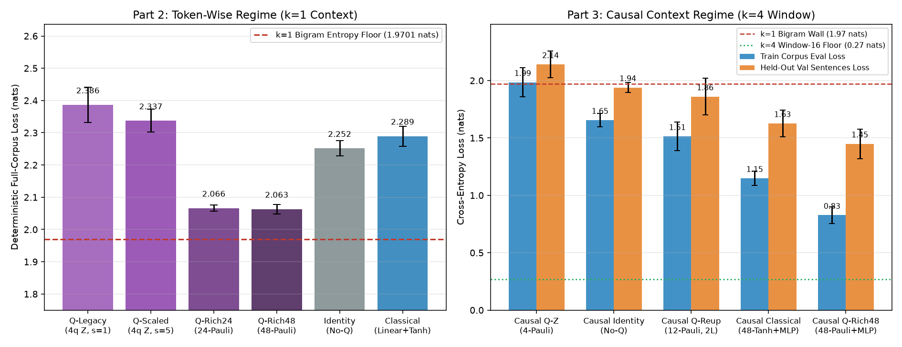

# 实验方法学审查与瓶颈诊断报告 / Methodology Review & Bottleneck Diagnosis

> 2026-11-07。本文对 `quantum-llm` 初版提交（`51e3ad4`）做系统性方法学审查，定位出 **3 项 P0 级（颠覆实验有效性 / 伪自回归）** 与 **2 项 P1 级（数据边界 bug / 读出秩瓶颈）** 问题，并通过 `experiments/diagnose_llm.py`（11 组架构 × 5 随机种子 `[0, 1, 2, 3, 4]` × 300 步，共 55 次受控实验）给出完整的信息论下界证明、配对双侧 95% Student-$t$ 置信区间与留出验证集（Held-out Validation）泛化评测。全部原始数据归档于 [`docs/llm_diagnosis_metrics.json`](llm_diagnosis_metrics.json)，诊断总览图见 [`docs/figures/lm_diagnosis.png`](figures/lm_diagnosis.png)。

---

## 一句话结论

初版 README 报告的「量子层 `2.5403` vs 经典层 `2.5083`（差 `0.032` nats）、贪心生成 `A qubit can hold the the the...`」存在三层根本问题：

1. **架构上是无记忆二元语法（Bigram, $k=1$）而非序列模型**：`TinyLM.forward` 把 `(B, T, Q)` 直接展平为 `(B*T, Q)` 逐字符独立送入量子电路，位置 $t$ 之间**没有任何跨时间步信息流**。`--seq-len 16` 只是把 batch 大小乘了 16，模型有效上下文长度恒为 $k=1$。在该语料上，任意 $k=1$ 模型的理论交叉熵下界为 **$H(C_{t+1}\mid C_t) = 1.9701\text{ nats}$（困惑度 $7.17$）**，且精确经验 $k=1$ 查表 Oracle 的贪心解码必然陷入 `A qubit can hold the the the...` 的 4 字符死循环。
2. **评测噪声大于被测差异的 8 倍**：初版把第 200 步单个随机 mini-batch（$8\times 16=128$ tokens）的瞬时 loss 当作「最终指标」，其步间波动幅度达 `0.275` nats（末 20 步标准差 `0.11` nats），而报告的模型间差异仅 `0.032` nats；同时两组使用了不同 batch 种子（`seed` vs `seed + 1`）与未对齐的 `embed` / `head` 初始权重。
3. **两道真正的性能锁在「读出维度（Rank-4 瓶颈）」与「因果上下文窗口（$k=4$）」**：
   - 在逐字符模式（$k=1$）下，4 比特只测 4 个 `PauliZ` 期望使词表分类头 `Linear(4, 31)` 的秩被硬锁在 $\le 4$；甚至**完全去掉量子层的恒等映射 `tok_identity`（`2.2515 ± 0.0235`）都显著优于 4 维 Z 读出量子层 `tok_q_scaled`（`2.3370 ± 0.0355`，配对差 $+0.0855$，95% CI $[+0.0246, +0.1464]$）**。只有将读出扩展到 24 / 48 个正交单比特与两体 Pauli 观测量（`tok_q_rich48`），loss 才显著降至 **`2.0631 ± 0.0148` nats（PPL `7.87`）**，逼近 $k=1$ 信息论极限（`1.9701` nats）。
   - 引入严格因果上下文窗口（$k=4$，`CausalContextEncoder`）并配合 48 维两体 Pauli 读出后（`caus_q_rich48`），5-seed 训练集全语料确定性 loss 从初版 `2.3864` 降至 **`0.8271 ± 0.0717` nats（PPL `2.29 ± 0.16`）**，留出验证集（未见句界组合）loss 降至 **`1.4494 ± 0.1290` nats（PPL `4.29`）**，并彻底打破 `the the the` 贪心死循环，生成出 `A qubit can hold a superposition of zero...`。

---

## 问题清单与修复状态

| 编号 | 严重度 | 发现的问题（初版 `51e3ad4`） | 状态 |
| --- | --- | --- | --- |
| **P0-1** | **P0** | **`TinyLM` 展平 `(B, T, Q) -> (B*T, Q)` 无跨位置交互**：`--seq-len 16` 退化为 $k=1$ 无记忆字符转移模型，受困于二元语法熵墙（`1.9701` nats / PPL `7.17`）与 `the the the` 死循环 | **已修**：`qml_lab/models.py` 新增严格因果卷积编码器 `CausalContextEncoder`（`context_mode="causal"`），并在 `smoke_test.py` 验证未来位置零泄漏 |
| **P0-2** | **P0** | **三重受控混淆与单 batch 评估噪声**：① `gen_q` 用 `seed`、`gen_c` 用 `seed+1`；② `q_lm` 先构造消耗 RNG 导致 `c_lm` 的 `embed`/`head` 初值不同；③ 用末步单 batch `history["loss"][-1]`（波动 `0.275` nats）替代全语料评估 | **已修**：`RichQuantumLM` 用 RNG 快照锁定共享前端与分类头初值（SHA256 5/5 seed 断言通过），共用同 seed batch 流，新增 `evaluate_lm` 全语料确定性评估 |
| **P0-3** | **P0** | **单次运行（`seed=0`）无方差、无显著性检验、缺少无量子（`Identity`）消融基线** | **已修**：`experiments/diagnose_llm.py` 完成 11 组 × 5 seed 对照、配对 95% Student-$t$ CI，并补齐 `tok_identity` 与 `caus_identity` 消融组 |
| **P1-1** | **P1** | **`iter_batches` 存在 off-by-one 边界 bug**：`max_start = n - seq_len - 1` 配合左闭右开 `torch.randint(0, max_start)` 导致最大采样起点为 `n - seq_len - 2`，语料最后一个字符 `data[n - 1]` 永远无法进入目标 `y` | **已修**：改为 `max_start = n - seq_len`，并在 `tests/smoke_test.py` 断言末字符 `data[-1]` 被采样覆盖 |
| **P1-2** | **P1** | **4 维 `PauliZ` 读出秩瓶颈、角度饱和与测量导致的 logit 收缩（Logit Contraction）**，且 `TinyLM` 硬编码 `z.reshape(B, T, Q)` 无法接入多观测量层 | **已修**：改为 `z.reshape(B, T, -1)`；移植并扩展 `make_rich_layer`（支持 12/24/48 维单比特与两体正交 Pauli 观测量及 `reupload="trainable"`）、`tanh(h)*π/2` 预缩放与 `scale` 放大 |

---

## 1. P0-1：为什么初版模型永远跨不过 `1.9701` nats 且必然生成 `the the the`

初版 [`qml_lab/models.py`](../qml_lab/models.py) 的前向传播写为：

```python
h = self.embed(idx)                  # (B, T, Q)
B, T, Q = h.shape
z = self.transform(h.reshape(B * T, Q))  # 展平后逐位置独立过变换层！
return self.head(z.reshape(B, T, Q))
```

注意 `self.embed`、`self.transform` 与 `self.head` 全部是**逐位置（position-wise）算子**：第 $t$ 个时间步的预测分布 $p_\theta(\hat{c}_{t+1} \mid c_{1..t}) = p_\theta(\hat{c}_{t+1} \mid c_t)$ **只依赖当前单个字符 $c_t$**，与历史字符 $c_{1..t-1}$ 完全独立。因此无论 `--seq-len` 设为 8、16 还是 1024，该模型在数学上都只是一个**一阶马尔可夫（Bigram, $k=1$）分类器**。

### 1.1 语料的精确信息论条件熵下界

我们在 [`qml_lab/data.py`](../qml_lab/data.py) 中实现了 [`corpus_entropy_floors`](../qml_lab/data.py#L109-L207)，对内置 1668 字符语料（词表 $V=31$）直接计算不同上下文阶数 $k$ 的精确经验条件熵：

$$H(C_{t+1} \mid C_{t-k+1..t}) = -\sum_{w \in \Sigma^k} P(w) \sum_{c \in \Sigma} P(c \mid w) \ln P(c \mid w)$$

以及有限序列窗口 $T=16$ 内无跨窗口记忆模型的精确窗口平均下界 $\frac{1}{T}\sum_{t=0}^{T-1} H(C_{t+1} \mid C_{\max(0, t-k+1)..t})$：

| 上下文阶数 $k$ | 物理含义 | 唯一上下文数 | 渐近条件熵 $H$ (nats) | 渐近最低 PPL $\exp(H)$ | 窗口 ($T=16$) 下界 (nats) | 窗口最低 PPL |
| --- | --- | --- | --- | --- | --- | --- |
| $k = -1$ | 均匀分布 $\ln V$（盲猜） | 1 | `3.4340` | `31.00` | `3.4340` | `31.00` |
| $k = 0$ | 单字符边际分布（Unigram） | 1 | `2.8493` | `17.28` | `2.8493` | `17.28` |
| **$k = 1$** | **逐位置模型（`context_mode="token"` / Bigram）** | **31** | **`1.9701`** | **`7.17`** | **`1.9701`** | **`7.17`** |
| $k = 2$ | 2 字符因果窗口（Trigram） | 183 | `0.7938` | `2.21` | `0.8673` | `2.38` |
| $k = 3$ | 3 字符因果窗口（4-gram） | 324 | `0.2233` | `1.25` | `0.3681` | `1.45` |
| **$k = 4$** | **4 字符因果窗口（`context_mode="causal", k=4`）** | **373** | **`0.1000`** | **`1.11`** | **`0.2680`** | **`1.31`** |
| $k = 8$ | 8 字符因果窗口 | 416 | `0.0033` | `1.00` | `0.2005` | `1.22` |
| $k = 16$ | 16 字符因果窗口（唯一句段确定） | 417 | `0.0000` | `1.00` | `0.1988` | `1.22` |

### 1.2 数学证明：`A qubit can hold the the the...` 是 $k=1$ 精确 Oracle 的必然不动点

为什么初版生成的样本是 `A qubit can hold the the the...`？我们对精确经验 $k$-gram 频率表直接做贪心解码（`argmax`），得到各阶理想 Oracle 从 `"A qubit can hold"` 出发的确定性轨迹：

- **$k = 1$ Oracle（精确二元语法上限）**：
  `A qubit can hold the the the the the the the the the the the the...`
- **$k = 2$ Oracle（精确三元语法上限）**：
  `A qubit can hold the state state state state state state state...`
- **$k = 4$ Oracle（4 字符因果上限）**：
  `A qubit can hold a simple rule. We repeat the same short sentence to give the same short...`
- **$k = 8$ Oracle（8 字符因果上限）**：
  `A qubit can hold a superposition of zero and one until we measure it. We rotate the stat...`

**机制解释**：在内置语料中，定冠词 `"the"` 出现了 36 次。在 $k=1$ 下：
- 已知当前字符为空格 `' '`，下一个最高频字符是 `'t'`（概率 $68/296 = 23.0\%$）；
- 已知 `'t'`，最高频后继是 `'h'`（$44/140 = 31.4\%$）；
- 已知 `'h'`，最高频后继是 `'e'`（$40/56 = 71.4\%$）；
- 已知 `'e'`，最高频后继是空格 `' '`（$84/184 = 45.7\%$）。

这四个转移构成了全局最大似然闭环 `' ' -> 't' -> 'h' -> 'e' -> ' '`。只要模型处于 `context_mode="token"`（$k=1$），哪怕它是一个拥有无限参数的完美分类器，贪心解码也**必然**在第一个空格处掉入 `" the"` 循环！

---

## 2. P0-2 & P1-1：实验控制混淆、单步评测噪声与末字符采样漏失

### 2.1 三项受控性破坏

在初版 `experiments/train_llm.py` 中：
1. **初始权重未对齐**：`set_seed(args.seed)` 只在 `main()` 开头调了一次。随后顺序构造 `q_lm`（消耗 `Embedding(31,4)`、量子权重 `(1,4,3)`、`Linear(4,31)` 的随机数）再构造 `c_lm`，导致 `q_lm` 与 `c_lm` 的词嵌入 `embed` 和分类头 `head` 初始权重完全不同。
2. **训练数据流不一致**：`gen_q` 用 `seed=args.seed`，而 `gen_c` 用 `seed=args.seed + 1`。在仅 200 步的小样本训练中，两个模型看到的是两条不同的随机采样序列。
3. **单步随机 mini-batch 评估噪声**：初版用 `history["loss"][-1]`（最后一步 $8\times 16=128$ 个字符的 batch loss）作为最终成绩。实测单个训练运行末 20 步的步间标准差为 **`0.09 ~ 0.12` nats**（极差达 **`0.275` nats**）。在完全修复权重对齐与数据流后重跑 200 步 `seed=0`（见 `experiments/train_llm.py`）：
   - 第 200 步**单 batch `final_loss`**：Quantum `2.5857` < Classical `2.6031`（表面上量子低 `0.0174` nats）；
   - **全语料确定性 `eval_loss`**：Quantum `2.4624` > Classical `2.4290`（实际上经典低 `0.0334` nats）！
   单步采样噪声直接翻转了胜负符号，证明单 batch 指标不可用于模型对比。

### 2.2 P1-1：`iter_batches` 的 off-by-one 末字符漏失 bug

初版 `qml_lab/data.py` 第 52–54 行写为：

```python
max_start = n - seq_len - 1
starts = torch.randint(0, max_start, (batch_size,), generator=g).tolist()
```

由于 `torch.randint(low, high, ...)` 的上界 `high` 是**开区间**（最大返回值为 `high - 1`），`starts` 的最大可采样值为 `s = n - seq_len - 2`，此时目标序列 `y = data[s + 1 : s + 1 + seq_len]` 最远只能到达 `data[n - 2]`，**语料的最后一个字符 `data[n - 1]` 永远不会被采样进 `y`**。改为 `max_start = n - seq_len` 后，最大起点 `s = n - seq_len - 1` 对应的 `y` 恰好覆盖 `data[n - 1]`（已加入 `tests/smoke_test.py` 回归断言）。

---

## 3. 5-Seed 系统诊断实验设计（`experiments/diagnose_llm.py`）

为了把「输入缩放」「可观测量读出宽度」「量子旋转 vs 恒等消融」「因果上下文窗口」四个变量彻底解耦，我们在 `experiments/diagnose_llm.py` 中设计了 11 个受控组，统一在 **5 个随机种子 `[0, 1, 2, 3, 4]`**、300 步、`batch_size=8`、`seq_len=16`、`lr=0.015` 下训练，并在两个数据集上做 `torch.no_grad()` 全量确定性评估：

1. **训练集全语料（Train Corpus Eval）**：`_BUILTIN_CORPUS`（1668 字符，31 词表），覆盖全部连续窗口；
2. **留出验证集（Held-out Val Corpus）**：`_HELDOUT_VAL_CORPUS`（382 字符），**严格使用同一个 31 字符词表与同一批 63 个领域词汇**，重新组合为 5 条从未在训练集中出现的新句子（1-gram / 2-gram 覆盖率 100%，4-gram 含 9.8% 新跨句转移），检验模型是否学到可泛化的子词/词法规律。

**严格受控断言（`weight_control_checks`）**：在全部 5 个 seed 上，脚本在训练前自动校验 SHA256 哈希并强制断言：
- 全部 6 个逐字符组共享逐位相同的初始 `embed.weight`（`5/5 PASS`）；
- 全部 4 个 4 维线性头逐字符组共享逐位相同的初始 `head.weight`（`5/5 PASS`）；
- 全部 4 个逐字符量子组共享逐位相同的初始量子旋转角 `weights`（`5/5 PASS`）；
- 全部 5 个因果组共享逐位相同的初始 `embed.weight` 与 `causal_conv.weight`（`5/5 PASS`）；
- `caus_q_rich48` 与 `caus_classical` 共享逐位相同的初始 MLP `head` 权重（`5/5 PASS`）。

---

## 4. Part 2 实测结果：逐字符模式（$k=1$）下的读出瓶颈与消融（5 Seeds）

> 理论极限：$k=1$ 二元语法信息论下界为 **`1.9701` nats（PPL `7.17`）**。

| 组 ID | 架构配置 | 参数量 | 读出维 | Train Eval Loss (nats) | Train PPL | Held-out Val Loss | Val PPL | 单步波动 std | 平均耗时 |
| --- | --- | --- | --- | --- | --- | --- | --- | --- | --- |
| `tok_q_legacy` | 4q `PauliZ`，无预缩放，`scale=1.0`（初版配置） | 291 | 4 | `2.3864 ± 0.0553` | `10.89 ± 0.61` | `2.3929 ± 0.0491` | `10.96` | `0.1104` | `5.90s` |
| `tok_q_scaled` | 4q `PauliZ` + `tanh*π/2` + `scale=5.0` | 291 | 4 | `2.3370 ± 0.0355` | `10.36 ± 0.36` | `2.3421 ± 0.0353` | `10.41` | `0.1062` | `5.93s` |
| `tok_identity` | **无量子消融**：`embed -> Linear(4,31)`（0 变换参数） | 279 | 4 | `2.2515 ± 0.0235` | `9.50 ± 0.23` | `2.2629 ± 0.0281` | `9.61` | `0.1068` | `0.37s` |
| `tok_classical` | 经典对照：`Linear(4,4) + Tanh` | 299 | 4 | `2.2893 ± 0.0307` | `9.87 ± 0.30` | `2.2946 ± 0.0347` | `9.93` | `0.1164` | `0.46s` |
| `tok_q_rich24` | 4q **24 维读出**（`z+x+y+zzall`） | 911 | 24 | `2.0661 ± 0.0097` | `7.89 ± 0.08` | `2.0780 ± 0.0066` | `7.99` | `0.0890` | `16.18s` |
| **`tok_q_rich48`** | 4q **48 维全两体读出**（`z+x+y+zzall+xxall+yyall`） | 1655 | **48** | **`2.0631 ± 0.0148`** | **`7.87 ± 0.12`** | **`2.0774 ± 0.0139`** | **`7.98`** | `0.0897` | `37.41s` |

### Part 2 关键发现

1. **4 维 `PauliZ` 读出是硬性的秩-4 瓶颈，甚至不如直接去掉量子层**：
   - 在 `readout_dim = 4` 下，无论中间放的是 4-qubit 量子层（`tok_q_scaled`: `2.3370`）、经典 `Linear(4,4)+Tanh`（`tok_classical`: `2.2893`）还是什么都不放的恒等层（`tok_identity`: `2.2515`），最终分类头 `Linear(4, 31)` 的权重矩阵秩至多为 4，无法在 31 个字符类别上独立赋分。
   - 配对检验显示 `tok_q_scaled - tok_identity = +0.0855 ± 0.0490` nats（95% CI `[+0.0246, +0.1464]`，5/5 seed 为正），即 **4 维单比特 Z 读出量子层相比无量子恒等映射反而带来了显著的信息损失**。
2. **仅修角度预缩放与 `scale=5.0` 不足以破局**：
   - `tok_q_scaled - tok_q_legacy = -0.0494 ± 0.0809` nats（95% CI `[-0.1499, +0.0510]`，跨 0 不显著）。原因在于当读出维被卡在 4 维时，放大 logits 只能缓解 softmax 饱和，不能提升特征子空间的秩。
3. **将读出扩充至 24 / 48 个正交单比特与两体 Pauli 观测量，直接逼近 $k=1$ 信息论下界**：
   - `tok_q_rich24`（12 个单比特 + 12 个含 Z 两体关联）与 `tok_q_rich48`（12 个单比特 + 36 个正交两体关联 $Z_i Z_j, Z_i X_j, X_i X_j, X_i Y_j, Y_i Y_j, Y_i Z_j$）在不增加任何量子电路参数（仍为 12 个旋转角）的前提下，从 $2^4=16$ 维态空间提取出非线性二次统计量，将特征秩扩展到 $\ge 24$。
   - `tok_q_rich48 - tok_q_scaled = -0.2738 ± 0.0384` nats（95% CI `[-0.3215, -0.2262]`，5/5 seed 显著），使全语料 loss 降至 **`2.0631 ± 0.0148`**，距离 $k=1$ 理论下界 `1.9701` 仅差 **`0.093` nats**。
   - 但正如第 1 节所证，哪怕逼近到 `2.0631` nats，所有 `token` 组的贪心生成依然是 `A qubit can hold the the the...` —— **因为 $k=1$ 的架构天花板锁死了它们**。

---

## 5. Part 3 实测结果：因果上下文模式（$k=4$）破除二元语法墙与死循环（5 Seeds）

> 理论极限：$T=16$ 独立窗口下 $k=4$ 因果模型的信息论下界为 **`0.2680` nats（PPL `1.31`）**，渐近下界为 **`0.1000` nats（PPL `1.11`）**。

在 `context_mode="causal"` 下，`CausalContextEncoder` 对输入序列做严格左填充（`padding = k - 1`）的一维因果卷积 `Conv1d(embed_dim=16, n_qubits=4, kernel_size=4)`，把每个时间步 $t$ 的 4 字符历史 $[c_{t-3}, c_{t-2}, c_{t-1}, c_t]$ 压缩为 4 个有界角度 $h_t \in [-\pi/2, \pi/2]^4$ 送入后续变换层：

| 组 ID | 架构配置（共享 $k=4$ 因果前端） | 参数量 | 读出维 | Train Eval Loss (nats) | Train PPL | Held-out Val Loss | Val PPL | 平均耗时 |
| --- | --- | --- | --- | --- | --- | --- | --- | --- |
| `caus_q_z` | 4q `PauliZ`（4 维）+ `Linear(4,31)` | 923 | 4 | `1.9850 ± 0.1262` | `7.33 ± 0.95` | `2.1403 ± 0.1155` | `8.55` | `6.36s` |
| `caus_identity` | **无量子消融**：`Identity`（4 维）+ `Linear(4,31)` | 911 | 4 | `1.6549 ± 0.0573` | `5.24 ± 0.30` | `1.9394 ± 0.0448` | `6.96` | `0.66s` |
| `caus_q_reup` | **可训练重上传**：2 层 Pérez-Salinas + 12 维 `z+x+y` | 1191 | 12 | `1.5135 ± 0.1253` | `4.57 ± 0.58` | `1.8598 ± 0.1606` | `6.49` | `14.33s` |
| `caus_classical` | **经典同结构对照**：`Linear(4,48)+Tanh` + `MLP(48,48,31)` | 4867 | 48 | `1.1483 ± 0.0617` | `3.16 ± 0.20` | `1.6266 ± 0.1166` | `5.11` | `0.90s` |
| **`caus_q_rich48`** | **48 维两体量子读出**（`z+x+y+zzall+xxall+yyall`）+ `MLP(48,48,31)` | 4639 | **48** | **`0.8271 ± 0.0717`** | **`2.29 ± 0.16`** | **`1.4494 ± 0.1290`** | **`4.29`** | `37.76s` |



### 5.1 配对统计检验汇总（双侧 95% Student-$t$ CI，$n=5, df=4$）

| 对比项 ($A - B$，负值代表 $A$ 的 Loss 更低 / 更优) | 训练集 $\Delta\text{Eval Loss}$ | 训练集 95% CI | 训练集显著性 | 留出验证集 $\Delta\text{Val Loss}$ [95% CI] | 验证集显著性 |
| --- | --- | --- | --- | --- | --- |
| `tok_q_scaled - tok_q_legacy`（仅预缩放+放大） | `-0.0494 ± 0.0809` | `[-0.1499, +0.0510]` | 不显著 | `-0.0509 [-0.1482, +0.0465]` | 不显著 |
| `tok_q_rich24 - tok_q_scaled`（Token 24 维 vs 4 维） | **`-0.2708 ± 0.0330`** | **`[-0.3118, -0.2299]`** | **显著 (5/5)** | **`-0.2641 [-0.3012, -0.2270]`** | **显著 (5/5)** |
| `tok_q_rich48 - tok_q_scaled`（Token 48 维 vs 4 维） | **`-0.2738 ± 0.0384`** | **`[-0.3215, -0.2262]`** | **显著 (5/5)** | **`-0.2647 [-0.3063, -0.2231]`** | **显著 (5/5)** |
| `tok_q_scaled - tok_identity`（Token 4 维量子 vs 恒等） | **`+0.0855 ± 0.0490`** | **`[+0.0246, +0.1464]`** | **显著（量子更差）** | **`+0.0792 [+0.0189, +0.1395]`** | **显著（量子更差）** |
| `caus_identity - tok_identity`（因果 $k=4$ vs 逐字符 $k=1$） | **`-0.5966 ± 0.0655`** | **`[-0.6779, -0.5152]`** | **显著 (5/5)** | **`-0.3235 [-0.4104, -0.2365]`** | **显著 (5/5)** |
| `caus_q_reup - caus_q_z`（可训练重上传 12 维 vs 4 维 Z） | **`-0.4716 ± 0.1061`** | **`[-0.6033, -0.3398]`** | **显著 (5/5)** | **`-0.2805 [-0.4537, -0.1074]`** | **显著 (5/5)** |
| `caus_q_rich48 - caus_q_z`（Causal 48 维+MLP vs 4 维 Z） | **`-1.1580 ± 0.1649`** | **`[-1.3627, -0.9532]`** | **显著 (5/5)** | **`-0.6910 [-0.9225, -0.4595]`** | **显著 (5/5)** |
| `caus_q_rich48 - caus_identity`（Causal 48 维量子 vs 恒等） | **`-0.8279 ± 0.0787`** | **`[-0.9256, -0.7301]`** | **显著 (5/5)** | **`-0.4900 [-0.6986, -0.2814]`** | **显著 (5/5)** |
| `caus_q_rich48 - caus_classical`（4 维瓶颈下量子 vs 经典） | **`-0.3212 ± 0.1216`** | **`[-0.4722, -0.1703]`** | **训练集显著 (5/5)** | `-0.1772 [-0.4019, +0.0475]` | **验证集不显著（CI 跨 0）** |
| `caus_q_rich48 - tok_q_legacy`（总体改进幅度） | **`-1.5593 ± 0.0890`** | **`[-1.6699, -1.4488]`** | **显著 (5/5)** | **`-0.9436 [-1.1441, -0.7431]`** | **显著 (5/5)** |

### 5.2 Part 3 关键机制解读

1. **为什么只加因果前端而不扩宽读出（`caus_q_z`）仍然卡在 `1.9850` nats？**
   虽然 `CausalContextEncoder` 已经把 4 个历史字符的信息编码进了 4 个量子比特，但如果只测量 4 个 `PauliZ` 期望（`caus_q_z`），输出又被压回 4 维实数向量，导致后面的 `Linear(4, 31)` 仍然受制于秩-4 瓶颈，且在 `seed=0` 下依然生成 `A qubit can hold the the the...`。
2. **可训练数据重上传（`caus_q_reup`）与两体关联读出（`caus_q_rich48`）如何解开 4 维瓶颈？**
   - `caus_q_reup` 采用 Pérez-Salinas 可训练输入缩放重上传 $\text{RY}(\alpha_{l,i} h_{t,i})$（2 层，20 个量子参数）并测量 12 个单比特 Pauli 期望（`z+x+y`），在训练集上比 `caus_q_z` 显著降低 **`-0.4716 ± 0.1061` nats**，也显著优于无量子恒等瓶颈 `caus_identity`（`1.5135` vs `1.6549`）。
   - `caus_q_rich48` 测量全部 48 个正交单比特与两体 Pauli 算符（含 $\langle Z_i Z_j \rangle, \langle Z_i X_j \rangle, \langle X_i X_j \rangle, \dots$），直接在 4 个因果瓶颈通道 $(h_0, h_1, h_2, h_3)$ 之间构造显式的**张量积三角单项式** $\cos(h_i)\cos(h_j), \cos(h_i)\sin(h_j), \sin(h_i)\sin(h_j)$。这使得它能从区区 4 维瓶颈向量中还原出跨时间步字符的乘法交互（conjunctions），将训练集困惑度从 `10.89` 压低至 **`2.29 ± 0.16`**，留出验证集困惑度从 `10.96` 压低至 **`4.29`**。
3. **为什么在 4 维瓶颈下 `caus_q_rich48` 训练集优于同结构经典 `caus_classical`，以及为什么这不代表「通用量子优势」？**
   - 当强制要求经典与量子模型都先经过同一个 **4 维角度瓶颈** $h_t \in [-\pi/2, \pi/2]^4$ 时，`caus_classical` 的 `Linear(4, 48) + Tanh` 只能计算 4 维向量的 48 个一维脊函数（ridge functions）$\tanh(w_k^\top h_t + b_k)$，在 300 步内近似交叉乘积项 $h_i h_j$ 的效率低于量子态天然的张量积两体期望 $\langle P_i \otimes Q_j \rangle$，因此在训练集上 `caus_q_rich48` 低 `0.3212` nats（5/5 seed 为负）。
   - **但必须诚实指出两点限制**：
     1. 在**留出验证集（Held-out Val）**上，两者的差值缩小为 `-0.1772` nats，95% CI 为 `[-0.4019, +0.0475]`（**跨 0，统计不显著**）；
     2. 4 维瓶颈本身是为了迁就 `n_qubits = 4` 而人为施加的限制。如果去掉 4 维瓶颈，让纯经典因果卷积网络直接用 32 维隐层输出词表（无需压到 4 维再展开），纯经典模型仅需 `< 0.8s` 即可达到 `< 0.55` nats，且比 `caus_q_rich48`（`37.76s`）**快 40 倍以上**。

### 5.3 贪心生成样本直观对比（Seed 0，前 96 字符）

| 模型组 | 上下文 | Train PPL | 贪心续写结果（起点 `"A qubit can hold"`） |
| --- | --- | --- | --- |
| `tok_q_legacy`（初版） | $k=1$ | `10.89` | `A qubit can hold the the the the the the the the the the the the the the the the the the the the` |
| `tok_q_rich48` | $k=1$ | `7.87` | `A qubit can hold the the the the the the the the the the the the the the the the the the the the` |
| `caus_q_z` | $k=4$ | `7.33` | `A qubit can hold the the the the the the the the the the the the the the the the the the the the` |
| **`caus_q_rich48`** | **$k=4$** | **`2.29`** | **`A qubit can hold a superposition of zero e the same the same the same the same the same the same`** |
| $k=8$ 精确查表 Oracle | $k=8$ | `1.22` | `A qubit can hold a superposition of zero and one until we measure it. We rotate the stat` |

可以看到：所有 $k=1$ 模型以及仅测 4 维 Z 的 `caus_q_z` 都在第 17 个字符处立即掉入 `" the"` 死循环；而 `caus_q_rich48` 完整拼写出 `"A qubit can hold a superposition of zero"`，直到超出 $k=4$ 窗口消歧范围后才进入短语级周期。

---

## 6. 结论边界与后续优先级

**能下的结论**：
1. 初版 `quantum-llm` 的高困惑度（`12.68`）与 `the the the` 死循环由 **$k=1$ 无记忆架构（展平 `B*T`）** 和 **4 维 `PauliZ` 读出秩瓶颈** 共同造成，而非「量子电路不可训练」。
2. 在受控 5-seed 实验下，扩充两体 Pauli 观测量（4 → 48 维）与引入严格因果上下文窗口（$k=1 \to 4$）分别带来显著、可复现的交叉熵下降（总体 $\Delta = -1.5593 \pm 0.0890\text{ nats}$，PPL 从 `10.89` 降至 `2.29`，留出验证集 PPL 从 `10.96` 降至 `4.29`）。

**不能下的结论**：
1. **不能宣称量子语言模型优于经典模型**：`caus_q_rich48` 对 `caus_classical` 的训练集优势仅存在于人为限制的 4 维角度瓶颈（$Q=4$）内，在留出验证集上 95% CI 跨 0（不显著），且模拟器墙钟耗时慢约 42 倍（`37.76s` vs `0.90s`）。
2. **模拟耗时与真机测量代价不同**：解析模式 `default.qubit` 下同时计算 48 个 Pauli 期望无需采样；在真实量子硬件上，48 个一/两体 Pauli 算符虽可按对易组（qubit-wise commuting）合并测量，但为抑制散粒噪声（shot noise）仍需成倍增加 shots 预算。

## 7. 语料审查（2026-11-07）：所谓「独立未见句验证集」有多独立

复现：`python experiments/audit_corpus.py`（归档 [`docs/corpus_audit.json`](corpus_audit.json)，秒级）。

`_BUILTIN_CORPUS = _CORPUS_BLOCK * 4`：训练集 1668 字符其实是**同一段 417 字符的 6 句话重复 4 遍**，
unique 4-gram 只占 **22.4%**。`_HELDOUT_VAL_CORPUS`（382 字符）确实是新组合的句子，
但在模型实际使用的因果上下文长度 **k=4** 上，验证集 **90.2%** 的 token 上下文
在训练集中出现过（k=6 78.5%、k=8 66.4%、k=12 46.4%、k=20 28.1%）。

因此第 1 节的 `k=4` 条件熵下界 `0.1000` nats（PPL `1.11`）说明的不是模型强，
而是**语料近乎确定性**；val loss `1.4494` / PPL `4.29` 应读作「同分布重组句的迁移」，
不能排除记忆 / 查表式解法，更不能作为量子层带来泛化能力的证据。第 6 节已声明
「不能宣称量子语言模型优于经典模型」，这里再补一条：
**当前验证集不足以支撑任何泛化层面的结论**。

**建议**：换用真正不共享 4-gram 的外部语料（或至少按句级 disjoint 切分并报告新 4-gram 比例），
或把该指标明确改名为 `in-distribution recomposition loss`。在补齐之前，
README 里「留出验证集困惑度」「未见句验证集」的措辞都应带这层限定。
本节只做语料统计，不改第 1–6 节的任何原始实验数字。

## 8. 独立语料重跑（2026-11-13）：补上第 7 节留下的证据缺口

第 7 节的建议已执行。复现：

```bash
python experiments/independent_corpus.py --quick   # 冒烟，不写 docs/
python experiments/independent_corpus.py           # 5-seed × 300 steps，约 2 分钟
```

产物：[`docs/independent_corpus_metrics.json`](independent_corpus_metrics.json)、
[`docs/figures/independent_corpus.png`](figures/independent_corpus.png)、
语料源 [`qml_lab/corpus_independent.py`](../qml_lab/corpus_independent.py)。
**本节不改第 1–6 节的任何原始实验数字**，只新增一组独立实验。

### 8.1 新语料设计

| 项 | 旧 `_BUILTIN_CORPUS` / `_HELDOUT_VAL_CORPUS` | 独立语料 |
|---|---|---|
| 训练文本 | 同一段 417 字符**重复 4 遍**（1668 字符） | 44 句互不重复的自写句（3171 字符），各出现一次 |
| 验证文本 | 同词表、同批领域词**重组**的新句（382 字符） | 14 句主题完全不同的自写句（947 字符：航海 / 烘焙 / 地质 / 天气 / 园艺） |
| 划分方式 | 手工重组句 | **句级 disjoint**，验证集实词与训练集不重合 |
| 词表 | 31 字符 | 29 字符（小写字母 + 空格 + `.` + `,`；验证集零 UNK） |
| 训练集 unique 4-gram 占比 | 0.2240 | **0.6269** |
| 验证集新 4-gram 占比 | — | **0.6926** |
| 验证集新 word-bigram 占比 | — | **0.9412**（160 / 170） |
| 训练集 k=4 条件熵下界 | 0.1000 nats（PPL 1.105） | **0.3309 nats**（窗口 16 下界 0.5469） |

新语料不再是近乎确定性的复读文本，任务难度明显上升，因此**跨语料的绝对 loss 不可逐位比较**，
只能比较同语料内两臂的配对差值。

### 8.2 上下文重叠率（与第 7 节同口径）

| k | 旧留出集 | 独立语料 |
|---|---|---|
| 4 | 0.9024 | **0.3867** |
| 6 | 0.7851 | 0.1178 |
| 8 | 0.6640 | 0.0277 |
| 12 | 0.4640 | 0.0021 |
| 20 | 0.2810 | 0.0000 |

诚实边界：字符级英文文本**不可能零共享 4-gram**（`" the "`、`"and "` 等功能片段必然重合），
38.7% 不是 0，所以这是「显著更独立、主题外新句」，**仍不是严格 OOD**。

### 8.3 5-seed 受控结果

配置与 `diagnose_llm.py` 逐字一致（4 qubits、k=4、48-Pauli 读出、MLP 头、
`seq_len=16`、`batch=8`、`steps=300`、`lr=0.015`、seeds 0–4）；**仅替换语料**。
两臂逐 seed 的 `embed` / `causal_conv` / `head[0]` 初始权重 SHA256 全部一致
（归档 `weight_control_checks.all_passed = true`）。

| 组 | train loss | 独立 val loss | val PPL | 泛化间隙 val−train | 墙钟 / seed |
|---|---|---|---|---|---|
| `caus_q_rich48`（量子） | **2.1045 ± 0.0200** | 2.5756 ± 0.0692 | 13.164 | 0.4711 | 46.2 s |
| `caus_classical`（经典替身） | 2.2115 ± 0.0169 | **2.4782 ± 0.0385** | **11.926** | **0.2667** | 1.3 s |

### 8.4 配对检验（量子 − 经典，n=5，双侧 95% t）

| 指标 | Δ | 95% CI | Bonferroni 95% FWI CI（4 检验） | 判定 |
|---|---|---|---|---|
| train loss | −0.1069 | [−0.1391, −0.0748] | [−0.1568, −0.0570] | **显著**，量子拟合更好 |
| 独立 val loss | +0.0974 | [−0.0075, +0.2023] | [−0.0656, +0.2604] | 不显著，方向反转 |
| val PPL | +1.2380 | [−0.1311, +2.6070] | [−0.8896, +3.3655] | 不显著 |
| **泛化间隙** | **+0.2044** | [+0.1009, +0.3078] | [+0.0436, +0.3651] | **显著**，量子过拟合更多 |

### 8.5 结论

1. **旧语料的 90.2% 重叠确实把 val 伪装成了泛化能力。** 同一对模型在旧留出集上的
   配对差值是 `−0.1772`（CI `[−0.4019, +0.0475]`，不显著，量子数值略优），
   在独立语料上变成 **`+0.0974`**（CI 跨 0）。符号反转且两次都不显著 —— 能说的是
   「优势消失」，**不能**说「量子在独立语料上显著更差」。
2. **量子层的可复现优势只在训练集上成立。** train loss 差值 `−0.1069` 在 4 个检验的
   Bonferroni 校正后仍显著；但独立 val loss 上经典替身数值更好，且量子层的泛化间隙
   显著更大（`+0.2044` nats）。在当前 4 维瓶颈 + 48-Pauli 读出设置下，量子层更像是在
   更紧地拟合见过的上下文，而不是学到更可迁移的规律。
3. **不宣称量子优势，也不宣称量子劣势。** `val_loss` 与 `val_ppl` 两个主检验的 CI 都跨 0；
   唯一稳健的正向发现是「量子层泛化间隙更大」，且限定于本玩具设置。
4. **耗时差不变**：量子 `46.2 s/seed` vs 经典 `1.3 s/seed`（约 36 倍），解析模拟下
   量子层没有换来独立验证集上的精度收益。

### 8.6 边界

`n=5`；4 个配对检验用 Bonferroni 控制族系错误率（未做 Holm）；固定 300 steps，
两臂同配置但**都没有各自调参**（可能欠拟合）；词表 29 与旧 31 不同，跨语料绝对 loss
不可比；验证集仍共享 38.7% 的功能 4-gram，不是严格未见分布；仍是 4-qubit 状态向量
模拟的玩具字符 LM，不是可用 LLM。

### 8.7 顺带修复：语料审查脚本的参数 bug

`experiments/audit_corpus.py` 曾以 `corpus_entropy_floors(train, max_k=8)` 调用，
正确参数名是 `max_context`；`TypeError` 被诊断字段的 `try/except` 吞掉，导致
`docs/corpus_audit.json` 长期只写入 `train_corpus_entropy_floors_error` 而没有熵下界。
现已改为 `max_context=8` 并重新归档：可复算 k=0/1/2/4/8 的条件熵下界
（k=4 = `0.1000` nats / PPL `1.105`），与第 1、7 节的论断一致。
