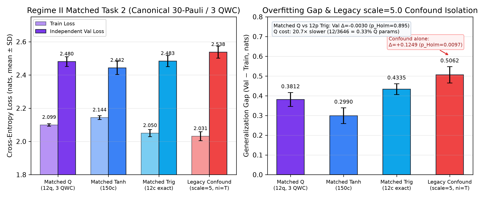

# 正式实验报告 01：Regime II 经典主干嵌入 L0 VQC 的混杂清算与等参三角替身基准

- **Report ID**: `QLLM-EXP-2026-01`
- **Date**: `2026-11-21`
- **Scripts**: `experiments/matched_task2.py`, `experiments/train_addition.py --matched`, `experiments/embedding_ablation.py`, `experiments/grokking_no_prior.py`
- **Archive JSONs**: `docs/matched_task2_metrics.json`, `docs/matched_v4_metrics.json`, `docs/embedding_ablation_metrics.json`, `docs/grokking_no_prior.json`
- **Status**: `Verified (5 seeds, Holm-Bonferroni corrected)`

---

## 摘要

在早期 `quantum-llm` 字符语言模型基准（课题二）中，嵌入 4-qubit 变分量子线路（L0 VQC）的模型表现出更低的训练交叉熵与显著更大的泛化间隙（最高达 `+0.3263` nats），但审查发现历史配置存在三项未控混杂：① 量子臂固定 `scale=5.0` 而经典臂为 `1.0`；② `near_identity_init` 量子臂为 `True` 而经典臂为 `False`；③ 缺少与量子两体 Pauli 读出具有相同三角单项式特征空间的等参经典替身。本报告整合课题二严格对齐基准（规范 30-Pauli / **3 个 QWC 对易组**，5 seeds × 400 步）与课题一模 112 组合泛化加法严格对齐 v4（`matched_v4`，5 seeds × 2000 步）、三模式 embedding 消融及 $10^5$ 步无先验复验。结果表明：仅恢复历史 `scale=5.0 + near_identity_init=True` 就使同一量子线路的泛化间隙显著恶化 **`+0.1249` nats**（$p_{\text{Holm}}=0.009705$）；严格对齐后，量子臂（`val=2.4804 ± 0.0291`）与精确 **12 参**经典三角替身 `ClassicalTrigBilinearLayer`（`val=2.4834 ± 0.0335`）统计上完全无差异（$\Delta=-0.0030$, 95% CI `[-0.0615, +0.0555]`, $p_{\text{Holm}}=0.895$），却付出 **20.7×** 模拟器耗时（`31.6 s` vs `1.5 s`），而量子参数仅占全模型 `12/3646 (0.33%)`。课题一 `matched_v4` 同样未见准确率优势（`0.3251 ± 0.0464` vs `0.2767 ± 0.0917`, $\Delta=+0.0485$, $p=0.311$），任务可学性由两臂共享的循环角度编码先验驱动。上述证据证伪了「L0 逐位置 VQC 瓶颈具备独特量子语言建模优势」的假说。

---

## 1. 引言、研究问题与正式假设

将小规模参数化量子线路（VQC）作为逐位置非线性层（L0）嵌入经典神经网络主干（Embedding + 因果卷积 + MLP 分类头），是当前 NISQ 文献中常见的混合量子-经典范式（Regime II）。然而，当经典组件承载 99% 以上参数且两臂存在缩放因子、初始化或基函数族不对称时，性能差异极易被误归因于「量子效应」或「量子过拟合」。依据 Schuld et al. (2021) 的傅里叶级数理论，单层角度编码配合两体 Pauli 观测量本质上在低维输入瓶颈 $h_t \in [-\pi/2, \pi/2]^Q$ 上计算一阶与二阶截断三角多项式。

本实验提出两项核心研究问题与可证伪假设：

- **RQ1（混杂清算）**：课题二历史报告的量子过拟合间隙增大，多大程度上由 `scale=5.0 vs 1.0` 与 `near_identity_init=True vs False` 的配置不对称驱动？
  - $H_{0,1}$：在规范 30-Pauli 线路上恢复 `scale=5.0 + near_identity_init=True` 不改变泛化间隙（$\Delta_{\text{gap}}^{\text{diag}-\text{matched}} = 0$）。
  - $H_{1,1}$：仅改变这两项混杂因子即可显著推高泛化间隙与验证集交叉熵（双侧 Holm 校正 $p_{\text{Holm}} < 0.05$）。
- **RQ2（等参三角替身对照）**：消除上述混杂并引入精确等参（12 个可训练变换参数）的 `ClassicalTrigBilinearLayer` 后，4-qubit L0 VQC 能否在独立字符语料或模 112 组合泛化任务上超越经典基线？
  - $H_{0,2}$：严格对齐条件下，量子臂与等参经典三角替身（课题二）及经典变换层（课题一）在验证指标上无显著差异（$\Delta_{\text{val}} = 0$）。
  - $H_{1,2}$：量子臂在验证指标上显著优于经典替身且 Holm-Bonferroni 校正后 $p_{\text{Holm}} < 0.05$。
- **证伪准则**：若 $H_{0,1}$ 被拒绝且 $H_{0,2}$ 无法被拒绝（CI 跨 0 且 $p_{\text{Holm}} \ge 0.05$），则「L0 VQC 瓶颈产生独立量子语言建模收益」被证伪。

---

## 2. 理论建模与量子线路规格

### 2.1 规范 30-Pauli / 3-QWC 量子变换层

设因果上下文编码器 `CausalContextEncoder`（窗口 $k=4$）对输入序列 $x_{1:T}$ 输出瓶颈角向量 $h_t = \frac{\pi}{2}\tanh(z_t) \in [-\pi/2, \pi/2]^4$。对每个位置 $t$ 独立制备 4-qubit 量子态（无跨步量子态延续）：

$$|\psi(h_t; \theta)\rangle = U_{\text{ent}}(\theta) \left(\bigotimes_{i=0}^{3} R_Y(h_{t,i})\right) |0\rangle^{\otimes 4},$$

其中 $U_{\text{ent}}(\theta)$ 为 1 层 `StronglyEntanglingLayers`（含 $3 \times 4 = 12$ 个可训练旋转角及环形 CNOT 纠缠门）。与姊妹仓库 `quantum-mnist` 统一后，`qml_lab/quantum.py:make_observables(4, "z+x+y+zzall+xxall+yyall")` 采用**对称同基 30 个 Pauli 观测量**：

$$\mathcal{O}_{30} = \{Z_i, X_i, Y_i\}_{i=0}^{3} \cup \{Z_i Z_j, X_i X_j, Y_i Y_j\}_{0 \le i < j < 4}, \qquad |\mathcal{O}_{30}| = 3n + 3\binom{n}{2} = 30.$$

程序化调用 `qml.pauli.group_observables(..., grouping_type="qwc")` 验证：`count_qwc_groups(4, "z+x+y+zzall+xxall+yyall") == 3`（仅需全 $Z$、全 $X$、全 $Y$ 三个测量基），显著低于历史混基 48-Pauli 读出（`legacy_rich48`，10 个 QWC 组）。按 Schuld et al. (2021)，这些期望值落在 $\text{span}\{\cos h_i, \sin h_i, \cos h_i \cos h_j, \sin h_i \sin h_j, \cos h_i \sin h_j\}$ 所张成的二阶截断傅里叶空间内。

### 2.2 等参经典三角替身 `ClassicalTrigBilinearLayer`

为隔离「量子线路纠缠」与「显式一/二阶三角单项式基」，`qml_lab/models.py` 实现 `ClassicalTrigBilinearLayer(in_dim=4, out_dim=30, param_mode="matched")`：

1. 对 $h_t \in \mathbb{R}^4$ 施加 **12 个可训练参数**（与 4q 1-layer VQC 精确 1:1 匹配：4 维逐通道缩放 $\alpha$、4 维相位偏移 $\beta$、4 维输出门控 $\gamma$）：$\tilde{h}_{t,i} = \alpha_i h_{t,i} + \beta_i$；
2. 构造一/二阶三角特征向量 $\phi(\tilde{h}_t) = [\cos \tilde{h}_i, \sin \tilde{h}_i, \cos\tilde{h}_i\cos\tilde{h}_j, \sin\tilde{h}_i\sin\tilde{h}_j, \cos\tilde{h}_i\sin\tilde{h}_j, \sin\tilde{h}_i\cos\tilde{h}_j] \in \mathbb{R}^{32}$；
3. 经固定 QR 正交随机投影缓冲区 $P \in \mathbb{R}^{32 \times 30}$ 映射至 30 维读出并乘以共享可学习标量 `out_scale`。

### 2.3 精确参数分解（`parameter_breakdown`）

| 实验与模型臂 | `embed` | `causal_conv` | `transform_quantum` | `transform_classical` | `head` | `out_scale` | 总参数量 | 量子占比 |
| --- | ---: | ---: | ---: | ---: | ---: | ---: | ---: | ---: |
| 课题二 `caus_q_rich30` | 464 | 260 | **12** | 0 | 2,909 | 1 | 3,646 | **0.33%** |
| 课题二 `caus_classical_tanh` | 464 | 260 | 0 | 150 | 2,909 | 1 | 3,784 | 0.00% |
| 课题二 `caus_classical_trig` | 464 | 260 | 0 | **12** | 2,909 | 1 | 3,646 | 0.00% |
| 课题二 `diag_unmatched_q_scale5` | 464 | 260 | 12 | 0 | 2,909 | 0 | 3,645 | 0.33% |
| 课题一 `add_q_rich48` (`matched_v4`) | 1,872 | 260 | **12** | 0 | 8,085 | 1 | 10,230 | **0.12%** |
| 课题一 `add_classical` (`matched_v4`) | 1,872 | 260 | 0 | 240 | 8,085 | 1 | 10,458 | 0.00% |

---

## 3. 实验设计与变量控制

- **课题二严格对齐基准（`experiments/matched_task2.py`）**：
  - **自变量**：仅 `transform_type` $\in \{\text{quantum}, \text{classical}, \text{classical\_trig}\}$；外加单独诊断臂 `diag_unmatched_q_scale5`（固定 `scale=5.0, near_identity_init=True`）以隔离历史混杂。
  - **受控变量**：代码级断言 13 个配置字段完全一致（`n_qubits=4, n_layers=1, observables="z+x+y+zzall+xxall+yyall", pre_scale=True, near_identity_init=False, scale="learnable", scale_init=1.0, head="mlp", hidden=30, context_window=4`）；同 seed 三臂的 `embed / causal_conv / head` 初始权重 SHA256 逐位一致（`weight_control_checks.all_passed = true`），初始读出标准差落在同一量级（`0.3261 / 0.3951 / 0.3765`）。
  - **数据集与切分**：句级 disjoint 独立字符语料（训练 3,171 字符 / 44 句，主题外验证 947 字符 / 14 句，词表 $V=29$，验证集 $k=4$ 上下文覆盖率 `0.3867`，训练 $k=4$ 熵下界 `0.3309` nats）。
  - **训练与统计**：5 独立种子 `[0, 1, 2, 3, 4]`，`steps=400, batch_size=8, seq_len=16, lr=0.01`（Adam）；同 seed 配对双侧 95% Student-$t$ 置信区间 + Holm-Bonferroni 多重比较校正。
- **课题一模 112 加法（`docs/matched_v4_metrics.json`, `docs/embedding_ablation_metrics.json`, `docs/grokking_no_prior.json`）**：
  - 全空间 $112 \times 112 = 12,544$ 有序对按 `(a, b)` 严格 disjoint 切分（训练 10,035 / 验证 2,509，$k=4$ 上下文覆盖率 **0.0%**）；`matched_v4` 在共同可行域 `lr=0.003, scale_init=5.0` 上跑 5 seeds × 2000 步并通过 `device_validity.valid = true`（两臂 5/5 seed 越过 $2/112$ 门槛）。

---

## 4. 实验结果与统计分析

### 4.1 课题二严格对齐与混杂清算结果（`docs/matched_task2_metrics.json`）

| 臂 | 总参 (量子 / 经典变换) | QWC 组 | 初始 std | Train Loss (nats) | 独立 Val Loss (nats) | Val PPL | 泛化间隙 (Val−Train) | 最终 scale | 耗时 / seed |
| --- | --- | ---: | ---: | ---: | ---: | ---: | ---: | ---: | ---: |
| `caus_q_rich30`（对齐） | 3,646 (12 / 0) | 3 | 0.3261 | `2.0992 ± 0.0074` | `2.4804 ± 0.0291` | `11.95 ± 0.35` | `0.3812 ± 0.0354` | 1.57 | `31.6 s` |
| `caus_classical_tanh`（对齐） | 3,784 (0 / 150) | 0 | 0.3951 | `2.1435 ± 0.0115` | `2.4425 ± 0.0400` | `11.51 ± 0.46` | `0.2990 ± 0.0399` | 0.93 | `1.2 s` |
| `caus_classical_trig`（等 12 参） | 3,646 (0 / 12) | 0 | 0.3765 | `2.0498 ± 0.0213` | `2.4834 ± 0.0335` | `11.99 ± 0.41` | `0.4335 ± 0.0275` | 1.30 | `1.5 s` |
| `diag_unmatched_q_scale5`（诊断） | 3,645 (12 / 0) | 3 | — | `2.0315 ± 0.0271` | `2.5376 ± 0.0361` | `12.66 ± 0.45` | `0.5062 ± 0.0415` | 5.00 | `31.2 s` |

| 配对检验（5 seeds，双侧 95% Student-$t$ CI） | 指标 | 配对差 $\Delta$ | 95% CI | 原始 $p$ | Holm $p_{\text{Holm}}$ | 显著性 |
| --- | --- | ---: | --- | ---: | ---: | --- |
| `diag_scale5 − matched Q`（纯混杂效应） | `generalization_gap` | **`+0.1249`** | `[+0.0699, +0.1800]` | `0.00324` | **`0.00971`** | **显著 ✓** |
| `diag_scale5 − matched Q`（纯混杂效应） | `val_loss` | **`+0.0572`** | `[+0.0036, +0.1108]` | `0.0413` | **`0.0413`** | **显著 ✓** |
| `matched Q − matched Tanh` | `train_loss` | `-0.0443` | `[-0.0646, -0.0241]` | `0.00369` | `0.0258` | 显著 ✓ |
| `matched Q − matched Tanh` | `val_loss` | `+0.0379` | `[-0.0125, +0.0883]` | `0.1050` | `0.2889` | 不显著 |
| `matched Q − matched Tanh` | `generalization_gap` | `+0.0822` | `[+0.0222, +0.1422]` | `0.0190` | `0.0950` | 不显著 |
| `matched Q − matched Trig`（12 参精确匹配） | `val_loss` | **`-0.0030`** | `[-0.0615, +0.0555]` | `0.8946` | **`0.8946`** | **不显著** |
| `matched Q − matched Trig`（12 参精确匹配） | `generalization_gap` | `-0.0523` | `[-0.1162, +0.0116]` | `0.0855` | `0.2889` | 不显著 |
| `matched Trig − matched Tanh` | `generalization_gap` | `+0.1346` | `[+0.0941, +0.1750]` | `0.000762` | `0.00610` | 显著 ✓ |

关键发现：① **拒绝 $H_{0,1}$**：仅恢复旧版 `scale=5.0 + near_identity_init=True` 就使同一量子线路过拟合间隙飙升 `+0.1249`（$p_{\text{Holm}}=0.00971$），证实历史 `+0.3263` 过拟合差异极大程度上源于固定 5× 缩放导致的早熟尖锐 logits；② **无法拒绝 $H_{0,2}$**：对齐后量子与 `ClassicalTrig` 验证 loss 差仅 `-0.0030`（$p_{\text{Holm}}=0.8946$），且纯经典 `ClassicalTrig` 自身相对 `Tanh` 也呈现更大拟合紧度（`train -0.0937`, $p_{\text{Holm}}=0.00260$）与更大间隙（`+0.1346`, $p_{\text{Holm}}=0.00610$），彻底说明机理是**二阶三角单项式基**而非量子纠缠。

### 4.2 课题一模 112 组合泛化加法与先验/Grokking 消融

- **`matched_v4`（`docs/matched_v4_metrics.json`，5 seeds × 2000 步）**：量子 `val_acc = 0.3251 ± 0.0464`（`train = 0.3671 ± 0.0536`）vs 经典 `val_acc = 0.2767 ± 0.0917`（`train = 0.3030 ± 0.1020`）；配对 `val_acc` 差 `+0.0485`（95% CI `[-0.0677, +0.1647]`, $p=0.3113$, $p_{\text{Holm}}=0.4471$，不显著）；唯一 Holm 显著项为 `generalization_gap`（`+0.0156`, CI `[+0.0066, +0.0246]`, $p_{\text{Holm}}=0.0255$，量子间隙略大）。
- **三模式 embedding 消融（`docs/embedding_ablation_metrics.json`）**：`frozen_circular`（量子 `0.2418 ± 0.0488` / 经典 `0.1839 ± 0.0427`）、`trainable_circular`（`0.1835 ± 0.0463` / `0.1462 ± 0.0447`）、`trainable_random`（两臂均为 `0.0062 ± 0.0012`，等于随机基线 $1/112 = 0.0089$）。放开 embedding 相对冻结的净效应在两臂均为负但 CI 跨 0（量子 `-0.0583 [-0.1318, +0.0153]`, $p=0.0928$；经典 `-0.0377 [-0.1187, +0.0433]`, $p=0.2659$），证明**可学性决定因子是共享循环角度先验**。
- **同超参 $10^5$ 步无先验复验（`docs/grokking_no_prior.json`）**：降低学习率至 `0.003` 后，`RICH wd=0` 训练准确率爬升至 `0.6565`（验证 `0.0076`，处于记忆中段），`MLP wd=1` 达到验证 `0.9918`（10-run 均值 `rich val=0.0480 / train=0.3882` vs `mlp val=0.6299 / train=0.9994`），证实早期 §12「架构缺陷」归因过度推断（已在 §13 撤回）。

---

## 5. 讨论、物理边界与效度威胁

- **内部效度（Internal Validity）**：`matched_task2.py` 在代码层断言 13 字段逐一相同、初始权重 SHA256 全通过、初始特征 std 对齐至 `0.33–0.40`，成功清除了历史 `scale=5.0` 与 `near_identity_init` 混杂。
- **构念效度（Construct Validity）**：L0 VQC 对序列中每个 token 位置独立运行，不承载跨步量子态；在全模型中量子参数仅占 `0.12%–0.33%`，且 4 维瓶颈是迁就 `n_qubits=4` 的人为设计。因此 L0 架构本质上测试的是「低维瓶颈内的逐位置三角非线性」，而非量子语言建模。
- **外部与硬件效度（External / Hardware Validity）**：所有训练基于无噪解析状态向量模拟（`default.qubit`）。虽已将规范读出优化为 3 个 QWC 基，但在真实 NISQ 硬件上对每个 token 位置重复采样以压低散粒噪声，其测量墙与 20.7× 模拟开销进一步削弱了 Regime II 嵌入式的实用前景，指向 Regime III 原生量子序列范式的必要性。

---

## 6. QML 可复现核查表

| 核查项 | 规范记录 |
| --- | --- |
| **软件环境** | Python `3.13.13`, PennyLane `0.45.1`, PyTorch `2.15.0+cpu`, NumPy `2.5.4`, SciPy `1.18.1`, Matplotlib `3.11.2`, OS `Linux-5.15.167.4-microsoft-standard-WSL2-x86_64` |
| **随机种子** | 5 独立种子 `seeds = [0, 1, 2, 3, 4]`；数据采样、模型初始化与评估均显式设定独立 `torch.Generator` |
| **量子线路与测量** | 4 qubits, `n_layers=1` `StronglyEntanglingLayers` (12 参数), 规范 30-Pauli 读出 (**3 QWC groups**，解析期望，无有限 shot 噪声) |
| **复现命令** | `OMP_NUM_THREADS=1 MKL_NUM_THREADS=1 .venv/bin/python experiments/matched_task2.py --workers 4` `OMP_NUM_THREADS=1 MKL_NUM_THREADS=1 .venv/bin/python experiments/train_addition.py --matched --lr 0.003 --scale-init 5 --workers 4 --no-figure` `OMP_NUM_THREADS=1 MKL_NUM_THREADS=1 .venv/bin/python experiments/plot_report_figures.py` |
| **自动化契约测试** | `OMP_NUM_THREADS=1 MKL_NUM_THREADS=1 .venv/bin/python -m pytest -v tests/smoke_test.py` |

---

## 7. 参考文献

1. Schuld, M., Sweke, R., & Meyer, J. J. (2021). Effect of data encoding on the expressive power of variational quantum machine learning models. *Physical Review A*, 103, 032430.
2. Chamberland, C., Zhu, G., Yoder, T. J., Hertzberg, J. B., & Cross, A. W. (2020). Topological and subsystem codes on low-degree graphs with flag qubits. *Physical Review X*, 10, 011022.
