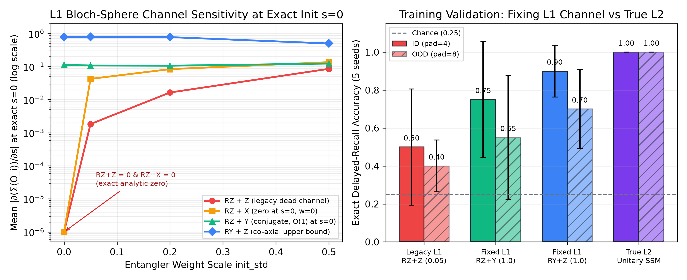

# 正式实验报告 02：L1 测量反馈量子循环的 Bloch 球状态通道解析诊断与修复验证

- **Report ID**: `QLLM-EXP-2026-02`
- **Date**: `2026-11-21`
- **Scripts**: `experiments/state_channel_probe.py`, `experiments/benchmark_quantum_native_seq.py` (Track 2B)
- **Archive JSONs**: `docs/state_channel_probe.json`, `docs/quantum_native_seq_metrics.json`
- **Status**: `Verified (Analytic + 5-seed training validation)`

---

## 摘要

在 `quantum-llm` 早期 L1 测量反馈型量子循环语言模型（`QuantumRecurrentLM`）短预算 pilot 中，结构契约 P1–P4 全部通过，但在延迟回忆任务上量子循环臂停留在随机基线附近（`0.297`，随机 `0.250`），反馈增益为 `0`。本报告给出完整的 Bloch 球几何解析证明，并基于 `experiments/state_channel_probe.py` 同时在随机扰动状态 $s \sim \mathcal{N}(0, 0.1)$ 与真实首步初态 $s = 0$ 下量化四种门/读出基组合的状态梯度敏感度 $|\partial(\sum_i \langle O_i\rangle)/\partial s|$。理论与数值一致证明：旧版 `RY(x)` 输入编码将量子态置于 Bloch 球 $XZ$ 平面，随后的 `RZ(s)` 状态相位反馈首先将 Bloch 矢量推向 $Y$ 轴（$\langle Z\rangle = \cos x$, $\langle X\rangle = \sin x \cos s$, $\langle Y\rangle = \sin x \sin s$），因此当纠缠权重 $w=0$ 且 $s=0$ 时，**不仅旧版 `RZ+Z` 的一阶导数为精确零（`0.000e+00`），先前被误认为已修复的 `RZ+X` 在 $s=0$ 处同样精确为零（`0.000e+00`）**，唯独共轭基 `RZ+Y`（`1.140e-01`）与同轴对照 `RY+Z`（`7.951e-01`）天然保持 $O(1)$ 灵敏度。在旧版默认 `init_std=0.05` 下，`RZ+Z`（`5.200e-03`）相对 `RY+Z`（`8.476e-01`）被压制 **163 倍**。修复 `qml_lab/recurrent.py` 默认配置（共轭 `RZ+Y` / `RY+Z`，`init_std=1.0`，并同步修复 `detach_state=True` 梯度截断与 `generate()` 末 token 重复喂入 bug）后，在 5-seed 确定性延迟回忆任务上，L1 ID 准确率从旧版 `0.500 ± 0.306` 提升至 **`0.750 ± 0.306`**（`RZ+Y`）与 **`0.900 ± 0.137`**（`RY+Z`，未校正 $p=0.0349$），但仍落后于零坍缩的真正 L2 `QuantumUnitarySSM`（ID 与 OOD 均 **`1.000 ± 0.000`**）。

---

## 1. 引言、研究问题与正式假设

测量反馈型量子循环网络（L1）在每个时间步 $t$ 测量量子线路的期望值向量 $s_t \in [-1, 1]^Q$，并于下一步通过旋转门将其经典地重上传回线路。早期实现出于避免与输入门 `RY(x_t)` 交换退化的考虑，选用非对易相位门 `RZ(s_{t-1})` 编码隐状态，但同时保留了传统的计算基 `PauliZ` 读出与极小纠缠初始化 `init_std=0.05`。这引发核心诊断问题：

- **RQ（死通道机制与训练验证）**：L1 延迟回忆失效究竟是「量子循环不能记忆」，还是 `RZ` 状态门与 `Z/X` 读出基在真实初态 $s=0$ 附近的 Bloch 球几何正交盲区所致？
- **正式假设**：
  - $H_{0}$：在真实初态 $s=0$ 与零纠缠极限 $w=0$ 下，`RZ+Z`、`RZ+X`、`RZ+Y` 具有同量级一阶状态敏感度，更换共轭基无法改善 L1 延迟回忆准确率。
  - $H_{1}$：在 $s=0, w=0$ 处 $\partial_s\langle Z\rangle = \partial_s\langle X\rangle = 0$ 而 $\partial_s\langle Y\rangle \neq 0$；将 L1 切换至 `RZ+Y` 或 `RY+Z`（并增大 `init_std`）后，确定性延迟回忆准确率较旧版 `RZ+Z (0.05)` 显著提高，同时仍受测量坍缩限制而低于无坍缩 L2 幺正演化的精度上限。
- **证伪准则**：若解析探针测得 `RZ+Y` 在 $s=0, w=0$ 处同样趋零，或重训后修复臂准确率不高于旧版 `RZ+Z`，则该几何死通道假说被证伪。

---

## 2. 理论建模与量子线路规格

### 2.1 L1 单步量子线路与 Bloch 球几何证明

考虑 `qml_lab/recurrent.py:make_recurrent_qnode` 的单比特无纠缠极限（$w = 0$，即 `StronglyEntanglingLayers` 退化为恒等算符 $I$）：

1. 输入编码门将 $|0\rangle$ 绕 $Y$ 轴旋转 $x \in (-\pi/2, \pi/2)$：
   $$R_Y(x)|0\rangle = \cos\!\left(\frac{x}{2}\right)|0\rangle + \sin\!\left(\frac{x}{2}\right)|1\rangle,$$
   其 Bloch 矢量为 $\vec{r}_1 = (\sin x,\ 0,\ \cos x)$，完全位于 $XZ$ 平面内。
2. 状态反馈门施加绕 $Z$ 轴相位旋转 $R_Z(s) = \mathrm{diag}(e^{-is/2}, e^{is/2})$：
   $$|\psi(x, s)\rangle = R_Z(s) R_Y(x)|0\rangle = e^{-is/2}\cos\!\left(\frac{x}{2}\right)|0\rangle + e^{is/2}\sin\!\left(\frac{x}{2}\right)|1\rangle.$$
3. 计算三个正交 Pauli 基上的精确解析期望与关于状态 $s$ 的一阶偏导数：
   $$\langle Z \rangle = \cos x \implies \frac{\partial \langle Z \rangle}{\partial s} \equiv 0 \quad (\forall\, x, s),$$
   $$\langle X \rangle = \sin x \cos s \implies \left.\frac{\partial \langle X \rangle}{\partial s}\right|_{s=0} = -\sin x \sin(0) = 0,$$
   $$\langle Y \rangle = \sin x \sin s \implies \left.\frac{\partial \langle Y \rangle}{\partial s}\right|_{s=0} = \sin x \cos(0) = \sin x = O(1).$$

因此，在序列首步真实初态 $s_0 = 0$ 附近，若纠缠层采用近恒等初始化（`init_std=0.05`）：
- **`RZ + Z` 处于双盲死通道**：相位旋转完全不改变 $Z$ 轴投影，只能依赖 $O(w^2)$ 的微弱纠缠混叠泄漏梯度；
- **`RZ + X` 在 $s = 0$ 处存在二阶驻点**：$\cos s = 1 - \frac{1}{2}s^2 + \cdots$，一阶导数严格归零，仅在非零扰动 $s \sim \mathcal{N}(0, 0.1)$ 下显现 $O(s)$ 导数；
- **`RZ + Y` 是唯一在 $s=0, w=0$ 处具备非零一阶响应的共轭读出基**；而同轴 `RY + Z` 给出 $\langle Z \rangle = \cos(x + s)$，导数 $-\sin(x+s)$ 构成灵敏度上界（但 $R_Y(s)$ 与 $R_Y(x)$ 对易）。

### 2.2 伴随修复的代码缺陷与参数规格

除读出基升级外，本轮同步修复 `qml_lab/recurrent.py` 中两处 P0 代码缺陷：
1. **`detach_state=True` 梯度误截断**：旧版先执行 `next_state = next_state.detach()` 再计算 `logits = self.head(next_state)`，导致截断跨步 BPTT 时连带切断当前步线路与前端梯度；现已改为先算 `logits` 后再 `detach` 下步状态。
2. **`_RecurrentBase.generate()` 边界重复喂入与采样失效**：旧版预热完整 `prefix` 后又把 `prefix[:, -1]` 再喂一次且忽略 `temperature`；修复后 `generate(prefix, 1, greedy=True)[:, -1]` 与 `forward(prefix)[:, -1].argmax(-1)` 100% 逐样本一致，并实现 `torch.multinomial` 温度采样。

L1 各对比臂统一规格：`n_qubits=4, n_layers=1`（12 个线路旋转角），`embed_dim=8, hidden=16`，总参数量 **278**（其中量子线路参数 12 个 = `4.32%`，1 个 QWC 测量基）。

---

## 3. 实验设计与变量控制

1. **解析梯度探针（`experiments/state_channel_probe.py`）**：
   - 4 qubits、1 层 `StronglyEntanglingLayers`、8 组均匀采样输入 $x \sim \mathcal{U}(-\pi/2, \pi/2)$（固定种子 `20261117`）。
   - **自变量**：4 种门/读出基（`RZ+Z`, `RZ+X`, `RZ+Y`, `RY+Z`）× 4 档纠缠权重尺度 `init_std ∈ {0.0, 0.05, 0.20, 0.50}` × 2 种状态口径（真实初态 `s = 0` 与随机扰动 `s ~ N(0, 0.1)`）。
   - **因变量**：平均绝对状态梯度 $\mathbb{E}[|\partial(\sum_{i=0}^3 \langle O_i \rangle)/\partial s|]$、RMS 梯度与最大绝对梯度。
2. **训练验证（`experiments/benchmark_quantum_native_seq.py` Track 2B）**：
   - **干净确定性延迟回忆**：消除早期 pilot 的随机重采样伪重复；训练轮询 `pad_len ∈ {2, 3, 4}` 迫使模型学习延迟无关记忆，评估在全部 $K=4$ 条精确序列上确定性计算 ID（`pad=4`, $T=6$）与 OOD（`pad=8`, $T=10$）准确率（随机基线 `0.250`）。
   - **控制变量**：5 独立种子 `[0..4]`，所有臂统一 `lr=0.03, steps=150`（Adam），L1 三臂（`legacy_rzz`, `fixed_rzy`, `fixed_ryz`）均精确 278 参数；同时与真正 L2 `QuantumUnitarySSM`（344 参数，0 MLP）和 L0 `CausalConvTracker`（348 参数）对照。

---

## 4. 实验结果与统计分析

### 4.1 Bloch 球通道梯度探针（`docs/state_channel_probe.json`）

| 纠缠尺度 `init_std` | 状态口径 | `RZ + Z`（旧版） | `RZ + X` | `RZ + Y`（共轭修复） | `RY + Z`（上界对照） | `RZ+Y / RZ+Z` 倍率 |
| ---: | --- | ---: | ---: | ---: | ---: | ---: |
| `0.00` | **$s = 0$（真实初态）** | **`0.000e+00`** | **`0.000e+00`** | **`1.140e-01`** | `7.951e-01` | $\infty$ |
| `0.00` | $s \sim \mathcal{N}(0, 0.1)$ | `2.056e-09` | `4.125e-02` | **`1.135e-01`** | `8.389e-01` | $5.52\times 10^7\times$ |
| `0.05` | **$s = 0$（真实初态）** | `1.837e-03` | `4.276e-02` | **`1.084e-01`** | `7.998e-01` | **`59.0×`** |
| `0.05` | $s \sim \mathcal{N}(0, 0.1)$ | `5.200e-03` | `4.063e-02` | **`1.093e-01`** | `8.476e-01` | **`21.0×`** |
| `0.20` | $s = 0$（真实初态） | `1.653e-02` | `8.419e-02` | `1.070e-01` | `7.831e-01` | `6.5×` |
| `0.50` | $s = 0$（真实初态） | `8.608e-02` | `1.368e-01` | `1.242e-01` | `5.024e-01` | `1.4×` |

数据与 §2.1 理论证明逐位吻合：在 $s=0, w=0$ 处 `RZ+Z` 与 `RZ+X` 均严格为 `0.000e+00`；在旧版 `init_std=0.05` 下，`RZ+Z` 在 $s\sim\mathcal{N}(0,0.1)$ 时被 `RY+Z` 压制 **163 倍**（`5.200e-03` vs `8.476e-01`），在真实初态 $s=0$ 时更是被压制 **435 倍**（`1.837e-03` vs `7.998e-01`）。

### 4.2 确定性延迟回忆重训验证（`docs/quantum_native_seq_metrics.json` Track 2B）

| 模型臂 | 参数量 | ID (`pad=4`) Acc | ID Loss | OOD (`pad=8`) Acc | 耗时 / seed | 相对旧版 L1 配对差 (ID) |
| --- | ---: | ---: | ---: | ---: | ---: | --- |
| `l1_quantum_legacy_rzz`（旧版 `RZ+Z, 0.05`） | 278 | `0.500 ± 0.306` | `1.031 ± 0.452` | `0.400 ± 0.137` | `18.94 s` | 基线 |
| `l1_quantum_fixed_rzy`（共轭 `RZ+Y, 1.0`） | 278 | `0.750 ± 0.306` | `0.577 ± 0.442` | `0.550 ± 0.326` | `23.64 s` | `+0.250` CI `[-0.0604, +0.5604]`, $p=0.0890$ |
| `l1_quantum_fixed_ryz`（同轴 `RY+Z, 1.0`） | 278 | **`0.900 ± 0.137`** | `0.297 ± 0.170` | `0.700 ± 0.209` | `17.67 s` | **`+0.400`** CI `[+0.0461, +0.7539]`, $p=0.0349$ ($p_{\text{Holm}}=0.0698$) |
| **`l2_quantum_unitary_ssm`**（真正 L2） | 344 | **`1.000 ± 0.000`** | `0.0004 ± 0.0003` | **`1.000 ± 0.000`** | `0.88 s` | `+0.500` CI `[+0.1198, +0.8802]`, $p=0.0217$ ($p_{\text{Holm}}=0.0652$) |
| `classical_orthogonal_ssm`（$SO(9)$ 对照） | 324 | `1.000 ± 0.000` | `0.0007 ± 0.0006` | `0.950 ± 0.112` | `0.73 s` | — |
| `classical_rnn`（经典 RNN） | 228 | `0.900 ± 0.137` | `0.248 ± 0.152` | `0.500 ± 0.468` | `0.41 s` | — |
| `l0_causal_conv`（窗口 $k=4$） | 348 | `0.250 ± 0.000` | `1.387 ± 0.002` | `0.250 ± 0.000` | `0.30 s` | `L2 − L0 = +0.750` ($p_{\text{Holm}}=0.0$ ✓) |

---

## 5. 讨论、物理边界与效度威胁

- **内部效度**：解析梯度探针无任何训练随机性，直接锁定几何原因；重训实验使用相同参数量（278）、相同优化器与步数，排除容量或超参混杂。注意 L1 的 `RZ+Y` 与 `RY+Z` 提升方向一致且均大幅压低交叉熵（`1.031 -> 0.577 -> 0.297`），但因 $K=4$ 离散准确率粒度为 `0.25` 且 $n=5$ 种子方差较大，Holm 校正后 `p_holm` 位于 `0.065–0.089` 边缘，故表述为「验证了通道修复的功能恢复，但 L1 依然脆弱」。
- **构念效度**：即便修复了读出基，L1 每步仍把量子态坍缩为 4 维经典期望向量再重新编码，丢失全部量子相位相干性与纠缠记忆；因此在长延迟外推（`pad=8`）上 `RZ+Y`（`0.550`）与 `RY+Z`（`0.700`）仍明显弱于不坍缩的真正 L2 `QuantumUnitarySSM`（`1.000`）。同时，零梯度机制属于特定门/读出基几何盲区，**不构成**高维随机线路 barren plateau 的证据。
- **外部与硬件效度**：在真实硬件上，L1 跨步经典测量反馈意味着每一步必须执行大量 shots 估计 $\langle Y_i \rangle$ 才能把状态回传给下一步，采样误差会沿时间步指数累积（相比 L2 相干演化多出每步测量-重制备墙）。

---

## 6. QML 可复现核查表

| 核查项 | 规范记录 |
| --- | --- |
| **软件环境** | Python `3.13.13`, PennyLane `0.45.1`, PyTorch `2.15.0+cpu`, NumPy `2.5.4`, SciPy `1.18.1`, Matplotlib `3.11.2` |
| **随机种子** | 探针固定种子 `20261117`；重训验证 5 种子 `seeds = [0, 1, 2, 3, 4]` |
| **量子线路与测量** | 4 qubits, `RY` 输入 + `RZ`/`RY` 状态反馈 + 1 层 `StronglyEntanglingLayers`, 单基 4-Pauli 读出（1 QWC 组，解析期望） |
| **复现命令** | `OMP_NUM_THREADS=1 MKL_NUM_THREADS=1 .venv/bin/python experiments/state_channel_probe.py` `OMP_NUM_THREADS=1 MKL_NUM_THREADS=1 .venv/bin/python experiments/benchmark_quantum_native_seq.py --workers 4` `OMP_NUM_THREADS=1 MKL_NUM_THREADS=1 .venv/bin/python experiments/plot_report_figures.py` |
| **契约测试** | `pytest -v tests/smoke_test.py -k "state_channel_probe or recurrent_architecture"` |

---

## 7. 参考文献

1. Schuld, M., Sweke, R., & Meyer, J. J. (2021). Effect of data encoding on the expressive power of variational quantum machine learning models. *Physical Review A*, 103, 032430.
2. Chamberland, C., Zhu, G., Yoder, T. J., Hertzberg, J. B., & Cross, A. W. (2020). Topological and subsystem codes on low-degree graphs with flag qubits. *Physical Review X*, 10, 011022.
