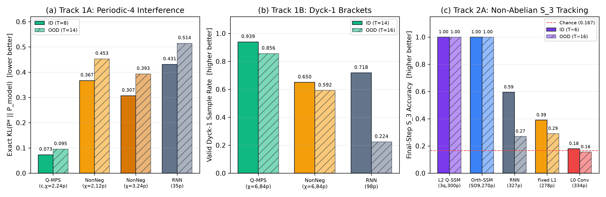

# 正式实验报告 03：Regime III 量子原生序列建模 — 自回归 MPS 玻恩机与 L2 幺正状态空间模型

- **Report ID**: `QLLM-EXP-2026-03`
- **Date**: `2026-11-21`
- **Scripts**: `experiments/benchmark_quantum_native_seq.py`, `qml_lab/born_machine.py`, `qml_lab/quantum_ssm.py`
- **Archive JSON**: `docs/quantum_native_seq_metrics.json`
- **Status**: `Verified (5 seeds, Holm-Bonferroni corrected, PennyLane statevector verified)`

---

## 摘要

为摆脱 Regime II「经典神经网络主干 + 极小 VQC 瓶颈」的局限，本报告建立并评测两条真正的 **Regime III 量子原生序列建模** 路线：① **轨道 1（自回归张量网络玻恩机，`QuantumMPSBornMachine`）**，以复数/有符号矩阵乘积态（MPS）波函数配合玻恩规则 $P(x)=|\langle x|\psi\rangle|^2/\langle\psi|\psi\rangle$ 实现精确归一与相消干涉，并与禁用负振幅的单变量受控经典基线 `ClassicalNonNegMPS`（同拓扑、公平 `softplus^{-1}` 稀疏初始化）及 `ClassicalCausalRNNLM` 对照；② **轨道 2（真正 L2 持久相干量子态循环，`QuantumUnitarySSM`）**，维护跨步不坍缩的 3-qubit 相干态 $|\psi_t\rangle = U(x_t)|\psi_{t-1}\rangle \in \mathbb{C}^8$ 与完备 POVM 读出（$\sum_c M_c = I_8$，**零经典 MLP 拐杖**，PennyLane 校验误差 `max|Δψ|=1.21e-7`）。5-seed 受控结果显示：在 **Periodic-4 周期干涉** 任务（训 $T\in\{4,6,8\} \to$ OOD $T=14$）上，24 参复数 $\chi=2$ MPS 达 `KL_ID=0.0729` / `KL_T14=0.0949`（禁态率 `0.057`），显著优于同 $\chi=2$ 非负 MPS（`KL_ID=0.3667`, $p_{\text{Holm}}=0.0192$）、**精确等 24 参且更高键维 $\chi=3$ 非负 MPS**（`KL_T14=0.3929`, $p_{\text{Holm}}=0.0247$）与 RNN（`0.5144`, $p_{\text{Holm}}=0.00573$）；在严格零重叠 **Dyck-1 括号平衡**（$T=14 \to 16$）上，84 参有符号 $\chi=6$ MPS 达 `NLL_ID=0.4415` / `valid_OOD=0.856`，显著击败等 84 参非负 MPS（`NLL_ID=0.4732`, $p_{\text{Holm}}=0.000382$）与 RNN（`valid_OOD=0.224`, $p_{\text{Holm}}=0.0144$）。在 **非阿贝尔 $S_3$ 群状态追踪**（训 $T=6 \to$ OOD $T=16$）与 **确定性延迟回忆**（OOD `pad=8`）上，L2 `QuantumUnitarySSM` 均达 **`1.000 ± 0.000`**，显著击败 L0（`0.156`）、L1（`0.291`）与 RNN（`0.270`），并与同维经典 $SO(9)$ `ClassicalOrthogonalSSM`（`1.000`）持平。本报告同时诚实界定：1D MPS 收缩为经典多项式 $O(TV\chi^3)$ 的量子启发干涉表征优势，而指数级希尔伯特空间 L2 SSM 依赖容错量子硬件（FTQC）。

---

## 1. 引言、研究问题与正式假设

量子计算区别于经典概率建模的两大核心物理资源是：① **复数/有符号概率幅的相消干涉**（类似 Shor 算法通过相位相消将错误周期态振幅压至零，而经典非负转移矩阵受 Perron-Frobenius 定理限制无法以低秩维持长周期零点；Han et al., 2018; Glasser et al., 2019）；② **幺正演化的严格保范相干记忆**（避免了耗散 RNN 的梯度消失/爆炸及 L1 逐步测量坍缩）。

本实验提出两条可证伪研究问题：

- **RQ1（轨道 1 — 相消干涉分离）**：在相同键维或相同参数量下，允许复数/负振幅干涉的 `QuantumMPSBornMachine` 能否显著击败禁用相消干涉的 `ClassicalNonNegMPS` 与参数匹配的经典 RNN？
  - $H_{0,1}$：禁止负振幅不损害 MPS 在 Periodic-4（$\chi=2$ vs $\chi=3$）与 Dyck-1（$\chi=6$）上的精确 KL 散度、交叉熵与 OOD 长度外推合法率。
  - $H_{1,1}$：有符号/复振幅玻恩机在 Periodic-4 精确 KL（ID 与 OOD $T=14$）及 Dyck-1 `NLL_ID` 上显著优于等参 `ClassicalNonNegMPS`（Holm 校正 $p_{\text{Holm}} < 0.05$）。
- **RQ2（轨道 2 — L2 相干幺正演化）**：真正跨步不坍缩、零 MLP 拐杖的 L2 `QuantumUnitarySSM` 能否在非阿贝尔群状态追踪的 OOD 长度外推上显著超越 L0、L1 及经典 RNN？相对同维经典正交群 `ClassicalOrthogonalSSM` 是否存在小尺度差异？
  - $H_{0,2}$：L2 `QuantumUnitarySSM` 在 $S_3$ OOD $T=16$ 上与 L0 / L1 / RNN 无显著差异。
  - $H_{1,2}$：L2 `QuantumUnitarySSM` 显著优于 L0、L1 与 RNN（$p_{\text{Holm}} < 0.05$），且通过精确同维 $SO(9)$ 经典对照检验其物理归因（幺正/正交保范群表示）。

---

## 2. 理论建模与量子线路规格

### 2.1 轨道 1：平移不变自回归 MPS 玻恩机（`qml_lab/born_machine.py`）

依 Han et al. (2018) 与 Glasser et al. (2019)，由共享站点张量 $A \in \mathbb{C}^{V \times \chi \times \chi}$（或 $\mathbb{R}^{V \times \chi \times \chi}$）与边界向量 $l, r \in \mathbb{C}^\chi$ 定义任意长度 $T$ 的波函数：

$$\langle x_1 \cdots x_T | \psi_T \rangle = l^\top A^{(x_1)} A^{(x_2)} \cdots A^{(x_T)} r, \qquad P(x_{1:T}) = \frac{|\langle x_{1:T} | \psi_T \rangle|^2}{\langle \psi_T | \psi_T \rangle}.$$

定义右环境格拉姆矩阵递归 $R_T = r r^\dagger$，$R_k = \sum_{s=0}^{V-1} A^{(s)} R_{k+1} (A^{(s)})^\dagger$（每步按 $\mathrm{Tr}(R_k)$ 归一以防数值溢出），则在任意前缀 $x_{<t}$ 处，精确自回归条件概率为：

$$P(x_t = s \mid x_{<t}) = \frac{v_{t-1}^\dagger A^{(s)} R_t (A^{(s)})^\dagger v_{t-1}}{\sum_{s'} v_{t-1}^\dagger A^{(s')} R_t (A^{(s')})^\dagger v_{t-1}},$$

复杂度 $O(T V \chi^3)$，满足 $\sum_{x \in \{0,1\}^T} P(x) \equiv 1$ 且支持精确祖先采样。

- **Periodic-4 干涉理论解**：目标分布 $P^*(x) \propto \cos^2(\frac{\pi}{4}\sum_{t=1}^T x_t)$ 在 $\sum x_t \equiv 2 \pmod 4$ 处因精确相消干涉概率恒为 0。复数 $\chi=2$ MPS 以对角相位矩阵 $A^{(0)} = I_2, A^{(1)} = \mathrm{diag}(e^{i\pi/4}, e^{-i\pi/4})$ 对任意长度 $T$ 精确实现该分布；反之，依据 Perron-Frobenius 定理，任意 $\chi \in \{2, 3\}$ 的非负矩阵无法维持周期 4 的零点干涉。
- **单变量控制 `ClassicalNonNegMPS`**：继承相同代码路径与转移矩阵收缩，仅施加 `F.softplus` 强制张量非负，并采用精确 `softplus^{-1}` 稀疏恒等初始化，避免 `softplus(0)=0.693` 造成不公平稠密劣化。

### 2.2 轨道 2：真正 L2 `QuantumUnitarySSM`（`qml_lab/quantum_ssm.py`）

维护 $n_H = 3$ 比特（$d_H = 8$）相干态 $|\psi_0\rangle = |000\rangle$，每步接收词元 $x_t$ 后施加由全部 36 个 1 体与 2 体无迹厄米 Pauli 算符生成的幺正门：

$$H(x_t) = \sum_{k=1}^{36} \theta_{x_t, k} P_k, \qquad U(x_t) = e^{-i H(x_t)} \in U(8), \qquad |\psi_t\rangle = U(x_t) |\psi_{t-1}\rangle.$$

无任何中间测量坍缩；仅在读出端通过白化构造的**完备 POVM**（$\sum_{c=0}^{C-1} M_c = I_8$，强制 `povm_rank >= ceil(8 / C)`）输出精确玻恩概率 $P(c \mid x_{\le t}) = \langle \psi_t | M_c | \psi_t \rangle$，**零经典 MLP 参数**。`verify_against_pennylane()` 在真实 PennyLane `default.qubit` 上逐时间步施加 `qml.QubitUnitary(U(x_t))` 校验态矢量与 POVM 概率。经典几何对照 `ClassicalOrthogonalSSM` 使用反对称生成元 $A(x_t) = -A(x_t)^\top \implies O(x_t) = e^{A(x_t)} \in SO(9)$ 与完备实平方读出。

---

## 3. 实验设计与变量控制

- **Track 1A（Periodic-4 干涉）**：训练采用混合长度 $T \in \{4, 6, 8\}$（打破单长度下 $A^{(0)}$ 的全局相位规范简并），评估 ID $T=8$ 与 OOD $T=12, 14$ 全支持集精确 $\mathrm{KL}(P^* \| P_{\text{model}})$ 及禁态采样率 $P(\sum x_t \equiv 2 \bmod 4)$。4 臂：`quantum_mps_complex_chi2`（24p）、`classical_nonneg_mps_chi2`（同 $\chi=2$, 12p）、`classical_nonneg_mps_chi3`（**等 24p**, $\chi=3$）、`classical_rnn_matched`（35p）。统一 `steps=450, batch=64, lr=0.03`，5 种子。
- **Track 1B（Dyck-1 括号平衡）**：$T=14$ 全部 $C_7 = 429$ 条合法串按 60%/20%/20% 严格零重叠切分（Train 257 / Val 86 / Test-ID 86），OOD $T=16$ 取 200 条未见合法串（精确 Bayes NLL: ID `0.4330` / OOD `0.4541`）。3 臂：84p 有符号 $\chi=6$ MPS、84p 非负 $\chi=6$ MPS、98p RNN，统一 `steps=450, lr=0.03`，5 种子。
- **Track 2A（非阿贝尔 $S_3$ 群词问题）**：3 生成元 $\{e, r, s\}$，6 群元素分类（随机 `0.167`），严格零重叠 Train 360 / Val 120 / Test-ID 160（$T=6$）与 OOD $T=12, 16$（各 200 条）。5 臂参数匹配在 `270–334`，统一 `lr=0.03, steps=250, batch=16`，5 种子。
- **Track 2B（确定性延迟回忆）**：见报告 02 §3，统一 `lr=0.03, steps=150`，5 种子。

---

## 4. 实验结果与统计分析

### 4.1 轨道 1：自回归 MPS 玻恩机结果（`docs/quantum_native_seq_metrics.json`）

| 任务与模型臂 | 参数量 | ID 指标 | OOD 长度外推指标 | 相对基线配对差 [95% CI] ($p_{\text{Holm}}$) |
| --- | ---: | --- | --- | --- |
| **Track 1A Periodic-4** | | 精确 $\text{KL}_{\text{ID}}$ ($T=8$) / 禁态率 | 精确 $\text{KL}_{\text{OOD}}$ ($T=14$) / 禁态率 | |
| `quantum_mps_complex_chi2` | **24** | **`0.0729 ± 0.1526`** / **`0.048`** | **`0.0949 ± 0.1521`** / **`0.057`** | 4/5 seed 达 `KL_ID ≤ 0.0066`, `forb_T14 ≤ 0.010` |
| `classical_nonneg_mps_chi2` | 12 | `0.3667 ± 0.0478` / `0.220` | `0.4527 ± 0.0739` / `0.255` | `Q − NonNeg(χ=2)` $\text{KL}_{\text{ID}}=-0.2938$ `[-0.4498,-0.1377]` (**`0.0192` ✓**) |
| `classical_nonneg_mps_chi3` | **24** | `0.3066 ± 0.0489` / `0.195` | `0.3929 ± 0.0505` / `0.248` | `Q − NonNeg(χ=3)` $\text{KL}_{\text{ID}}=-0.2337$ (**`0.0247` ✓**); $\text{KL}_{T14}=-0.2981$ (**`0.0247` ✓**) |
| `classical_rnn_matched` | 35 | `0.4310 ± 0.0374` / `0.230` | `0.5144 ± 0.0854` / `0.249` | `Q − RNN` $\text{KL}_{T14}=-0.4195$ `[-0.5681,-0.2708]` (**`0.00573` ✓**) |
| **Track 1B Dyck-1** | | Test-ID NLL / 合法率 | OOD $T=16$ NLL / 合法率 | |
| `quantum_mps_chi6` | **84** | **`0.4415 ± 0.0070`** / **`0.939 ± 0.046`** | **`0.4704 ± 0.0186`** / **`0.856 ± 0.202`** | 逼近 Bayes 下界 `0.4330 / 0.4541` |
| `classical_nonneg_mps_chi6` | **84** | `0.4732 ± 0.0046` / `0.650 ± 0.023` | `0.5036 ± 0.0030` / `0.592 ± 0.046` | `Q − NonNeg` $\text{NLL}_{\text{ID}}=-0.0317$ `[-0.0373,-0.0261]` (**`0.000382` ✓**); 合法率 `+0.264` (`0.0571`) |
| `classical_rnn_matched` | 98 | `0.4741 ± 0.0158` / `0.718 ± 0.092` | `0.5928 ± 0.0598` / `0.224 ± 0.116` | `Q − RNN` $\text{NLL}_{\text{OOD}}=-0.1225$ (**`0.0252` ✓**); 合法率 `+0.632` (**`0.0144` ✓**) |

### 4.2 轨道 2：非阿贝尔 $S_3$ 状态追踪与延迟回忆结果

| 模型臂 | $S_3$ 参数 | ID ($T=6$) | OOD ($T=12$) | **OOD ($T=16$)** | $S_3$ OOD $T=16$ 配对差 ($p_{\text{Holm}}$) | 延迟回忆 ID (`pad=4`) / OOD (`pad=8`) |
| --- | ---: | ---: | ---: | ---: | --- | --- |
| **`l2_quantum_unitary_ssm`** | 300 | **`1.000 ± 0.000`** | **`1.000 ± 0.000`** | **`1.000 ± 0.000`** | 基准（PennyLane `max|Δψ|=1.21e-7`, `max|Δp|=2.38e-7`） | **`1.000 ± 0.000`** / **`1.000 ± 0.000`** |
| `classical_orthogonal_ssm` | 270 | `1.000 ± 0.000` | `1.000 ± 0.000` | `1.000 ± 0.000` | `L2 − Orth = 0.000` (`p_holm=1.000`) | `1.000 ± 0.000` / `0.950 ± 0.112` |
| `classical_rnn` | 327 | `0.595 ± 0.134` | `0.321 ± 0.153` | `0.270 ± 0.155` | `L2 − RNN = +0.730` `[+0.5379,+0.9221]` (**`0.000912` ✓**) | `0.900 ± 0.137` / `0.500 ± 0.468` |
| `l1_quantum_fixed_rzy` | 278 | `0.390 ± 0.126` | `0.331 ± 0.070` | `0.291 ± 0.059` | `L2 − L1 = +0.709` `[+0.6363,+0.7817]` (**`3.32e-5` ✓**) | `0.750 ± 0.306` / `0.550 ± 0.326` |
| `l0_causal_conv` | 334 | `0.180 ± 0.018` | `0.176 ± 0.016` | `0.156 ± 0.018` | `L2 − L0 = +0.844` `[+0.8214,+0.8666]` (**`2.06e-7` ✓**) | `0.250 ± 0.000` / `0.250 ± 0.000` |

---

## 5. 讨论、物理边界与效度威胁

- **内部效度**：Track 1A 显式比较了同 $\chi=2$ 与精确等 24 参更高 $\chi=3$ 两个非负对照，全部 4 项 Holm 检验显著，严格拒绝 $H_{0,1}$；seed 4 上复数 MPS 落入局部极小（`KL_ID=0.3458`）导致 SD 较大，但仍以全 5 种子诚实汇报且统计显著。Track 2A 通过同维 `ClassicalOrthogonalSSM` 揭示：在 $d_H=8$ 尺度下 100% OOD 外推源于**幺正/正交保范群表示**而非小维复振幅奇迹。
- **构念效度**：Track 1 的 `QuantumMPSBornMachine` 直接体现与 Shor 算法同源的相消干涉原理（用复振幅抵消禁态概率）；Track 2 的 `QuantumUnitarySSM` 彻底移除经典 MLP 与逐步测量坍缩，满足严格 L2 架构定义。
- **外部与硬件效度**：① 1D MPS 精确收缩的经典复杂度为 $O(TV\chi^3)$，因此轨道 1 证明的是**量子启发干涉压缩/表征优势**（可编译为浅层序列量子电路），而非指数级量子硬件加速；② 将 `QuantumUnitarySSM` 扩展至指数维希尔伯特空间 $2^n$ 以突破经典 $O(d^2)$ 矩阵乘上限，需要容错量子硬件（FTQC）维持长相干时间并在低度耦合图上实现高保真 2Q 门（Chamberland et al., 2020）。

---

## 6. QML 可复现核查表

| 核查项 | 规范记录 |
| --- | --- |
| **软件环境** | Python `3.13.13`, PennyLane `0.45.1`, PyTorch `2.15.0+cpu`, NumPy `2.5.4`, SciPy `1.18.1`, Matplotlib `3.11.2` |
| **随机种子** | 5 独立种子 `seeds = [0, 1, 2, 3, 4]`（数据集种子按任务偏移 `100/200/300 + seed`） |
| **量子线路与校验** | Track 1: 精确转移矩阵收缩；Track 2: 3-qubit $U(8)$（36 项 1+2 体 Pauli 生成元 + 完备 POVM $\sum M_c = I_8$），PennyLane `default.qubit` 校验误差 `< 2.4e-7`（无噪解析模式） |
| **复现命令** | `OMP_NUM_THREADS=1 MKL_NUM_THREADS=1 .venv/bin/python experiments/benchmark_quantum_native_seq.py --workers 4` `OMP_NUM_THREADS=1 MKL_NUM_THREADS=1 .venv/bin/python experiments/plot_report_figures.py` |
| **契约测试** | `pytest -v tests/smoke_test.py -k "quantum_native_models"` |

---

## 7. 参考文献

1. Han, Z.-Y., Wang, J., Fan, H., & Wang, L. (2018). Unsupervised generative modeling using matrix product states. *Physical Review X*, 8, 031012.
2. Glasser, I., Pancotti, N., & Cirac, J. I. (2019). Expressive power of tensor-network factorizations for probabilistic modeling. *NeurIPS 2019*.
3. Chamberland, C., Zhu, G., Yoder, T. J., Hertzberg, J. B., & Cross, A. W. (2020). Topological and subsystem codes on low-degree graphs with flag qubits. *Physical Review X*, 10, 011022.
