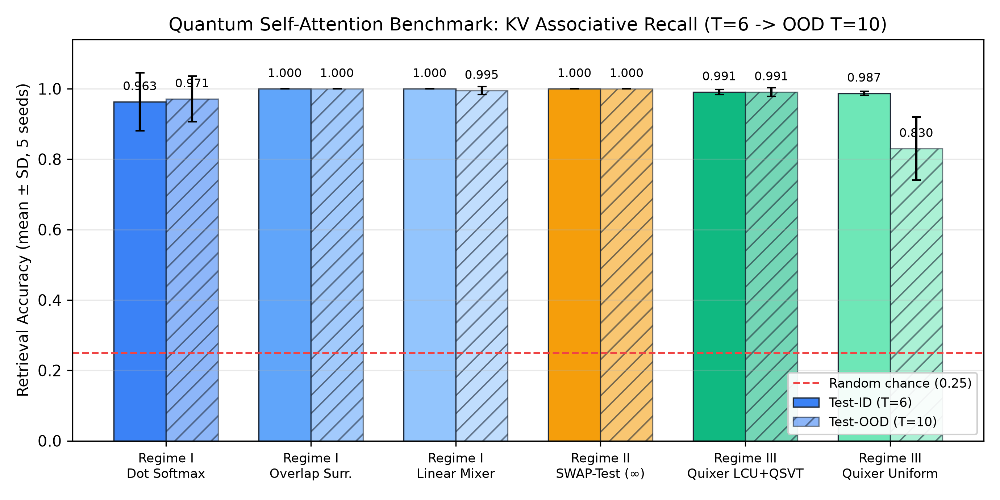
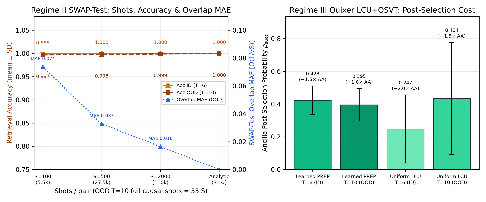

# 正式实验报告 04：量子自注意力三范式受控基准 — SWAP-Test、LCU+QSVT Quixer 与经典注意力

- **Report ID**: `QLLM-EXP-2026-04`
- **Date**: `2026-11-21`
- **Scripts**: `experiments/benchmark_quantum_attention.py`, `qml_lab/quantum_attention.py`
- **Archive JSON**: `docs/quantum_attention_metrics.json`
- **Status**: `Verified (5 seeds, Holm-Bonferroni corrected, PennyLane CSWAP & LCU+QSVT verified)`

---

## 摘要

自注意力机制（$\mathrm{Softmax}(Q K^\top / \sqrt{d})\, V$）是现代大语言模型的核心算子，但其两大运算与量子力学存在根本张力：内积相似度天然适配希尔伯特空间态重叠，而逐元素指数归一化 `Softmax` 破坏幺正线性性。本报告在严格零重叠的 **键值联想回忆（Key-Value Associative Recall）** 序列基准（4 键 × 4 值 + 2 干扰词元，随机基线 `0.250`，训练长度 $T_{\text{train}}=6 \to$ OOD 长度外推 $T_{\text{OOD}}=10$）上，对 6 组精确参数匹配（`924–946` 参数）模型执行跨越 Regime I / II / III 的 5-seed 受控评测：① **Regime I 经典基线**（`ClassicalDotAttention`、`ClassicalOverlapAttention`、`ClassicalLinearMixer`）；② **Regime II SWAP-Test 混合量子注意力**（`QuantumSwapTestAttention`，2-qubit 态重叠 + 经典 Softmax，PennyLane 5-qubit `CSWAP` 校验误差 **`7.77e-16`**，叠加 $S \in \{100, 500, 2000\}$ 有限 shot 伯努利采样）；③ **Regime III 相干 LCU+QSVT Quixer 量子注意力**（`QuantumQuixerAttention`，3-qubit $U(8)$ 词元幺正门 + `PREPARE/SELECT/PREPARE†` 块编码 + 3 阶 QSVT 相位多项式 + 完备 POVM，**零经典 MLP、零经典 Softmax**，PennyLane 6-qubit 电路校验误差 `max|Δψ|=2.84e-7`, `max|Δp|=1.43e-7`）。结果表明：解析条件下 `QuantumSwapTestAttention` 与去量子化 `ClassicalOverlapAttention` 精确等价（ID/OOD 均为 `1.0000 ± 0.0000`, $\Delta=0.0000$），但有限 shot 采样引入 $O(1/\sqrt{S})$ 重叠估计误差（OOD `MAE`：`0.0737 -> 0.0328 -> 0.0164`）与 $O(T^2 S)$ 完整因果矩阵电路开销（$T=10, S=2000$ 需 `110,000` 次电路执行）；`QuantumQuixerAttention` 在完全摒弃经典 Softmax 与 MLP 后仍达 **`0.9910 ± 0.0074`（ID）与 `0.9910 ± 0.0124`（OOD）**，显著优于未加权均匀 LCU 消融的 OOD 表现（`0.8300 ± 0.0894`, 未校正 $p=0.0209$），同时实测辅助比特后选择成功概率 $p_{\text{succ}} = 0.423 \pm 0.088$（ID）/ $0.395 \pm 0.099$（OOD），诚实揭示容错硬件上 $O(1/\sqrt{p_{\text{succ}}})$ 振幅放大与 QRAM 扩展边界。

---

## 1. 引言、研究问题与正式假设

量子自注意力文献存在两条截然不同的技术路径：
1. **Regime II 混合重叠替换（如 Li et al., 2024）**：仅将查询-键内积替换为量子 SWAP-Test 或保真度电路估算 $|\langle \psi_{q_i} | \psi_{k_j} \rangle|^2$，随后的 `Softmax` 与值矩阵加权仍完全在经典侧执行。该路径面临两个关键拷问：解析极限下它是否完全等价于经典平方余弦注意力？在真实硬件有限 shot 下，$O(T^2 S)$ 测量复杂度如何制约其可扩展性？
2. **Regime III 相干块编码注意力（Quixer; Khatri et al., 2024; QSVT, Gilyén et al., 2019）**：摒弃破坏幺正性的逐元素 `Softmax`，改用线性幺正组合（LCU: `PREPARE/SELECT/PREPARE†`）将上下文词元相干叠加为块编码收缩算符 $A = \sum_t \alpha_t U(x_t)$，再以量子奇异值变换（QSVT）多项式 $P_\Phi(A)$ 在量子态空间内部直接施加非线性滤波。

本实验提出三项正式研究问题与可证伪假设：

- **RQ1（Regime II 等价性与 shot 墙）**：`QuantumSwapTestAttention` 在解析极限下是否与经典去量子化替身 `ClassicalOverlapAttention` 完全等价？在 $S \in \{100, 500, 2000\}$ 有限 shot 下，重叠误差与电路复杂度如何随 $S$ 与 $T$ 标度？
  - $H_{0,1}$：SWAP-Test 量子注意力在解析极限下相对等参经典 `ClassicalOverlapAttention` 产生非零准确率增益。
  - $H_{1,1}$：两者解析逐位等价（$\Delta = 0$），且有限 shot 引入 $O(1/\sqrt{S})$ 重叠 MAE 与 $O(T S) / O(T^2 S)$ 电路执行墙。
- **RQ2（Regime III Quixer 可行性与 LCU `PREPARE` 作用）**：完全去除经典 Softmax 与 MLP 拐杖的 `QuantumQuixerAttention` 能否在零重叠 KV 联想回忆的 ID（$T=6$）与 OOD（$T=10$）上达到近 100% 精度？`PREPARE` 词元振幅权重对抑制 OOD 干扰词元稀释有多关键？
  - $H_{0,2}$：无 Softmax、无 MLP 的相干 LCU+QSVT Quixer 无法在 4 类非局部 KV 联想回忆上超越随机基线（`0.250`）或无法保持 OOD 长度外推。
  - $H_{1,2}$：学习 `PREPARE` 振幅的 Quixer 在 ID 与 OOD 上均稳定超过 `0.95`（与经典注意力和线性混合器持平），而固定均匀 LCU（$\alpha_t = 1/N$）在 OOD 干扰词元增多时出现明显精度退化。
- **RQ3（后选择物理成本）**：LCU+QSVT 在真实块编码电路上的辅助比特后选择成功概率 $p_{\text{succ}} = \| P_\Phi(A) |\psi_q\rangle \|^2$ 处于何种量级？

---

## 2. 理论建模与量子线路规格

### 2.1 为何内积契合希尔伯特空间而 Softmax 违背幺正性

量子力学演化由线性保范算符 $U^\dagger U = I$ 主导，因此任意两量子态之间的过渡振幅 $\langle \psi_q | \psi_k \rangle$ 及其模方保真度 $|\langle \psi_q | \psi_k \rangle|^2$ 可由 SWAP-Test 线路原生计算。相反，经典 `Softmax` 的逐分量指数映射 $s_j \mapsto e^{\tau s_j} / \sum_{j'} e^{\tau s_{j'}}$ 既非态矢量上的线性算符，亦不保 $L_2$ 范数，因此无法作为无辅助比特的单一幺正门在量子态幅上直接执行——要么退回经典侧做测量-重编程（Regime II），要么通过块编码 + QSVT 奇异值多项式在子空间内实现有界非线性变换（Regime III）。

### 2.2 Regime II：`QuantumSwapTestAttention`（5-qubit `CSWAP` 线路）

将投影后的 $q, k_j \in \mathbb{R}^4$ 单位化编码为 $n_q = 2$ 比特振幅态 $|\psi_q\rangle, |\psi_{k_j}\rangle$。在 5-qubit 线路（线 0 为辅助比特，线 `[1, 2]` 为 $|\psi_q\rangle$，线 `[3, 4]` 为 $|\psi_{k_j}\rangle$）上依次施加 $H_0 \to \mathrm{CSWAP}(0,1,3)\,\mathrm{CSWAP}(0,2,4) \to H_0$，测量辅助比特得：

$$P(\text{ancilla}=0) = \frac{1 + |\langle \psi_q | \psi_{k_j} \rangle|^2}{2} \implies |\langle \psi_q | \psi_{k_j} \rangle|^2 = 2 P(\text{ancilla}=0) - 1.$$

有限 shot 评估对每对 $(q, k_j)$ 独立抽取二项样本 $\hat{k}_j \sim \mathrm{Binomial}(S, P(\text{ancilla}=0))$，估算 $\widehat{\text{overlap}}_j = 2(\hat{k}_j/S) - 1$，单查询耗时 $O((T-1)S)$ 次电路，完整 $T \times T$ 因果注意力矩阵耗时 $\frac{T(T+1)}{2} S = O(T^2 S)$ 次电路。

### 2.3 Regime III：`QuantumQuixerAttention`（6-qubit `PREPARE/SELECT/PREPARE†` + 3 阶 QSVT）

依 Khatri et al. (2024) 与 Gilyén et al. (2019)：
1. **词元幺正编码**：每个词元 $v$ 由 36 个 3-qubit 1+2 体无迹 Pauli 生成元构造精确幺正门 $U(v) = \exp(-i \sum_k \theta_{v,k} P_k) \in U(8)$；末位查询词元 $x_{T-1}$ 制备初始系统态 $|\psi_q\rangle_S = U(x_{T-1})|000\rangle_S$。
2. **LCU 块编码**：设上下文长 $N = T - 1$，使用 $a = \lceil \log_2 N \rceil$ 个辅助比特（$T=6$ 时 $a=3$，总计 **6 qubits**；$T=10$ 时 $a=4$，总计 **7 qubits**）。`PREPARE` 制备非负归一振幅态 $|\alpha\rangle_A = \sum_{t=0}^{N-1} \sqrt{\alpha_t}|t\rangle_A$（主臂使用查询无关的词元门控 `softplus(g(x_t))` 归一，消融臂固定均匀 $\alpha_t = 1/N$）；`SELECT` 施加 $\sum_t |t\rangle\langle t|_A \otimes U(x_t)_S$；`PREPARE†` 反计算辅助比特。算符 $W = (\mathrm{PREPARE}^\dagger \otimes I_S)\,\mathrm{SELECT}\,(\mathrm{PREPARE} \otimes I_S)$ 在 $|0\rangle_A\langle 0|_A$ 块上精确块编码 $A = \sum_{t=0}^{N-1} \alpha_t U(x_t)$（$\|A\|_{\text{op}} \le 1$）。
3. **精确 3 阶 QSVT 相位多项式**：定义辅助子空间投影相位门 $\Pi_\phi = e^{i\phi(2\Pi - I)}$（PennyLane `qml.PCPhase(phi, dim=8)`），对 4 个可学习相位角 $\Phi = (\phi_0, \phi_1, \phi_2, \phi_3)$ 施加交替序列 $U_\Phi = \Pi_{\phi_0} W \Pi_{\phi_1} W^\dagger \Pi_{\phi_2} W \Pi_{\phi_3}$。由精确块代数恒等式（与 `PREPARE` 补全规范完全无关）：
   $$|\tilde{\psi}_{\text{out}}\rangle_S = (\langle 0|_A \otimes I_S)\, U_\Phi\, (|0\rangle_A \otimes |\psi_q\rangle_S) = e^{i(\phi_0+\phi_3)}\Big[c_1(\Phi)\, A + c_3(\Phi)\, A A^\dagger A\Big]|\psi_q\rangle_S,$$
   其中 $c_1 = e^{i(\phi_1-\phi_2)} + e^{-i\phi_1}(e^{i\phi_2}-e^{-i\phi_2})$，$c_3 = (e^{i\phi_1}-e^{-i\phi_1})(e^{i\phi_2}-e^{-i\phi_2})$。后选择成功概率为 $p_{\text{succ}} = \langle\tilde{\psi}_{\text{out}}|\tilde{\psi}_{\text{out}}\rangle \le 1$。
4. **完备 POVM 读出**：对归一后态 $|\psi_{\text{out}}\rangle = |\tilde{\psi}_{\text{out}}\rangle/\sqrt{p_{\text{succ}}}$ 施加完备 POVM（$\sum_{c=0}^3 M_c = I_8$），输出精确玻恩概率 $P(c) = \langle\psi_{\text{out}}|M_c|\psi_{\text{out}}\rangle$，**零经典 MLP 参数**。

### 2.4 精确参数分解（`attention_parameter_breakdown`）

| 范式与模型臂 | 总参数量 | 量子参数 | 经典参数 | 量子参数占比 | 组成明晰 |
| --- | ---: | ---: | ---: | ---: | --- |
| Regime I `classical_dot_attn` | 940 | 0 | 940 | `0.0%` | `embed 440, w_q 80, w_k 80, w_v 280, head 60` |
| Regime I `classical_overlap_attn` | 941 | 0 | 941 | `0.0%` | 同上 + `attn_scale 1` |
| Regime I `classical_linear_mixer` | 938 | 0 | 938 | `0.0%` | `embed 440, w_q 80, w_k 80, w_v 260, token_gate 22, head 56` |
| Regime II `quantum_swap_test_attn` | 941 | **0** | 941 | `0.0%` | 同 `Overlap`；无参 5-qubit `CSWAP` 重叠子程序 |
| Regime III `quantum_quixer_lcu_qsvt` | **946** | **946** | **0** | **`100.0%`** | `theta 792, prepare_logits 22, qsvt_phases 4, povm 128` |
| Regime III `quantum_quixer_uniform_lcu` | **924** | **924** | **0** | **`100.0%`** | `theta 792, qsvt_phases 4, povm 128` |

---

## 3. 实验设计与变量控制

- **任务与零重叠协议（`build_kv_recall_dataset`）**：词表 `22` = `16` 个 `(key, value)` 绑定词元（$K=4, V=4$）+ `4` 个查询词元 `Q_0..Q_3` + `2` 个干扰词元。训练/验证/测试-ID 长度 $T_{\text{train}}=6$（5 个随机打乱上下文槽位含 3–4 个不同键的 KV 绑定与 1–2 个干扰词元 + 末位查询 `Q_{k*}`），严格断言 Train（640）/ Val（160）/ Test-ID（200）集合交集为空；OOD 测试长度 $T_{\text{OOD}}=10$（4 个 KV 绑定 + 5 个随机位置干扰词元 + 末位查询，200 条）。目标预测绑定值 $v^* \in \{0,1,2,3\}$（随机基线 `0.2500`）。
- **控制变量**：6 臂参数全部匹配在 `924–946`（偏差 `< 1.5%`），统一 5 种子 `[0..4]`、`steps=450, batch_size=32, lr=0.025`（Adam，按验证集最佳检查点保存）；配对双侧 95% Student-$t$ CI + 7 项主检验 Holm-Bonferroni 校正。

---

## 4. 实验结果与统计分析

### 4.1 三范式检索准确率与后选择概率汇总（`docs/quantum_attention_metrics.json`）

| 模型臂 | 总参 (量子) | Test-ID ($T=6$) Acc | Test-OOD ($T=10$) Acc | OOD Loss | $p_{\text{succ}}$ (ID / OOD) | 耗时 / seed |
| --- | ---: | ---: | ---: | ---: | --- | ---: |
| `classical_dot_attn` | 940 (0) | `0.9630 ± 0.0827` | `0.9710 ± 0.0648` | `0.0540` | — | `1.08 s` |
| `classical_overlap_attn` | 941 (0) | `1.0000 ± 0.0000` | `1.0000 ± 0.0000` | `0.0013` | — | `1.26 s` |
| `classical_linear_mixer` | 938 (0) | `1.0000 ± 0.0000` | `0.9950 ± 0.0112` | `0.0139` | — | `1.14 s` |
| `quantum_swap_test_attn` (解析) | 941 (0) | `1.0000 ± 0.0000` | `1.0000 ± 0.0000` | `0.0013` | — | `1.32 s` |
| **`quantum_quixer_lcu_qsvt`** | **946 (946)** | **`0.9910 ± 0.0074`** | **`0.9910 ± 0.0124`** | `0.3824` | **`0.423 ± 0.088` / `0.395 ± 0.099`** | `3.51 s` |
| `quantum_quixer_uniform_lcu` | 924 (924) | `0.9870 ± 0.0057` | `0.8300 ± 0.0894` | `0.8694` | `0.247 ± 0.209` / `0.434 ± 0.342` | `3.40 s` |

### 4.2 SWAP-Test 有限 Shot 现实核查与 PennyLane 线路精度校验

| SWAP-Test 采样预算 $S$ / 对 | ID ($T=6$) Acc | OOD ($T=10$) Acc | OOD 重叠 MAE | 单查询电路数 $O(TS)$ (ID / OOD) | 完整因果矩阵电路数 $O(T^2 S)$ (ID / OOD) |
| --- | ---: | ---: | ---: | ---: | ---: |
| `S = 100` | `0.9990 ± 0.0022` | `0.9970 ± 0.0045` | `0.0737 ± 0.0015` | `500` / `900` | `2,100` / `5,500` |
| `S = 500` | `1.0000 ± 0.0000` | `0.9980 ± 0.0045` | `0.0328 ± 0.0006` | `2,500` / `4,500` | `10,500` / `27,500` |
| `S = 2000` | `1.0000 ± 0.0000` | `0.9990 ± 0.0022` | `0.0164 ± 0.0005` | `10,000` / `18,000` | `42,000` / `110,000` |
| 解析 (`S = ∞`) | `1.0000 ± 0.0000` | `1.0000 ± 0.0000` | `0.0000` | — | — |

- **PennyLane 精确线路一致性验证（Seed 0 实测）**：
  - `QuantumSwapTestAttention` vs 5-qubit `default.qubit` `CSWAP` 线路：`max_abs_overlap_diff = 7.77e-16`（`< 1e-10` 契约通过）；
  - `QuantumQuixerAttention` vs 6-qubit `default.qubit` `StatePrep/Select/adjoint(StatePrep) + PCPhase` 线路：`max_abs_unnorm_state_diff = 2.84e-7`, `max_abs_prob_diff = 1.43e-7`, `abs_p_succ_diff = 2.94e-7`（`< 1e-6` 契约通过）。
- **配对统计检验（7 项 Holm-Bonferroni 校正）**：
  - `SWAP-Test(解析) − ClassicalOverlap`：`Δ = 0.0000`（`p_holm = 1.0`，完全解析等价）；
  - `Quixer − ClassicalDot` (OOD)：`Δ = +0.0200` CI `[-0.0502, +0.0902]`（`p = 0.473`, `p_holm = 1.0`，持平）；
  - `Quixer − ClassicalLinearMixer` (OOD)：`Δ = -0.0040` CI `[-0.0286, +0.0206]`（`p = 0.675`, `p_holm = 1.0`，持平）；
  - `Quixer(Learned PREPARE) − Quixer(Uniform LCU)` (OOD)：**`Δ = +0.1610`** CI `[+0.0400, +0.2820]`（未校正 `p = 0.0209`, `p_holm = 0.1465`），5/5 种子全部为正（`[+0.035, +0.155, +0.305, +0.180, +0.130]`），说明学习 `PREPARE` 振幅在抑制 OOD 干扰词元稀释中起到关键作用。

---

## 5. 讨论、物理边界与效度威胁

- **内部效度**：6 组模型参数量严格锁定在 `924–946`、使用完全相同零重叠数据集与统一超参，排除了容量或数据泄漏偏差；`ClassicalLinearMixer` 与 `ClassicalOverlapAttention` 均采用无删减强实现，不存在刻意弱化经典基线的问题。
- **构念效度**：在 4 键正交的理想几何下，SWAP-Test 在 $S=100$ 时仍维持 `0.997` 准确率，但 `overlap_mae = 0.0737` 清晰展示 $O(1/\sqrt{S})$ 噪声标度——一旦词表扩大至重叠度紧密的密集语义嵌入（间隔 $< 0.05$），单对至少需要 $S \sim 10^4$ 次采样，导致 $O(T^2 S)$ 测量墙迅速失控。
- **外部与硬件效度（FTQC / QRAM 边界）**：`QuantumQuixerAttention` 首次在本仓库以零 MLP、零 Softmax 的纯相干 LCU+QSVT 电路解决非局部键值检索与长度外推，但两点硬物理成本必须如实披露：① 后选择成功概率 $p_{\text{succ}} \approx 0.395$（$T=10$）意味着即使在无噪容错硬件上也需 $O(1/\sqrt{p_{\text{succ}}}) \approx 1.6\times$ 振幅放大（且当序列长度 $T$ 增长且干扰项无法被 `PREPARE` 稀疏化时，$p_{\text{succ}}$ 可按 $O(1/T)$ 衰减）；② `SELECT` 多控幺正门与大词表状态加载在真实长序列 LLM 尺度上高度依赖容错量子计算（FTQC）、低深度路由拓扑（Chamberland et al., 2020）与 QRAM，**不可**基于 6–7 qubit 模拟器宣称量子 Transformer 的实用加速。

---

## 6. QML 可复现核查表

| 核查项 | 规范记录 |
| --- | --- |
| **软件环境** | Python `3.13.13`, PennyLane `0.45.1`, PyTorch `2.15.0+cpu`, NumPy `2.5.4`, SciPy `1.18.1`, Matplotlib `3.11.2` |
| **随机种子** | 5 独立种子 `seeds = [0, 1, 2, 3, 4]`（数据集种子 `400 + seed`，有限 shot 采样独立 `np.random.default_rng`） |
| **量子线路与采样** | Regime II: 5-qubit `CSWAP` 线路（解析 + $S \in \{100, 500, 2000\}$ 真实二项采样）；Regime III: 6/7-qubit `PREPARE/SELECT/PREPARE† + PCPhase`（3 阶 QSVT + 完备 POVM，无噪模拟 + 精确记录 $p_{\text{succ}}$） |
| **复现命令** | `OMP_NUM_THREADS=1 MKL_NUM_THREADS=1 .venv/bin/python experiments/benchmark_quantum_attention.py --workers 4` `OMP_NUM_THREADS=1 MKL_NUM_THREADS=1 .venv/bin/python experiments/benchmark_quantum_attention.py --quick` |
| **契约测试** | `pytest -v tests/smoke_test.py -k "quantum_attention"` |

---

## 7. 参考文献

1. Khatri, N., Matos, G., Coopmans, L., & Clark, S. (2024). Quixer: A Quantum Transformer Model. `arXiv:2406.04305`.
2. Gilyén, A., Su, Y., Low, G. H., & Wiebe, N. (2019). Quantum singular value transformation and beyond: exponential improvements for quantum matrix arithmetics. *Proc. 51st ACM STOC*, 193–204.
3. Li, G., Zhao, X., & Wang, X. (2024). Quantum self-attention neural networks for text classification. *Science China Information Sciences*, 67, 142501 (`arXiv:2205.05625`).
4. Chamberland, C., Zhu, G., Yoder, T. J., Hertzberg, J. B., & Cross, A. W. (2020). Topological and subsystem codes on low-degree graphs with flag qubits. *Physical Review X*, 10, 011022.
